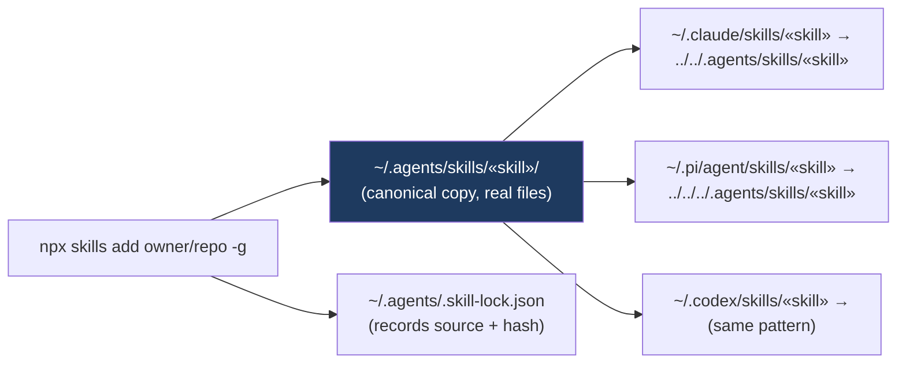

# Skills management workflow for atlas-config (skills.sh wrapper)

**Date:** 2026-06-10 · **Status:** Plan — approved decisions: manifest + standalone `skills` command (callable from any directory) + docs; agents = Claude Code, Pi, Codex; Mermaid-in-markdown visuals.

## Context

Ed installs agent skills with skills.sh (`npx skills`), but that workflow lives entirely outside atlas-config — the repo that stores all agent harness config. There is no committed record of which skills are installed and no way to restore them on a fresh machine. A previous design (2026-06-09, `.agents/atlas/plans/2026-06-09-custom-skills-management.md`) proposed git-tracking the whole `~/.agents/skills` store as a stow package; Ed rejected that as overcomplex and redirected toward using skills.sh's own capabilities simply.

The fix: keep skills.sh as the installer, commit only a small **manifest** of what's installed, and wrap the few reliable skills.sh commands in `just` recipes. Restore = replay `npx skills add` per manifest line — `add` is the one command that works dependably (it re-fetches and overwrites), which sidesteps every open lockfile/update bug.

## How skills.sh works (visual summary)

```mermaid
mindmap
  root((skills.sh))
    Directory (www.skills.sh)
      Leaderboard — 652K+ installs, ranked by anonymous CLI telemetry
      Topics, Official, Security audits
      Per-agent pages (70+ agents)
      Open source: vercel-labs/skills (Vercel)
    CLI (npx skills)
      add «owner/repo» — install (reliable ✅)
        Sources: GitHub shorthand, full URL, GitLab, git URL, local path
        Flags: -g global, -a agent, -s skill, --copy, -y, --all
      use — one-shot prompt, no install
      list / find / init / remove
      update / check — buggy ⚠️
      DISABLE_TELEMETRY=1 to opt out
    Install model
      Scopes
        Project (default): ./«agent»/skills/ + committable skills-lock.json
        Global (-g): ~/«agent»/skills/  ← Ed uses this
      Methods
        Symlink (default): canonical store + relative links
        Copy: independent copies
      Canonical store: ~/.agents/skills/«skill»
      Agent dirs: ~/.claude/skills, ~/.pi/agent/skills, ~/.codex/skills
    Lockfiles
      Global: ~/.agents/.skill-lock.json (v3 schema)
      Project: ./skills-lock.json (v1 schema)
      Tracks source, skillPath, folder hash (GitHub tree SHA), timestamps
    Known issues (all OPEN, June 2026)
      No stable restore from lockfile — #549; only experimental_install
      update: false success #923, ignores project lock #542, silent skips #415/#1114
      check mutates state #954
      CLI upgrade can wipe global lock — #542
      Verdict: trust only «add»; treat files on disk as truth
```

Install flow on this machine (global scope, symlink method):



Current on-disk reality (verified 2026-06-10): `~/.agents/skills/` holds ~40 skill folders + `node_modules`/`package.json` (skills packaged as npm deps) ; `~/.claude/skills/` mixes PAI-native skills (real PascalCase dirs — untouched by this plan) with skills.sh symlinks; `~/.pi/agent/skills/` mixes skills.sh symlinks with CE-managed real dirs (`ce-*` — runtime-owned, never tracked, per decision #508); `~/.codex/skills/` has `.system/` + one skill.

## Design

Three pieces, all in atlas-config:

### 1. `skills.manifest` (repo root, committed)

Plain text, one line per skill: `<source> <skill-name>`, `#` comments allowed.

```
# skills.sh manifest — restore with `just skills-restore`
vercel-labs/agent-browser agent-browser
mattpocock/skills caveman
mattpocock/skills diagnose
...
```

- Bootstrapped once from the current global lockfile: `jq -r '.skills | to_entries[] | "\(.value.source) \(.key)"' ~/.agents/.skill-lock.json | sort` — then hand-pruned (drop `source-command-recall-*` and anything CE/setup-script-owned).
- No hashes, no timestamps — skills track upstream latest; git history of the manifest is the change record.

### 2. `bin/skills` — standalone command, callable from any directory

A single executable Bun TypeScript script (`#!/usr/bin/env bun`) living in atlas-config and stowed onto PATH at `~/.local/bin/skills`. Justfile recipes are directory-bound; this works from anywhere.

| Subcommand | Does |
|---|---|
| `skills add <source> <skill>` | `bunx -y skills add <source> --skill <skill> -g -a claude-code -a pi -a codex -y`, then append `<source> <skill>` to `skills.manifest` if not already present |
| `skills restore` | Loop manifest lines → run `add` for each (re-fetches latest; doubles as **update-all** since `add` overwrites the store) |
| `skills list` | `bunx -y skills ls -g` |
| `skills remove <skill>` | `bunx -y skills remove <skill> -g -a claude-code -a pi -a codex -y`, then delete the manifest line (skills.sh leaves lockfile entries stale on remove — #808 — manifest stays correct because we own it) |

Implementation notes:

- **Repo/manifest resolution without hardcoded paths:** the script resolves its own real location (`realpathSync` through the stow symlink) and walks up to the repo root, so the manifest is always `<repo>/skills.manifest` no matter the cwd.
- **No name collision:** PATH `skills` is ours; the script shells out to `bunx -y skills …`, which resolves the npm package, not PATH.
- Skip `#`/blank manifest lines; subcommands are idempotent; never call `skills update`/`check` (buggy upstream).
- **Stow packaging:** new `bin/` package (`bin/.local/bin/skills`) stowed to `~`, with a `.stow-local-ignore` copied from `Codex/.stow-local-ignore` per repo convention. Verify `~/.local/bin` is on fish's PATH; add `fish_add_path ~/.local/bin` if not.
- **Justfile:** add thin aliases (`just skills-add` → `bin/skills add …`, etc.) so the in-repo habit still works.

### 3. `docs/agents/skills.md` (committed doc, follows existing docs/agents pattern)

Prescriptive doc covering: the mind map + flow diagram above; the manifest format; the recipe table; the rules — only `add` is trusted, update = re-run restore, CE skills and PAI-native skills are out of scope, lockfiles are not tracked in git (they drift, #542/#808); fresh-machine bootstrap = `git clone && just link && just skills-restore`.

## Files to change

| File | Change |
|---|---|
| `skills.manifest` | **New** — bootstrapped from `~/.agents/.skill-lock.json`, hand-pruned |
| `bin/.local/bin/skills` | **New** — executable Bun TS script (add/restore/list/remove), stowed to `~/.local/bin/skills` |
| `bin/.stow-local-ignore` | **New** — copied from `Codex/.stow-local-ignore` per repo convention |
| `justfile` | Add `bin` package to the stow recipes (`link`/`up`/`unlink`/`status`) + thin `skills-*` aliases calling `bin/skills` |
| `docs/agents/skills.md` | **New** — workflow doc with Mermaid visuals |
| `AGENTS.md` | Add a "Skills" subsection under "Agent skills" pointing at `docs/agents/skills.md`, and add the `bin` package to the repo-layout table |
| `.agents/atlas/plans/2026-06-09-custom-skills-management.md` | Move to `.agents/atlas/plans/archive/` — superseded by this plan |

Nothing in `~/.agents/skills` enters git. No changes to existing stow packages.

## Verification

1. `just up` restows; `which skills` resolves to `~/.local/bin/skills` → atlas-config; from a different directory (e.g. `~`), `skills list` shows the current installed set.
2. `skills add mattpocock/skills tdd` (already installed — proves idempotence): exits 0, no duplicate manifest line.
3. Pick one skill, delete its store dir + agent symlinks manually, run `skills restore` → folder and all three agent symlinks reappear; `ls -la ~/.claude/skills/<skill> ~/.pi/agent/skills/<skill> ~/.codex/skills/<skill>` resolve.
4. `skills remove <test-skill>` removes symlinks and the manifest line; `skills add` restores.
5. `just skills-list` still works in-repo via the alias.
6. `git diff` shows only the files above.
