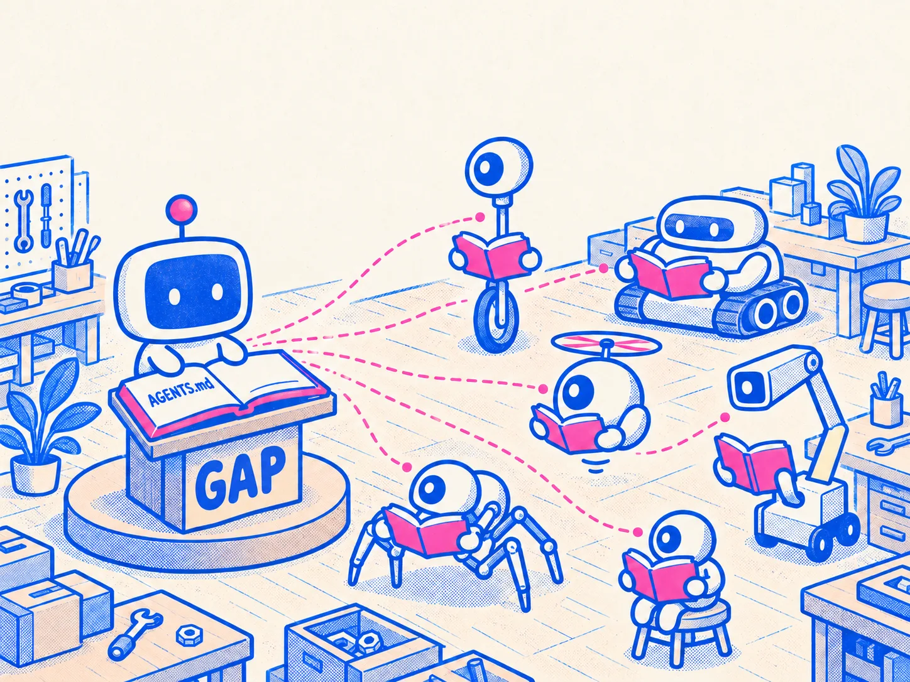
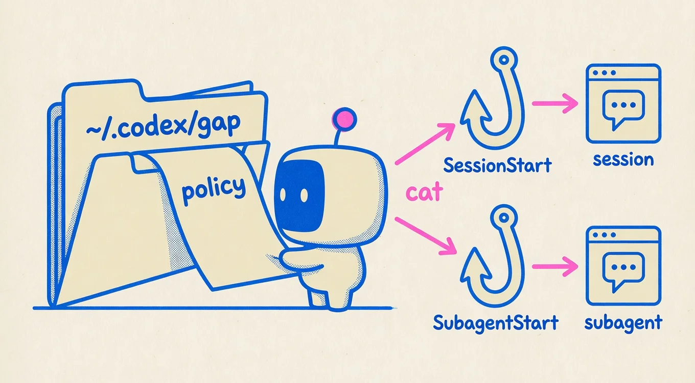
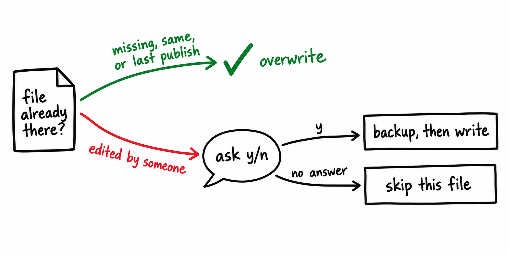

```
 ██████╗  █████╗ ██████╗
██╔════╝ ██╔══██╗██╔══██╗
██║  ███╗███████║██████╔╝
██║   ██║██╔══██║██╔═══╝
╚██████╔╝██║  ██║██║
 ╚═════╝ ╚═╝  ╚═╝╚═╝
```

# Global Agent Policies (GAP)

GAP is one set of rules that every coding agent on your machine follows. You, or an agent, write the rules once in `global/AGENTS.md`. The `gap sync` command copies them into the file each agent already reads.



## Before you start

- Go 1.24 or newer (`go version`)
- Go's bin folder on your `PATH`: `$(go env GOPATH)/bin`, or `GOBIN` if you set it

## Install `gap`

Run this once from the repo root:

```bash
go install ./cmd/gap
```

Check that your shell finds it:

```bash
gap --help
# usage: gap sync [--remove-codex-legacy]
```

`gap` publishes the checkout it was installed from, so it runs from any folder. Run `go install ./cmd/gap` again after `cmd/gap` changes or after you move the repo. To skip installing, run `go run ./cmd/gap sync` from the repo root.

## Commands

| Command | What it does |
| --- | --- |
| `gap sync` | Publish `global/AGENTS.md` to every agent |
| `gap sync --remove-codex-legacy` | Publish, then strip the old policy copy from `~/.codex/AGENTS.md` |
| `go test ./...` | Run the self-test against throwaway folders |

## Change the policy

Do these steps every time you change the rules.

### Step 1: Edit `global/AGENTS.md`

Make your change in `global/AGENTS.md`. Longer notes it links to live in `global/docs/agents/`. Keep one policy for every agent; don't add a policy file for a single agent.

### Step 2: Merge the change

Commit the edit, merge it to `master`, and pull. `gap sync` publishes only merged rules. It refuses when:

- you're on a branch other than `master` or GitButler's `gitbutler/workspace`
- you're in a git worktree
- `global/` differs from `origin/HEAD`

### Step 3: Run `gap sync`

```bash
gap sync
```

It prints each file it wrote:

```text
~/.claude/rules/global-agent-policy.md
~/.pi/agent/APPEND_SYSTEM.md
~/.omp/agent/APPEND_SYSTEM.md
~/.codex/gap/global-agent-policy.md
~/.cursor/rules/global-agent-policy.mdc
```

Each is a regular file, not a symlink. Start a new session in any agent to load the new rules.

### Step 4: Answer if `gap sync` asks about a file

`gap sync` asks before it replaces a file that you or another tool edited.

1. Type `y`. Sync backs up the old file under `~/.gap/backups/` and prints where it went.
2. Open the backup and move anything you want to keep into `global/AGENTS.md`.
3. Merge that change and run `gap sync` again.

Any other answer leaves that file alone. With no terminal to ask in, such as an agent's shell, sync prints `Refusing to replace foreign file`, skips that file, publishes the rest, and exits `1`. Run `gap sync` yourself in a terminal to answer.

## Set up Codex (once per machine)

Codex has no rules folder. The first `gap sync` adds two hooks to `~/.codex/hooks.json`, SessionStart and SubagentStart. They print `~/.codex/gap/global-agent-policy.md` into every Codex session and subagent.



1. Open Codex and run `/hooks`. Trust both GAP hooks.
2. Start a session and a subagent. Confirm both see the policy.
3. If `~/.codex/AGENTS.md` still holds an old copy of the policy, remove it:

   ```bash
   gap sync --remove-codex-legacy
   ```

   The flag refuses unless both hooks were already in `hooks.json` before that run. On a clean machine it reports that there's nothing to strip.

GAP uses `~/.codex` unless you set `CODEX_HOME`. An empty `CODEX_HOME` counts as unset. A relative path is refused.

## Check Grok (once per machine)

Grok has no file of its own. It reads the Claude copy when Claude compatibility is on, which is the default.

```bash
grok inspect
```

Look for `~/.claude/rules/global-agent-policy.md` in the global rules list. If it's missing, turn Claude compatibility back on. Don't add a Grok file. A second copy would load the policy twice.

## Reference

### Where each agent reads the policy

| Agent | File it reads |
| --- | --- |
| Claude | `~/.claude/rules/global-agent-policy.md` |
| Pi | `~/.pi/agent/APPEND_SYSTEM.md` |
| OMP | `~/.omp/agent/APPEND_SYSTEM.md` |
| Codex | `~/.codex/gap/global-agent-policy.md`, printed by the SessionStart and SubagentStart hooks |
| Cursor | `~/.cursor/rules/global-agent-policy.mdc` |
| Grok | No file of its own. It reads the Claude copy. |

### How sync tells its own files apart

`~/.gap/published.json` holds a fingerprint of each file sync last wrote. Sync overwrites a file without asking when it is missing, matches the new publish, or matches that fingerprint. Anything else counts as edited, and sync asks first.



### Don't create `~/CLAUDE.md`

Claude searches parent folders for `CLAUDE.md`. A file at `~/CLAUDE.md` sits above every project, and it stops Claude from reading that project's `AGENTS.md`. The Claude rules file above already covers every project.

### Self-test

```bash
go test ./...
```

The test builds `gap` inside a throwaway clone of this repo and runs it against a temporary home folder. It never touches your real agent files. It exits `0` when every check passes.
