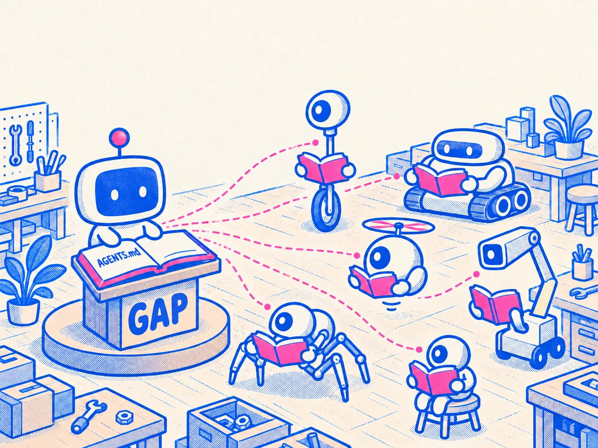
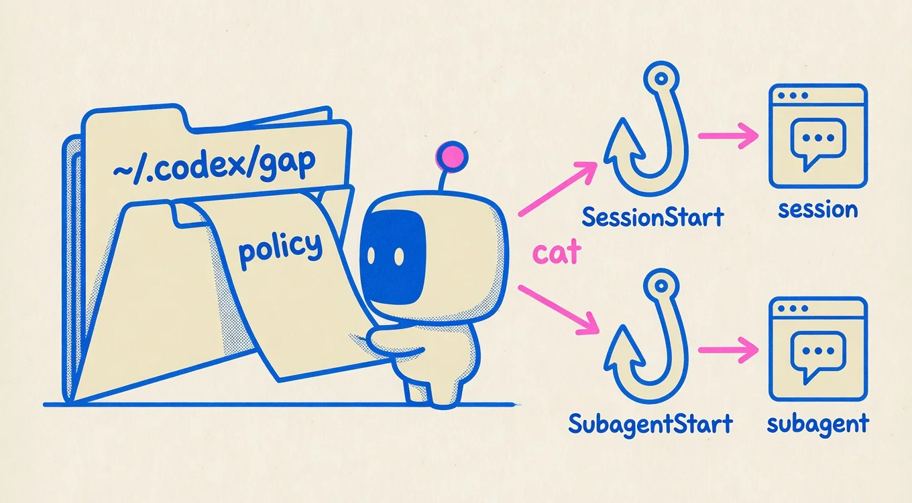

```
 ██████╗  █████╗ ██████╗
██╔════╝ ██╔══██╗██╔══██╗
██║  ███╗███████║██████╔╝
██║   ██║██╔══██║██╔═══╝
╚██████╔╝██║  ██║██║
 ╚═════╝ ╚═╝  ╚═╝╚═╝
```

# Global Agent Policies (GAP)

GAP is one set of rules that every coding agent on your machine follows. You, or an agent, write the rules once in `global/AGENTS.md`. The `gap sync` command copies them into the file each agent already reads.



## Before you start

- macOS or Linux. `gap` builds on Windows, but its harness paths and tests are not checked there.
- The Go version required by [go.mod](go.mod), or newer (`go version`)
- Go's bin folder on your `PATH`: `$(go env GOPATH)/bin`, or `GOBIN` if you set it

## Install `gap`

```bash
curl -fsSL https://raw.githubusercontent.com/edheltzel/GAP/master/scripts/install.sh | sh
```

That one line does four things:

1. `curl` downloads `scripts/install.sh` from the `master` branch of `github.com/edheltzel/GAP`.
2. The piped script clones that repo into a new checkout under `~/.gap/checkouts/` and keeps it there. Each curl install gets its own checkout, so earlier installs and published documentation links keep their source.
3. It builds `gap` with `go install ./cmd/gap` and puts the binary in Go's bin folder.
4. It checks whether your shell can find that folder. If not, it prints the exact `export PATH=...` line to add to your shell config. Open a new terminal after adding it.

Installation also needs git. It writes the source checkout and Go binary. `gap sync` publishes the policy and installs the selected components and skills.

Already have the repo checked out? From its root, `sh scripts/install.sh` builds that copy instead of cloning, including when stdin is redirected. Keep that checkout too.

Then publish:

```bash
gap sync
```

`gap` publishes the checkout it was built from, so it runs from any folder. Run the curl command again after `cmd/gap` changes. To skip installing, run `go run ./cmd/gap sync` from a checkout.

To uninstall, there is no `gap uninstall` yet. Do these steps in order: steps 1 and 3 need the records in `~/.gap/`, so trash it last.

Use the Codex home used for publication: `<codex-home>` below means the absolute `CODEX_HOME` value, or `~/.codex` when empty or unset.

1. Run `gap list`, then `gap remove <id>` for every entry whose `SOURCE` is `user`, including disabled utilities. Finish all removals before continuing; see [utility removal rules](#add-a-utility) for hook approval, failures, and shared files. Keep `~/.gap/state.json` until then so GAP can find each utility's installation.
2. If `<codex-home>/AGENTS.md` still holds an old unmarked GAP policy prefix, follow [Set up Codex](#set-up-codex-once-per-machine) to run `gap sync --remove-codex-legacy` first. Keep the policy file, both trusted GAP hooks, and `~/.gap/published.json` until that cleanup succeeds. Preserve unrelated rules in `AGENTS.md`.
3. For each file listed in [Where each agent reads the policy](#where-each-agent-reads-the-policy), and `<codex-home>/AGENTS.md`:
   - If it has `<!-- gap:begin -->` and `<!-- gap:end -->`, delete that text, markers included. Delete a file that held only that block.
   - If it has no markers, an older `gap` may have written the whole file. For those publications, `~/.gap/published.json` records each file's absolute path and whole-file SHA-256. When `shasum -a 256 <file>` matches that path's digest, delete the file or restore a saved copy from `~/.gap/backups/`. If the entry is missing or does not match, leave the file untouched.
   - Use `<codex-home>/gap/global-agent-policy.md` for the Codex policy.
4. Remove only the GAP SessionStart and SubagentStart hooks that print that policy from `<codex-home>/hooks.json`, and each published `global/commands/*.md` from `~/.claude/commands/` and `~/.omp/agent/commands/`.
5. Trash the installed `gap` binary: `$(go env GOBIN)/gap` if `GOBIN` was nonempty at installation, otherwise `$(go env GOPATH)/bin/gap`. Use the location from that installation if your Go settings have since changed. Copy out any saved files you want from `~/.gap/backups/` and `~/.gap/recovery/`, then trash `~/.gap/`; those folders are not a complete replacement history. Distro skills stay in `~/.agents/skills` and `~/.claude/skills` until you remove them.

## Commands

| Command | What it does |
| --- | --- |
| `gap sync` | Preview what will sync, ask on a terminal, then publish `global/AGENTS.md` and each `global/commands/*.md`, install missing skills, and check skills for drift. See [Choose what syncs](#choose-what-syncs) |
| `gap sync --skip <groups>` / `--only <groups>` / `--yes` | Leave groups out, sync only some, or sync without asking. Groups: `policy`, `manifest`, or a component id |
| `gap sync --profile crew` | Prepare project files for cloud agents without fetching components or writing to the home directory |
| `gap sync --remove-codex-legacy` | Same, then strip the old policy copy from Codex home's `AGENTS.md`; see [Set up Codex](#set-up-codex-once-per-machine) |
| `gap status` | Show each component's pin, its store copy, and drift in its selected skills. Writes nothing; exits `1` on skill drift or an unpinned, missing, changed, or unreadable source checkout |
| `gap restore [id]` | Back up and replace selected missing or drifted component skills at the locked commit, reusing a verified store copy |
| `gap pin <id>@<ref>` | Resolve a distro component's branch, tag, or commit and write it to the distro's `gap.lock` |
| `gap doctor` | Run configured component doctors and report which harness commands are on `PATH` |
| `gap add <owner/repo[@ref]> [--id <id>]` | Add a utility: pin a repo that ships a `gap-utility.toml` and install it. See [Add a utility](#add-a-utility) |
| `gap update [id]` | Update one utility, or every utility you added when the id is omitted. See [Add a utility](#add-a-utility) |
| `gap remove <id>` | Run a utility's uninstall hook, move its files to `~/.gap/backups/`, and drop it from your config and lock |
| `gap list` | List every component and utility with its source, ref, pinned commit, and hook trust |
| `gap init [--adopt] [dir]` | Create project configuration and a policy pointer; `--adopt` reports and preserves existing project files |
| `go test ./...` | Run the self-test against throwaway folders |

Use `gap --help` or `gap <command> --help` for usage and flags. Status and doctor reports use color and tables in terminals, and plain text when redirected.

## Manage skills

The distro's `gap.toml` and your `~/.config/gap/gap.toml` select pinned [components](#components). Their skill lists and load levels are described under [Load levels](#load-levels). `global/skills.json` selects additional skills by source. In that manifest, `"source": "."` means a skill in this repo's `skills/` folder; any other source is a GitHub `owner/repo`, optionally followed by a subdirectory path.

```json
[
  { "source": "kunchenguid/gh-axi", "skills": ["gh-axi"] }
]
```

`gap sync` copies selected component skills directly from the pinned store into `~/.agents/skills` and `~/.claude/skills`. Harnesses that read neither folder get no skills from GAP; the policy still reaches them. Component skill installation, drift repair, and restore do not use Node or `npx`. Project skills use the same two paths under the invoking project instead of the home directory; see [load levels](#load-levels).

Additional skills in `global/skills.json` still install through skills.sh (`npx -y skills add <source> -g -y -a claude-code -a codex -s <name>`, repeating `-s` for each missing skill). They use the home-directory destinations above, with a Claude link managed by skills.sh, and require Node. If such an installation is needed but `npx` is unavailable, sync still publishes the policy, skips that installation, and exits `1`.

Sync checks installed managed skills against their selected source. Component skills use the pinned store as their baseline and leave the skills.sh lock unchanged; matching existing copies stay in place. Manifest skills retain skills.sh source-identity migration and hash checks, described in the [sync contract](cmd/gap/AGENTS.md#sync-steps). For each drifted skill, sync shows the diff and asks:

- `k` keeps the installed copies for this run. Later runs check them again. An incomplete installation still exits `1`.
- `t` takes the source. Sync backs up both destinations under `~/.gap/backups/`, then reinstalls. A failed install restores the previous destinations.
- `s` skips it for now. Sync exits `1`.

With no terminal to ask in, sync lists the drifted skills, including a foreign lock that was not migrated, changes none of them, and exits `1`. Skills outside the selected components and `global/skills.json` are never touched.

### Choose what syncs

`gap sync` groups its work as `policy` (policy and global commands), each enabled component id (distro or user), and `manifest` (`global/skills.json`, when it lists any source). A utility's commands belong to its component group. With both stdin and stdout attached to a terminal, it opens a picker with every group checked: space toggles a group, and enter syncs the checked groups. Only enter syncs: ctrl+c, a termination signal, or submitting with no groups checked writes nothing. A `TERM=dumb` terminal gets the line prompt below instead.

After selection, terminal output shows a framed plan, phase headers, progress lines, and a final result. Written paths use `~` for your home directory. Piped output keeps the plain preview and progress lines, for example:

```
gap sync will:
  policy     publish AGENTS.md to 6 harness files and 1 command
  do-skills  66 skills @ master (abc1234)
  echo       run its installer @ v0.13.0 (def5678)
  manifest   15 skills from 12 sources in global/skills.json (skills.sh, needs npx)
```

With terminal input and either `TERM=dumb` or piped output, sync prints the preview before asking `[a]ll, [c]hoose, [q]uit`; `c` asks `[Y/n/q]` about each group. Press enter to submit each answer. An empty submitted line means all at the first prompt and yes at each group prompt. Entering `q`, choosing no groups, or reaching end of input (EOF), even after typing a partial answer, prints `Nothing synced.`, writes nothing, and exits `0`.

For scripts, `gap sync --skip do-skills,manifest`, `gap sync --only policy`, or `gap sync --yes` skip the question. `--only` and `--skip` are mutually exclusive. Without terminal input, every group syncs unless a flag leaves it out. A skip lasts for one run; to leave a component out of every sync, add `[components.<id>]` with `enabled = false` to `~/.config/gap/gap.toml`.

To add a whole utility for yourself, run [`gap add`](#add-a-utility). To add a skill from an existing component, add its name to that component's `names` array in `gap.toml`. For another source, add an entry to `global/skills.json`. Then follow [the merge and publish steps](#step-2-merge-the-change).

For a direct skills.sh install that does not use `gap.lock`, run `npx skills add edheltzel/Do-Skills -s <skill-name>`.

### Components

A component is a repo pinned to one commit that supplies skills, commands, or its own installer and doctor. [`gap.toml`](gap.toml) selects the distro's components; [`gap.lock`](gap.lock) records the exact commits and trees. A component whose pinned commit includes a [`gap-utility.toml`](#publish-a-utility) describes its own skills, commands, and hooks, so its entry needs only `repo` and `ref`; keeping `install` or `doctor` in that entry is refused. A distro component whose pinned commit lacks one lists its skills in `names` and may set `install` and `doctor` commands in its entry.

The distro can narrow a manifest's skill list as described under [Load levels](#load-levels). For example:

```toml
# gap.toml
schema = "2"
[components.do-skills]
repo  = "github.com/edheltzel/Do-Skills"
ref   = "master"
names = ["do-commit", "do-todo"]
```

`gap pin do-skills@master` writes the requested ref, resolved commit, and tree to `gap.lock`. If a branch and tag share a name, use `refs/heads/<name>` or `refs/tags/<name>` to choose one. Machine sync fetches the locked commit into `~/.gap/store/<id>/<commit>/`, checks its tree against the lock, and installs the selected skills as described above. Sync never moves a pin. A component missing from `gap.lock` stops the sync and names the `gap pin` command to run. `gap.toml` and `gap.lock` pass the same merge gate as `global/`.

The distro includes Do-Skills, Forge, Echo, and Recall. Forge supplies `forge-interview`. Echo and Recall have empty skill lists: machine sync runs their `install` commands from their verified stores, and those installers own their skills and runtime prerequisites. Hook timing and state are described under [Hooks and trust](#hooks-and-trust). Gap copies no skills from them and never installs a harness.

`gap doctor` runs each configured `doctor` command from its verified pinned store, then reports harness presence using `PATH`. Missing pins, missing or changed stores, and failed doctors produce exit `1`; doctor does not fetch missing components.

Doctor also asks Echo's verified pinned store for `scripts/install.sh --list-installed`. A successful report replaces Echo's adapter list and store commit in `~/.gap/state.json`, preserving other component entries. The current Echo pin lacks this optional flag: doctor prints `echo reported nothing; no adapters recorded` and leaves the ledger unchanged. This skipped report does not itself fail doctor. Wait for a supporting Echo tag before changing the pin. GAP records only reported names and does not install or remove adapters.

`gap status` checks component source checkouts and selected component skills, using the locked ref when pinned. It does not check Recall's memory database or additional manifest skills. `store=missing` means the checkout is absent, `store=changed` means its source files differ from the pin, and `store=unpinned` means `gap.lock` has no entry. For these states, it prints the matching repair command. Ignored, untracked build output does not change the result; tracked edits, deletions, and mode changes still do. Skill drift is checked only when the source checkout matches the lock; an unreadable checkout reports an error.

Status and `gap restore [id]` use the same component overrides and skill selection as sync. `gap restore do-skills` repairs that component's selected missing or drifted skills without asking; omit the id to repair all components. Restore backs up replaced copies and rolls them back if installation fails. A verified store avoids network access.

### Load levels

A component's skills are the `skills` in its `gap-utility.toml`, or its `names` array when its repo has no manifest. `names` beside a manifest narrows that list. An optional `[components.<id>.skills.<name>]` table selects how an existing name installs:

| `load` | Installation |
| --- | --- |
| `listed` (default), `always` | Install in the home-directory skill destinations |
| `project` | Install under the invoking project only when any `when.files` glob matches |
| `command`, `off` | Not selected for installation by sync or restore |

For example, the distro's `do-astro` selection uses `load = "project"` with `when.files = ["astro.config.*"]`. Globs are relative to the invoking project's Git root, or the current directory outside Git.

### Overrides

Sync, status, restore, and doctor read the installed distro's `gap.toml`, then `~/.config/gap/gap.toml`, then the invoking project's `.gap/gap.toml`. Later values win. `gap sync --profile <name>` applies the distro's `profiles/<name>.toml` last. A project with `profile = "crew"` also loads the crew profile on later runs.

Overrides can replace an existing component's `enabled` and `ref`, or a listed skill's `load` and `when.files`. Only `~/.config/gap/gap.toml` can add a component, and `gap add` writes that entry for you; see [Add a utility](#add-a-utility). A later `enabled = true` can re-enable a component. `when.files` replaces the earlier list. For example:

```toml
[components.recall]
enabled = false

[components.do-skills.skills.do-astro]
load = "project"
[components.do-skills.skills.do-astro.when]
files = ["astro.config.*", "apps/site/astro.config.*"]
```

Overrides never write either lock. If an overridden `ref` differs from the locked ref, the command stops: use `gap pin <id>@<ref>` for a distro component, or [`gap update <id>`](#add-a-utility) for a user utility.

### Project setup

Run `gap init --adopt [dir]` for an existing project, or `gap init [dir]` for a new one; `dir` defaults to the current directory. Both create `.gap/gap.toml` only when absent, using `profile = "project"` and the directory name as the slug. Existing configuration must parse and contain a non-empty string `slug`; init reports an error before project writes otherwise. Init appends a short policy pointer to an unmarked `AGENTS.md`, preserving its existing text. With `--adopt`, an existing `AGENTS.md` stays byte-identical, including an empty file. A missing `AGENTS.md` is created in either mode, and a file containing either GAP marker stays unchanged. Non-regular `AGENTS.md` files are refused. `--adopt` also lists existing agent, Forge, task, and stack files. Successful project setup checks Recall through its CLI and adds `gap provisioned <slug>` using the persisted slug, unless a matching breadcrumb already exists anywhere in that project's history. Project-file provisioning failures add no breadcrumb; keeping an adopted or marked file still reaches the Recall check. Missing Recall prints a notice and succeeds. A failed Recall search or add reports an error and makes init exit `1`; project files already written stay in place for a retry. GAP never writes Recall's database directly. Crew setup, including a later init on a project with persisted `profile = "crew"`, never calls Recall. Init does not run the Forge interview.

For cloud agents, run `gap sync --profile crew`. It uses the same protected project-file writes, creating missing configuration with `profile = "crew"`. The [crew profile](profiles/crew.toml) excludes Recall and Echo; this sync skips home publication, store fetching, component installers, and skill installation. Commit the project files for the cloud agent. With an effective crew profile, status reports `crew: project files only` and restore writes nothing.

## Add a utility

A utility is a GitHub repo with a [`gap-utility.toml`](#publish-a-utility) at its root. Add one the way a lazy.nvim plugin is added:

```sh
gap add owner/repo            # default branch
gap add owner/repo@v1.2.0     # a branch, tag, or commit
gap add owner/repo --id tools # another id; the default is the repo name, lowercased
```

`gap add` reads the manifest at the resolved commit, appends the repo to `~/.config/gap/gap.toml`, pins it in `~/.config/gap/gap.lock`, and installs its skills, commands, and install hook. These two files are yours: they never touch the distro's `gap.toml` or `gap.lock`, and the sync merge gate does not cover them. An id the distro already uses is refused, even when disabled. `policy` and `manifest` are reserved sync group names. User utility skills install under home; `load = "project"` is available only to distro components. Disabling a utility skips installation while keeping it available to `gap list`, `gap update`, and `gap remove`.

```toml
# ~/.config/gap/gap.toml, as written by gap add
[components.tools]
repo = "github.com/owner/repo"
ref = "master"
```

| Step | Command | What happens |
| --- | --- | --- |
| Install from the lock | `gap sync` | Installs every utility at its pinned commit, like the distro components. Sync never moves a pin |
| Update | `gap update [id]` | Moves every requested pin to the newest commit on its effective ref before installing enabled utilities. A skill copy you did not edit moves to the new version; an edited copy is kept and `gap restore <id>` takes the new one. Hook timing follows the [manifest reference](#publish-a-utility) |
| See what is added | `gap list` | One line per component: id, `distro` or `user`, repo, ref, commit, and whether its hooks run, ask, or are trusted |
| Remove | `gap remove <id>` | Runs the `uninstall` hook, moves the skills and commands GAP placed for it into one `~/.gap/backups/<time>/` folder, and drops its config entry, pin, and record. An edited copy is named in the output |

Before installing any utility, update verifies every requested source checkout, including disabled utilities, and rebuilds missing or corrupt caches even when the pin is already current. Update compares each skill with its last copied version, tracked separately from hook completion in `~/.gap/state.json`. If an update hook fails, fix its cause and rerun `gap update [id]`: installation retries even when the pin is already current.

GAP removes only the files it recorded for that utility in `~/.gap/state.json`, keeping files another source still selects. If it cannot determine remaining component selections from verified local checkouts, removal stops before running the uninstall hook; run `gap sync` before retrying. If a successfully installed, untrusted utility has an `install` hook and no `uninstall` hook, `gap remove` warns that it cannot undo what the installer did. A failing or unapproved `uninstall` hook stops `gap remove` before anything moves.

### Hooks and trust

A utility's hooks are shell commands from someone else's repo, so GAP shows the command and asks `[y/N]` whenever it needs to run one. Approval applies to that execution. With no terminal, an untrusted hook is skipped and the command exits `1`. During add, update, or sync, skills and commands still install when a hook is skipped. Successful install and update hooks, and completed installations needing no hook, are recorded in `~/.gap/state.json` so repeating the same pin skips the hook. The hook choice on a pin change is defined in the [manifest reference](#publish-a-utility).

To stop the questions for a repo or an owner you trust, the way you trust a Homebrew tap, list it in your config:

```toml
# ~/.config/gap/gap.toml
[trust]
repos = ["owner/repo", "edheltzel/*"]
```

A trusted repo runs its hooks with no prompt and no warning. Distro components are trusted: the distro's `gap.toml` already passes the merge gate.

## Publish a utility

Make any repo installable with `gap add` by putting a `gap-utility.toml` at its root. A minimal manifest:

```toml
schema = "1"
name = "my-tools"
description = "Skills and a command for my workflow"
skills = ["my-skill"]
commands = ["commands/my-command.md"]

[hooks]
install = "./scripts/install.sh"
uninstall = "./scripts/uninstall.sh"
```

| Key | Required | Meaning |
| --- | --- | --- |
| `schema` | yes | Always `"1"` |
| `name` | yes | Display name |
| `description` | no | One line about the utility |
| `skills` | no | Skill names. Each needs a `<name>/SKILL.md` folder in the repo, such as `skills/<name>/SKILL.md`. GAP copies them into `~/.agents/skills` and `~/.claude/skills` |
| `commands` | no | Repo paths of `.md` command files. GAP copies each by basename, unchanged, into `~/.claude/commands` and `~/.omp/agent/commands` |
| `hooks.install` | no | Runs on the first installation and on later pin changes when `update` is absent |
| `hooks.update` | no | Replaces `install` when installing a different pin after a first successful installation |
| `hooks.uninstall` | no | Runs on `gap remove` from the last successfully installed version, before GAP moves its files; skipped if no installation succeeded. It must undo the effects of `install` and `update` outside GAP's skill and command files |
| `hooks.doctor` | no | Runs on `gap doctor` |

A manifest needs at least one skill, command, or hook. Unknown keys are refused, so a typo fails at `gap add` instead of being ignored. Hooks run with `sh -c` from the verified checkout for that version in `~/.gap/store/<id>/<commit>/`; treat that folder as read-only. Exit `0` is success. Any other exit fails that utility, makes the command exit `1`, and leaves the hook to run again next time. Command basenames must be unique within a utility and across registered components and `global/commands/`. Names of previously copied commands remain reserved until the owning utility is removed.

Command publication stops if a registered user utility's manifest cannot be resolved from a verified local checkout, even when that utility is disabled or skipped for this run.

## Change the policy

Do these steps every time you change the rules.

### Step 1: Edit `global/AGENTS.md`

Make your change in `global/AGENTS.md`. Longer notes it links to live in `global/docs/agents/`. Keep one policy for every agent; don't add a policy file for a single agent.

### Step 2: Merge the change

Commit the edit, merge it to `master`, and pull. `gap sync` publishes only merged rules. It refuses when:

- you're on a branch other than `master` or GitButler's `gitbutler/workspace`
- you're in a git worktree
- `global/`, `skills/`, `gap.toml`, or `gap.lock` differs from `origin/HEAD`, including untracked files. An ignored file blocks only when skills.sh would install it, or when gap reads it (`global/AGENTS.md`, `global/skills.json`, top-level `global/commands/*.md`, `gap.toml`, `gap.lock`). Ignored `node_modules` and `.DS_Store` do not block.

### Step 3: Run `gap sync`

```bash
gap sync
```

It reports each file it wrote using the [terminal or plain-text format](#choose-what-syncs).

Policy files are the shared rules. Each top-level `global/commands/*.md` is a slash-command prompt, copied unchanged as a whole file to OMP and Claude Code. See [how sync handles existing files](#step-4-answer-if-gap-sync-asks-about-a-file).

The bundled [`/state-docs`](global/commands/state-docs.md) prompt writes project maps under `docs/state`. It follows the skill in a local clone of [nessa-docs](https://github.com/nessalabs/nessa-docs), found through `NESSA_DOCS`; see the prompt for arguments.

Each is a regular file, not a symlink. Start a new session in any agent to load the new rules.

### Step 4: Answer if `gap sync` asks about a file

`gap sync` asks before it appends the policy to a foreign file without a complete GAP marker pair, or replaces a foreign command file or a symlink. An empty file without a matching ledger entry also needs confirmation.

1. Type `y`. For a foreign regular policy file, sync copies it under `~/.gap/backups/` and appends the policy between `<!-- gap:begin -->` and `<!-- gap:end -->`. The rest of the file stays, so the harness keeps loading it. For a foreign command file, sync copies the old contents under `~/.gap/backups/` and replaces them. A policy symlink moves under `~/.gap/recovery/`; a command symlink moves under `~/.gap/backups/`. Sync writes a regular file in the link's place, so the harness loads the new file.
2. Later policy syncs replace only that block and do not ask again. An unchanged policy file stays in place. Before replacing a changed policy file, sync moves the previous file under `~/.gap/recovery/<dest-id>/<timestamp>/` and prints that path; it keeps the 3 newest regular copies per destination and never prunes displaced symlinks. A concurrent edit retained only in that copy triggers a warning with the path. Existing regular policy files keep their permissions. Routine updates to managed command files replace their contents without saving the previous version. The full recovery rules are step 5 of the [sync contract](cmd/gap/AGENTS.md#sync-steps).
3. Rules you want every harness to follow still belong in `global/AGENTS.md`. Text outside the policy markers stays in that file. Command edits belong in the matching source under `global/commands/`.

Any other answer leaves that file alone. With no terminal to ask in, such as an agent's shell, sync prints `Refusing to replace foreign file`, skips that file, publishes the rest, and exits `1`. Run `gap sync` yourself in a terminal to answer.

## Set up Codex (once per machine)

The paths below use the default Codex home, `~/.codex`. Substitute the absolute `CODEX_HOME` value if set. An empty `CODEX_HOME` counts as unset; a relative path is refused.

Codex has no rules folder. The first `gap sync` adds two hooks to `~/.codex/hooks.json`, SessionStart and SubagentStart. They print `~/.codex/gap/global-agent-policy.md` into every Codex session and subagent.



1. Open Codex and run `/hooks`. Trust both GAP hooks.
2. Start a session and a subagent. Confirm both see the policy.
3. If `~/.codex/AGENTS.md` still holds an old copy of the policy, remove it:

   ```bash
   gap sync --remove-codex-legacy
   ```

   The flag refuses unless both hooks were already in `hooks.json` before that run. On a clean machine it reports that there's nothing to strip.

## Check Grok (once per machine)

Grok has no file of its own. It reads the Claude copy when Claude compatibility is on, which is the default.

```bash
grok inspect
```

Look for `~/.claude/rules/global-agent-policy.md` in the global rules list. If it's missing, turn Claude compatibility back on. Don't add a Grok file. A second copy would load the policy twice.

## Set up Empryo (once per machine)

Empryo reads `~/.empryo/EMPRYO.md`, which already holds SoulStack's block. The first `gap sync` asks once to append the GAP block there, so run it from a terminal and type `y`. SoulStack's block and anything else in the file stay as they are.

Empryo injects every skill in `skills.autoLoad` in full into every prompt. GAP recommends three: `do-todo` (the policy tracks tasks every turn), `do-commit` and `but-axi` (the GitButler flow). Everything else loads by name when a task needs it. Until your pins match, `gap sync` prints the exact `settings` call. Ask an agent inside Empryo to run it. gap never changes Empryo's settings; it only writes its block in `EMPRYO.md`.

`gap sync` also warns when `~/.empryo/skills/<name>` differs from a managed skill. Empryo loads that copy first, so the managed one never runs there.

## Skill catalog

GAP keeps no skill source. [Do-Skills](https://github.com/edheltzel/Do-Skills#readme) supplies the `do-*` and marketing skills, pinned in `gap.toml` and `gap.lock`; its README holds the catalog and the human docs for each skill. See [Manage skills](#manage-skills) for the other sources GAP selects.

## Reference

### Where each agent reads the policy

| Agent | File it reads |
| --- | --- |
| Claude | `~/.claude/rules/global-agent-policy.md` |
| Pi | `~/.pi/agent/APPEND_SYSTEM.md` |
| OMP | `~/.omp/agent/APPEND_SYSTEM.md` |
| Codex | `~/.codex/gap/global-agent-policy.md` (`$CODEX_HOME/gap/global-agent-policy.md` when nonempty), printed by the SessionStart and SubagentStart hooks |
| Cursor | `~/.cursor/rules/global-agent-policy.mdc` |
| Empryo | `~/.empryo/EMPRYO.md`, beside the SoulStack block. The first sync asks once, so run it from a terminal. |
| Grok | No file of its own. It reads the Claude copy. |

### How sync tells its own files apart

The [sync contract](cmd/gap/AGENTS.md#sync-steps) defines ledger fingerprints, legacy-file recognition, and Cursor frontmatter handling.

### Don't create `~/CLAUDE.md`

Claude searches parent folders for `CLAUDE.md`. A file at `~/CLAUDE.md` sits above every project, and it stops Claude from reading that project's `AGENTS.md`. The Claude rules file above already covers every project.

### Self-test

```bash
go test ./...
```

The test builds `gap` inside a throwaway clone of this repo and runs it against a temporary home folder. It never touches your real agent files. It exits `0` when every check passes.
