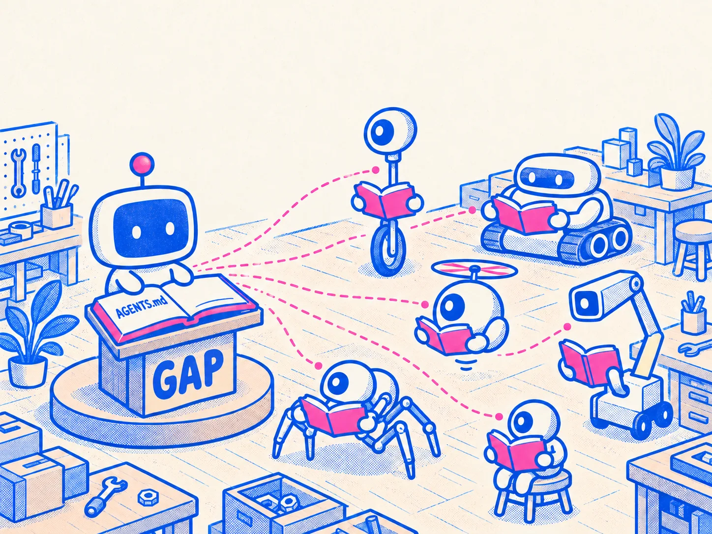
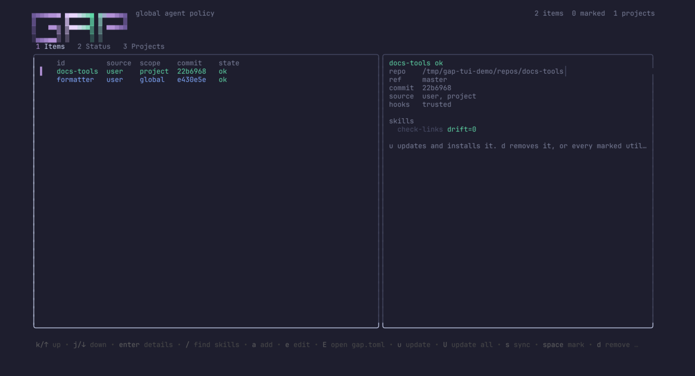
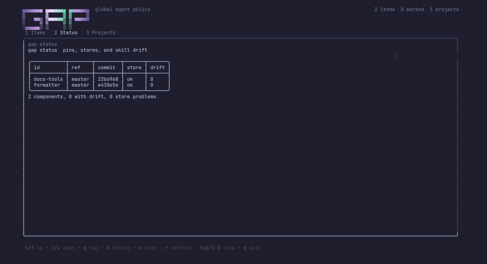
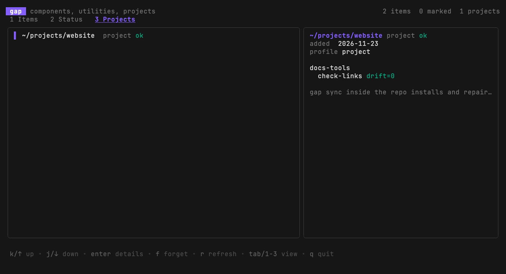
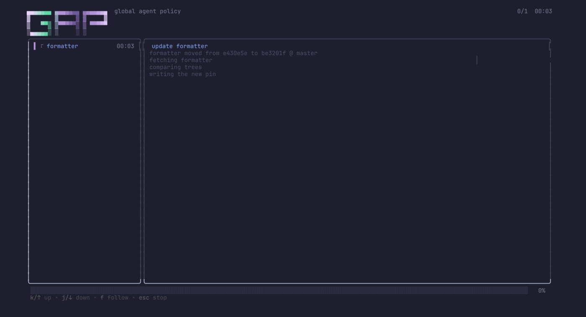
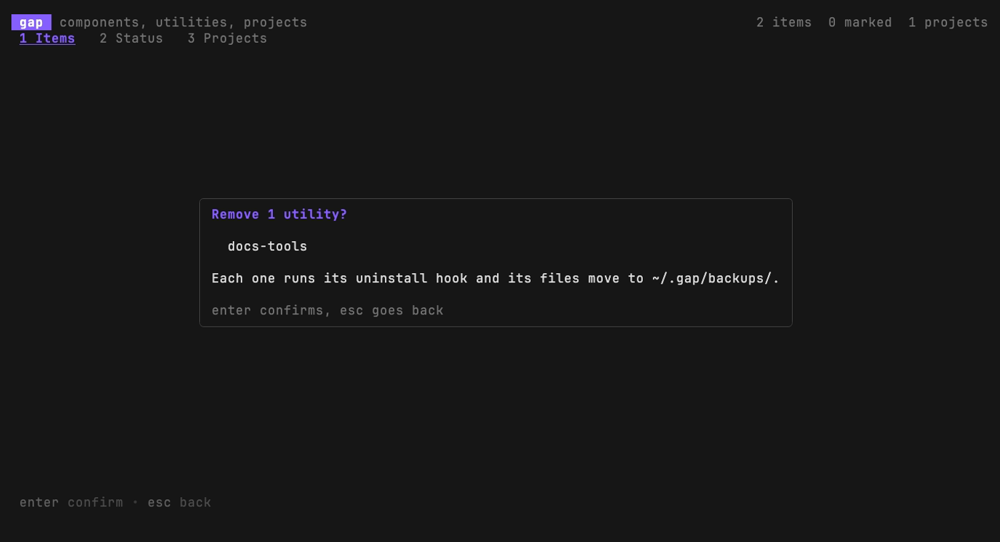
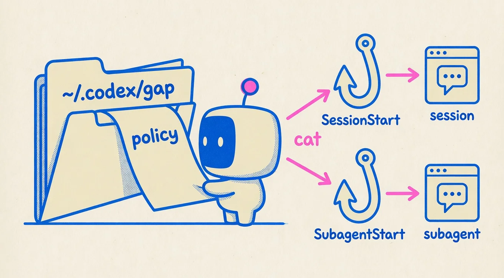

```
 ██████╗  █████╗ ██████╗
██╔════╝ ██╔══██╗██╔══██╗
██║  ███╗███████║██████╔╝
██║   ██║██╔══██║██╔═══╝
╚██████╔╝██║  ██║██║
 ╚═════╝ ╚═╝  ╚═╝╚═╝
```

# Global Agent Policies (GAP)

GAP is one set of rules that every coding agent on your machine follows. You, or an agent, write the rules once in `global/AGENTS.md`. The `gap sync` command copies them into the file each agent already reads.



## Before you start

- macOS or Linux. `gap` builds on Windows, but its harness paths and tests are not checked there.
- git and curl on your `PATH`. Go is optional; the installer can download a release binary.

## Install `gap`

```bash
curl -fsSL https://raw.githubusercontent.com/edheltzel/GAP/master/scripts/install.sh | sh
```

`curl` downloads `scripts/install.sh` from the `master` branch of `github.com/edheltzel/GAP`. The script chooses an installation path based on whether `go` is on your `PATH`:

- With Go, use the version required by [go.mod](go.mod), or newer. The piped script clones the repo into a new checkout under `~/.gap/checkouts/`, then builds `gap` with `go install ./cmd/gap`. The binary goes in `GOBIN` if set, otherwise `$(go env GOPATH)/bin`. Each curl install keeps its own checkout, so earlier installs and published documentation links keep their source.
- Without Go, the script downloads the latest release for macOS or Linux on amd64 or arm64. It checks the archive's SHA-256 against `checksums.txt`, stops on a mismatch, and installs the binary to `~/.local/bin`. It also clones `master` into `~/.gap/checkout`, or fast-forwards that checkout on a later install. This path needs tar and either shasum or sha256sum.

The script checks whether your shell can find the binary's folder. If not, it prints the exact `export PATH=...` line to add to your shell config. Open a new terminal after adding it. Installation writes the binary and source checkout; `gap sync` publishes the policy and installs the selected components and skills.

Already have the repo checked out? With Go available, `sh scripts/install.sh` from its root builds that copy instead of cloning, including when stdin is redirected. Keep that checkout too.

Then publish:

```bash
gap sync
```

`gap` runs from any folder. Source builds use their build checkout while it remains available; release builds and source builds without a usable build path use `~/.gap/checkout`. Keep the checkout: published documentation links point into it. Run `gap self-update` to update the installation: a source build fast-forwards its build checkout and rebuilds itself with Go; a release build fast-forwards `~/.gap/checkout` and replaces itself with the latest release after checking `checksums.txt`, and never moves to an older version. It refuses a checkout that is off its primary branch or has uncommitted changes to tracked files, before changing anything. Running the curl command again also works. With Go, you can skip installing and run `go run ./cmd/gap sync` from a checkout.

To uninstall, run:

```bash
gap uninstall
```

It previews what it will remove and asks on a terminal (`--yes` skips the question, `--dry-run` only previews). Without a terminal, `--yes` is required. Use the same `CODEX_HOME` and `JCODE_HOME` you published with. It removes every utility the way [gap remove](#add-a-utility) does, the MCP servers and commands recorded for components, GAP policy blocks, the GAP Codex hooks, and published global commands that still match `~/.gap/published.json`. Text outside marked policy blocks stays byte for byte; files left with only whitespace or Cursor front matter are removed. An unmarked policy file is removed when its whole-file SHA-256 matches the ledger. A ledger-verified prefix, including a legacy Codex GAP prefix, is stripped while preserving the text after it; the file is removed if only whitespace remains. Other policy files and unmatched global commands stay and are listed.

Skills are removed from the destinations GAP recorded for them in `~/.gap/state.json`, or from both `~/.agents/skills/` and `~/.claude/skills/` when a component's `skills` or `skillCopies` records the name without destinations. An unreadable or malformed skills.sh lock stops discovery before removal. Policy, command, skill, and Codex hook backups go under `~/.gap/backups/<time>/`; utility removals can use separate timestamped folders. Before removing utilities, GAP saves their skill and command ownership in `~/.gap/state.json` so cleanup can resume after an interruption. After cleanup succeeds, it deletes `~/.gap/store/`, `~/.gap/state.json`, and `~/.gap/published.json`. A failed cleanup exits `1` and keeps the records for a retry.

It leaves `~/.gap/backups/`, `~/.gap/recovery/`, `~/.gap/checkout/`, `~/.gap/checkouts/`, your remaining `~/.config/gap/` settings, and the `gap` binary. It prints a `trash` command for the binary and confirms successful cleanup with `Uninstall complete.` Copy out any saved files you want, then trash `~/.gap/` yourself.

## Commands

| Command | What it does |
| --- | --- |
| `gap sync` | Preview what will sync, ask on a terminal, then publish `global/AGENTS.md` and each `global/commands/*.md`, install missing skills, and check skills for drift. See [Choose what syncs](#choose-what-syncs) |
| `gap sync --skip <groups>` / `--only <groups>` / `--yes` | Leave groups out, sync only some, or sync without asking. Groups: `policy` or a component id |
| `gap sync --profile crew` | Prepare project files for cloud agents without fetching components or writing to the home directory |
| `gap sync --remove-codex-legacy` | Same, then strip the old policy copy from Codex home's `AGENTS.md`; see [Set up Codex](#set-up-codex-once-per-machine) |
| `gap status` | Show each component's pin, its store copy, and drift in its selected skills. With `recall` on `PATH`, also prints `recall: N promotion candidates` (skipped after 5 seconds or on any Recall error). Writes nothing; exits `1` on skill drift or an unpinned, missing, changed, or unreadable source checkout |
| `gap source` | Print the GAP checkout `gap sync` publishes from. Writes nothing |
| `gap restore [id]` | Back up and replace selected missing or drifted component skills at the locked commit, reusing a verified store copy |
| `gap check [id]` | List the commits waiting on each component's ref after its pin. Changes no pin; `gap status` shows the counts from the last check as `new=N`. See [Update components](#update-components) |
| `gap pin <id>@<ref>` | Resolve a distro component's branch, tag, or commit and write it to the distro's `gap.lock` |
| `gap doctor` | Run configured component doctors and report which harness commands are on `PATH` |
| `gap add <source> [options]` (aliases `install`, `i`, `a`) | Add skills from any git repository or local folder, with the flags of `npx skills add`: per project by default, `-g` for every project. See [Add a utility](#add-a-utility) and [Global vs project](#global-vs-project) |
| `gap update [id]` | Move one component's pin, or every pin without `pin = true` when the id is omitted, to the newest commit on its ref. Distro pins go to `gap.lock` for a PR; utilities install right away. See [Update components](#update-components) |
| `gap remove <id>` | Remove a utility and its recorded installations. See [Add a utility](#add-a-utility) |
| `gap uninstall [--yes] [--dry-run]` | Preview and remove recorded installations. See [Install `gap`](#install-gap) for removal rules and retained files |
| `gap search [query]` | Search `catalog.toml`, the list of known utilities, by id, tag, or description. Distro components show `included with GAP; gap sync installs it`; other matches show a `gap add` command |
| `gap list` | List every component and utility with its source, repo, ref, pinned commit, and hook trust |
| `gap tui` | Open the terminal UI to update, check, remove, and disable items and see status and projects. Plain `gap` on a terminal opens it too. See [Terminal UI](#terminal-ui) |
| `gap init [--adopt] [dir]` | Create project configuration and a policy pointer; `--adopt` reports and preserves existing project files |
| `gap self-update` | Update the `gap` binary and its source checkout to the latest `master` (source builds) or release (release builds). Leaves your user lock and installed components alone, but a fast-forward can bring in a newer distro `gap.lock` that the next `gap sync` installs. See [Install `gap`](#install-gap) |
| `gap --version` | Show the CLI version; release binaries report the tagged release version |
| `go test ./...` | Run the self-test against throwaway folders |

Use `gap --help` or `gap <command> --help` for usage and flags. Help and terminal reports use GAP's light or dark palette; status, list, and search show framed tables with totals. Git ref lookups and store fetching show spinners on terminal stderr. On a terminal, `gap sync` and `gap update` pin a progress bar to the last row (a spinner, percent, steps done, a ticking elapsed time, estimated time left, the current group in its color, and what it is working on, such as `skills: check drift  42/156 do-commit`) while everything else scrolls above it. Each finished step is listed above the bar with its time, such as `✓ do-skills  1.3s`; it is cleared when the run ends and never drawn when output is redirected or `TERM=dumb`; long titles are truncated to the terminal width measured at the start of the operation, when available. Set `NO_COLOR=1` or `TERM=dumb` to suppress report colors and spinners while keeping terminal layouts. Redirected reports use plain text. Add, update, restore, pin, remove, and uninstall outcome lines also appear when redirected.

## Breaking changes

`gap add -l` now means `--list`, not `--local`. Use `-p`, `--project`, or `--local` for a project install.

## Terminal UI

`gap tui` opens a terminal UI with three views:



Captured from the real TUI in an isolated demo home with two local example utilities.

<details>
<summary>Status, Projects, an update, and removal confirmation</summary>









</details>

- **Items**: every component and utility with its source, scope, effective ref and commit, store state, drift, and `new=N` from the last `gap check`. Distro components show as locked. An item this repo turns off shows `off here` beside its real pin and store state.
- **Status**: the output of `gap status`.
- **Projects**: each repo in `~/.gap/projects.json` with its profile and project-scope skill drift. A folder that no longer exists is flagged missing. A project item whose pinned store is missing or changed stays listed and the project shows `unchecked`. Project drift is checked only when this view opens, once per refresh. Items and Projects verify each pinned store once per refresh, and the Status view runs `gap status` only while it is shown.

| Key | What it does |
| --- | --- |
| `j`/`k` or arrows | Move, or scroll the Status view |
| `g` / `G` | Top / bottom |
| `enter` | Open the selected item or project full screen, scrollable; `esc` goes back |
| `tab` / `shift+tab` or `1`-`3` | Switch views |
| `space` | Mark a utility |
| `/` | Search the skills.sh catalog as you type. Hits show install counts, a check for trusted sources (vercel-labs, anthropics, microsoft, google-labs-code), and where you already have them. `enter` asks Everywhere or This project, then runs `gap add <repo> --skill <name>` with `--global` or `--project`. Hits from non-GitHub sources are hidden because `gap add` cannot install them |
| `a` | Add a utility: type the repo, an optional id, and whether it installs everywhere or only in this project. On the Projects view it adds to the selected project. It hands the terminal to `gap add`, so its trust prompt works |
| `e` | Edit the selected item: enabled, hold updates (`pin`), and color, saved everywhere or for this project only. For a utility it also edits the version: a new one runs `gap update` and is kept only if the pin moves. A distro component's version changes with `gap pin <id>@<ref>`. On the Projects view, `e` opens that project's `.gap/gap.toml` |
| `E` | Open `~/.config/gap/gap.toml` or this project's `.gap/gap.toml` in `$VISUAL` or `$EDITOR` |
| `u` | Run `gap update <id>` on the selected item |
| `U` | Confirm the items `gap update` will move (every item not held with `pin = true`, disabled ones included), then hand the terminal to it and press enter to come back |
| `s` | Hand the terminal to `gap sync`: its group picker, progress bar, and every prompt work as on the command line. Press enter to come back |
| `c` / `C` | Run `gap check <id>` / `gap check` |
| `d` | Remove the marked utilities, or the selected one, after one confirmation that lists every id. Each runs `gap remove <id>`: the uninstall hook runs and files move to `~/.gap/backups/` |
| `x` | Disable or enable a distro component after a confirmation. It writes `enabled = false` or `enabled = true` under `[components.<id>]` in `~/.config/gap/gap.toml` |
| `f` | Forget a project from the registry |
| `r` | Refresh |
| `q` | Quit |

A run looks like AUP: the animated GAP wordmark with done/total and elapsed time, each step in its group color with a spinner, check, or cross and its time or exit code, the selected step's live output beside it, and a progress bar with the percent done under both. `j`/`k` pick a step, `f` follows the running one again. While a run is going, `esc` asks before cancelling. Stop interrupts the current step's whole process group, kills what is still running after 5 seconds, waits for it to end, and skips the rest. A failed step does not stop the others. The summary lists each step as ok, failed, cancelled, or not run; it opens on the first failure, `j`/`k` pick a step, and `pgup`/`pgdn` scroll that step's output. A removal confirmation too short to show one id refuses `enter`; long ids wrap and scroll.

Actions run the `gap` binary itself with stdin closed and `NO_COLOR=1`, so they behave exactly like the CLI. Item ids follow `--`, so an id that looks like a flag is never read as one. An untrusted utility hook is skipped and exits `1`, as without a terminal.

Each item shows in its group color. Set `color = "#RRGGBB"` in a component's table in `gap.toml`, or in `[components.<id>]` in `~/.config/gap/gap.toml` or a project's `.gap/gap.toml`; later files win. Without one, items take the next color from GAP's palette. Any other value is an error.

Plain `gap` with no subcommand opens the TUI when stdin and stdout are terminals and `NO_COLOR` and `TERM=dumb` are unset. Otherwise it prints help and exits `2`. `gap tui` without a terminal prints `gap tui needs a terminal ...` and exits `2`.

A successful `gap init`, `gap add --project` (including a project utility added to another repo), `gap sync` in a repo with `.gap/gap.toml` once its selection goes ahead, and a `gap sync` that leaves a project-scope skill installed and matching its pin record that repo's root in `~/.gap/projects.json`. A quit or crew sync writes nothing there. Roots are stored with symlinks resolved, so one repo reached through a link has one entry. The file is sorted, has one entry per root, and keeps the date each root was first seen. Home is never recorded, through a link either. A failed registry write prints a warning and never fails the command. Until the file exists, the Projects view shows the roots recorded under `projectSkills` in `~/.gap/state.json`. Folders are never scanned.

## Change the policy

Do these steps every time you change the rules.

### Step 1: Edit `global/AGENTS.md`

Make your change in `global/AGENTS.md`. Longer notes it links to live in `global/docs/agents/`. Keep one policy for every agent; don't add a policy file for a single agent.

### Step 2: Merge the change

Commit the edit, merge it to `master`, and pull. `gap sync` publishes only merged rules. It refuses when:

- the checkout is on a branch other than `master`. The main checkout and a git worktree on `master` both publish.
- `global/`, `skills/`, `gap.toml`, or `gap.lock` differs from `origin/HEAD`, including untracked files. An ignored file blocks only when it is installable content under `skills/`, or when gap reads it (`global/AGENTS.md`, top-level `global/commands/*.md`, `gap.toml`, `gap.lock`). Ignored `node_modules` and `.DS_Store` do not block.

### Step 3: Run `gap sync`

```bash
gap sync
```

It reports each file it wrote using the [terminal or plain-text format](#choose-what-syncs).

Policy files are the shared rules. Each top-level `global/commands/*.md` is a slash-command prompt, copied unchanged as a whole file to Claude Code, Pi, and OMP. See [how sync handles existing files](#step-4-answer-if-gap-sync-asks-about-a-file).

The bundled [`/state-docs`](global/commands/state-docs.md) prompt writes project maps under `docs/state`. It follows the skill in a local clone of [nessa-docs](https://github.com/nessalabs/nessa-docs), found through `NESSA_DOCS`; see the prompt for arguments.

Each is a regular file, not a symlink. Start a new session in any agent to load the new rules.

### Step 4: Answer if `gap sync` asks about a file

`gap sync` asks before it appends the policy to a foreign file without a complete GAP marker pair, or replaces a foreign command file or a symlink. An empty file without a matching ledger entry also needs confirmation.

1. Type `y`. For a foreign regular policy file, sync copies it under `~/.gap/backups/` and appends the policy between `<!-- gap:begin -->` and `<!-- gap:end -->`. The rest of the file stays, so the harness keeps loading it. For a foreign command file, sync copies the old contents under `~/.gap/backups/` and replaces them. A policy symlink moves under `~/.gap/recovery/`; a command symlink moves under `~/.gap/backups/`. Sync writes a regular file in the link's place, so the harness loads the new file.
2. Later policy syncs replace only that block and do not ask again. An unchanged policy file stays in place. Before replacing a changed policy file, sync moves the previous file under `~/.gap/recovery/<dest-id>/<timestamp>/` and prints that path; it keeps the 3 newest regular copies per destination and never prunes displaced symlinks. A concurrent edit retained only in that copy triggers a warning with the path. Existing regular policy files keep their permissions. Routine updates to managed command files replace their contents without saving the previous version. The full recovery rules are step 5 of the [sync contract](cmd/gap/AGENTS.md#sync-steps).
3. Rules you want every harness to follow still belong in `global/AGENTS.md`. Text outside the policy markers stays in that file. Command edits belong in the matching source under `global/commands/`.

Any other answer leaves that file alone. With no terminal to ask in, such as an agent's shell, sync prints `Refusing to replace foreign file`, skips that file, publishes the rest, and exits `1`. Run `gap sync` yourself in a terminal to answer.

## Set up Codex (once per machine)

The paths below use the default Codex home, `~/.codex`. Substitute the absolute `CODEX_HOME` value if set. An empty `CODEX_HOME` counts as unset; a relative path is refused.

Codex has no rules folder. The first `gap sync` adds two hooks to `~/.codex/hooks.json`, SessionStart and SubagentStart. They print `~/.codex/gap/global-agent-policy.md` into every Codex session and subagent.



1. Open Codex and run `/hooks`. Trust both GAP hooks.
2. Start a session and a subagent. Confirm both see the policy.
3. If `~/.codex/AGENTS.md` still holds an old copy of the policy, remove it:

   ```bash
   gap sync --remove-codex-legacy
   ```

   The flag refuses unless both hooks were already in `hooks.json` before that run. On a clean machine it reports that there's nothing to strip.

## Check Grok (once per machine)

Grok has no file of its own. It reads the Claude copy when Claude compatibility is on, which is the default.

```bash
grok inspect
```

Look for `~/.claude/rules/global-agent-policy.md` in the global rules list. If it's missing, turn Claude compatibility back on. Don't add a Grok file. A second copy would load the policy twice.

## Set up Empryo (once per machine)

Empryo reads `~/.empryo/EMPRYO.md`, which already holds SoulStack's block. The first `gap sync` asks once to append the GAP block there, so run it from a terminal and type `y`. SoulStack's block and anything else in the file stay as they are.

Empryo injects every skill in `skills.autoLoad` in full into every prompt. GAP recommends two: `do-todo` (the policy tracks tasks every turn) and `do-commit`. Everything else loads by name when a task needs it. Until your pins match, `gap sync` prints the exact `settings` call. Ask an agent inside Empryo to run it. gap never changes Empryo's settings; it only writes its block in `EMPRYO.md`.

`gap sync` warns when `~/.empryo/skills/<name>` differs from a managed skill and never changes that copy, because Empryo loads it first. A jcode copy that differs from the pinned store is replaced with it. The [drift-check contract](cmd/gap/AGENTS.md#sync-steps) says when, and what is left alone.

## Manage skills

The distro's `gap.toml` and your `~/.config/gap/gap.toml` select pinned [components](#components). Their skill lists and load levels are described under [Load levels](#load-levels). The separate `global/skills.json` manifest is no longer used.

`gap sync` copies a distro component's selected skills directly from the pinned store into `~/.agents/skills` and `~/.claude/skills`. A utility added with [`gap add`](#add-a-utility) installs where add put it: one copy in `.agents/skills` that each selected agent reads, a symlink to that copy in each other agent's skills folder, or a separate copy per agent with `--copy`. Harnesses that read none of these folders get no skills from GAP; the policy still reaches them. GAP's skill copying, drift repair, and restore do not use Node or `npx`. Project skills use the same paths under the invoking project instead of the home directory; see [load levels](#load-levels).

Sync checks every selected skill against its pinned store. Existing skills.sh installations are adopted in place when both destinations match that source: GAP records component ownership and removes only that skill's entry from the skills.sh lock. The lock is `$XDG_STATE_HOME/skills/.skill-lock.json` when `XDG_STATE_HOME` is set, otherwise `~/.agents/.skill-lock.json`. Unrelated lock entries and fields stay intact. If GAP cannot save component ownership, adoption fails and restores the previous lock contents. If that restoration also fails, the error includes both failures and the lock path. Missing, unreadable, or malformed locks follow the [migration failure contract](cmd/gap/AGENTS.md#sync-steps). Edited copies go to drift review. For each drifted skill, sync shows the diff and asks:

- `k` keeps the installed copies for this run. Later runs check them again. An incomplete installation still exits `1`.
- `t` takes the source. Sync backs up both destinations under `~/.gap/backups/`, then reinstalls. A failed install restores the previous destinations.
- `s` skips it for now. Sync exits `1`.

With no terminal to ask in, sync lists the drifted skills, leaves those copies in place, and exits `1`. Skills outside the selected components are never touched, including skills from a component that was removed from `gap.toml`; delete those copies by hand.

### Components

A component is a utility pinned to one commit. [`gap.toml`](gap.toml) selects the distro's components; [`gap.lock`](gap.lock) records the exact commits and trees. A component whose pinned commit includes a [`gap-utility.toml`](#publish-a-utility) takes its installation declarations from that manifest, so its entry needs only `repo` and `ref`; keeping `install` or `doctor` in that entry is refused. A distro component whose pinned commit lacks one lists its skills in `names` and may set `install` and `doctor` commands in its entry.

An optional `path` restricts skill lookup to that subtree of the pinned checkout. For example, `path = ".agents/skills"` selects that variant when a repository contains multiple copies. Without `path`, lookup tries `skills/` first, then the repository, choosing the shallowest matching folder and using lexical order to break ties.

The distro can narrow a manifest's skill list as described under [Load levels](#load-levels). For example:

```toml
# gap.toml
schema = "2"
[components.do-skills]
repo  = "github.com/edheltzel/Do-Skills"
ref   = "master"
names = ["do-commit", "do-todo"]
```

`gap pin do-skills@master` writes the requested ref, resolved commit, and tree to `gap.lock`. If a branch and tag share a name, use `refs/heads/<name>` or `refs/tags/<name>` to choose one. Machine sync fetches the locked commit into `~/.gap/store/<id>/<commit>/`, checks its tree against the lock, and installs the selected skills as described above. Sync never moves a pin. A component missing from `gap.lock` stops the sync and names the `gap pin` command to run. `gap.toml` and `gap.lock` pass the same merge gate as `global/`.

Pin confirms the new pin, shows the old and new commits when it moves, or reports that it is already current. A new or moved pin includes a reminder to run `gap sync` to install it.

### Update components

GAP updates the way lazy.nvim does. `gap.toml` says what you want (a `ref`), `gap.lock` records the commit installed, and only an update moves the lock.

| lazy.nvim | GAP |
| --- | --- |
| Startup installs from `lazy-lock.json` | `gap sync` installs from `gap.lock` and never moves a pin |
| `:Lazy check` and its checker | `gap check [id]` fetches each ref into `~/.gap/cache/<id>.git` (history only, no file contents) and lists the commits after the pin. It records the counts in `~/.gap/check.json`; `gap status` shows them offline as `new=N` while the pin is unchanged |
| `:Lazy update` | `gap update [id]` moves each pin to the newest commit on its ref and prints the commits it brings in |
| `:Lazy restore` | `gap restore [id]` |
| `pin = true` | `pin = true` in a component's table. Update and check skip it unless it is named |
| Update refuses a plugin with local changes | Sync upgrades a skill copy without asking when it equals that skill in an earlier commit of the same component under `~/.gap/store/<id>/`, including a skills.sh install, which it adopts. A copy that matches no earlier commit was edited, and the [drift choices](#manage-skills) apply |

A distro component's new pin is written to `gap.lock` in the GAP checkout, the same way `gap pin` writes it. Commit `gap.lock` and merge it; the merge gate refuses `gap sync` until then. After the merge, `gap sync` installs the new commit. A utility added with `gap add` keeps its pin in `~/.config/gap/gap.lock`, so `gap update` installs it right away.

The distro includes Do-Skills, Forge, Echo, Recall, and the third-party skill sources declared in [`gap.toml`](gap.toml). Forge supplies `forge-interview`. Echo and Recall have empty skill lists: machine sync runs their `install` commands from their verified stores, and those installers own their skills and runtime prerequisites. Hook timing and state are described under [Hooks and trust](#hooks-and-trust). Gap copies no skills from them and never installs a harness.

`gap doctor` runs each configured `doctor` command from its verified pinned store, then reports harness presence using `PATH`. Missing pins, missing or changed stores, and failed doctors produce exit `1`; doctor does not fetch missing components.

Doctor also records the adapters Echo reports in `~/.gap/state.json`, when the pinned Echo supports that report. GAP never installs or removes adapters itself; the full rule is in the [`gap` contract](cmd/gap/AGENTS.md#project-setup-and-doctor).

`gap status` checks component source checkouts and selected component skills, using the locked ref when pinned. It does not check Recall's memory database. `store=missing` means the checkout is absent, `store=changed` means its source files differ from the pin, and `store=unpinned` means `gap.lock` has no entry. For these states, it prints the matching repair command. Ignored, untracked build output does not change the result; tracked edits, deletions, and mode changes still do. Skill drift is checked only when the source checkout matches the lock; an unreadable checkout reports an error.

Status and `gap restore [id]` use the same component overrides and skill selection as sync. `gap restore do-skills` repairs that component's selected missing or drifted skills without asking; omit the id to repair all components. Restore backs up replaced copies and rolls them back if installation fails. A verified store avoids network access.

Restore names each repaired skill and its source pin, then reports the total restored. If nothing needs repair, it reports how many selected skills were checked, or that none were selected. An id limits that confirmation to the requested component.

### Global vs project

| Scope | Config | Where skills go | How to use it |
| --- | --- | --- | --- |
| Global | `~/.config/gap/gap.toml` | `~/.agents/skills`, plus each selected agent's own global folder | `gap add -g owner/repo`, or a distro skill with the default `load` |
| Project | `<repo>/.gap/gap.toml` | `<repo>/.agents/skills`, plus each selected agent's project folder | `gap add owner/repo` (the default, or `-p`, `--local`) inside the repo, or a distro skill with `load = "project"` and a matching `when.files` |

```sh
gap add -g owner/repo          # global: every project sees its skills
cd ~/code/site
gap add owner/repo             # only this repo gets its skills
cd ~/code/app
gap add owner/repo             # add the same utility to a second repo
```

A per-project add records `repo`, `ref`, and `load = "project"` under the utility in `~/.config/gap/gap.toml`, and `load = "project"` with the repo's selection (`names`, `agents`, `copy`, `subagents`, and each renamed skill's `from`) under `[components.<id>]` in the repo's `.gap/gap.toml`, creating that file the way `gap init` does when it is missing. Each repo keeps its own selection. `gap sync` and `gap update` inside an opted-in repo keep its copy current; elsewhere they install no skills for that utility. A utility's commands, hooks, and MCP servers stay machine-wide in both scopes. One id is either global or per project: `gap remove <id>` removes it from every repo it was added to, moving each project copy to `~/.gap/backups/<time>/projects/`, and then it can be added again in the other scope. A project file can also leave any component out of that repo with `enabled = false`.

### Load levels

A component's skills are the `skills` in its `gap-utility.toml`, or its `names` array when its repo has no manifest. `names` beside a manifest narrows that list. An optional `[components.<id>.skills.<name>]` table selects how an existing name installs:

| `load` | Installation |
| --- | --- |
| `listed` (default), `always` | Install in the home-directory skill destinations |
| `project` | Install under the invoking project only when any `when.files` glob matches |
| `command`, `off` | Not selected for installation by sync or restore |

For example, the distro's `do-astro` selection uses `load = "project"` with `when.files = ["astro.config.*"]`. Globs are relative to the invoking project's Git root, or the current directory outside Git. `do-no-comments` uses `load = "project"` with no `when.files`, so it installs only in a project whose `.gap/gap.toml` opts in:

```toml
[components.do-skills.skills.do-no-comments.when]
files = ["*"]
```

### Overrides

Sync, status, restore, and doctor read the installed distro's `gap.toml`, then `~/.config/gap/gap.toml`, then the invoking project's `.gap/gap.toml`. Later values win. `gap sync --profile <name>` applies the distro's `profiles/<name>.toml` last. A project with `profile = "crew"` also loads the crew profile on later runs.

Overrides can replace an existing component's `enabled`, `pin`, `ref`, and `color`, or a listed skill's `load` and `when.files`. Only `~/.config/gap/gap.toml` can add a component, and `gap add` writes that entry for you; see [Add a utility](#add-a-utility). A later `enabled = true` can re-enable a component. `when.files` replaces the earlier list. For example:

```toml
[components.recall]
enabled = false

[components.do-skills.skills.do-astro]
load = "project"
[components.do-skills.skills.do-astro.when]
files = ["astro.config.*", "apps/site/astro.config.*"]
```

Overrides never write either lock. If an overridden `ref` differs from the locked ref, the command stops: use `gap pin <id>@<ref>` for a distro component, or [`gap update <id>`](#add-a-utility) for a user utility.

### Choose what syncs

`gap sync` groups its work as `policy` (policy and global commands) and each enabled component id (distro or user). A utility's skills, commands, and MCP servers belong to its component group. With both stdin and stdout attached to a terminal, it opens a picker with every group checked: space toggles a group, and enter syncs the checked groups. Only enter syncs: ctrl+c, a termination signal, or submitting with no groups checked writes nothing. A `TERM=dumb` terminal gets the line prompt below instead.

After selection, terminal output shows a framed plan, phase headers, progress lines, and a final result. Written paths use `~` for your home directory. Piped output keeps the plain preview and progress lines, for example:

```
gap sync will:
  policy     publish AGENTS.md to 7 harness files and 1 command
  do-skills  66 skills @ master (abc1234)
  echo       run its installer @ v0.13.0 (def5678)
  gh-axi     1 skill @ main (fed4321)
```

With terminal input and either `TERM=dumb` or piped output, sync prints the preview before asking `[a]ll, [c]hoose, [q]uit`; `c` asks `[Y/n/q]` about each group. Press enter to submit each answer. An empty submitted line means all at the first prompt and yes at each group prompt. Entering `q`, choosing no groups, or reaching end of input (EOF), even after typing a partial answer, prints `Nothing synced.`, writes nothing, and exits `0`.

For scripts, `gap sync --skip do-skills,gh-axi`, `gap sync --only policy`, or `gap sync --yes` skip the question. `--only` and `--skip` are mutually exclusive. Without terminal input, every group syncs unless a flag leaves it out. A skip lasts for one run; to leave a component out of every sync, add `[components.<id>]` with `enabled = false` to `~/.config/gap/gap.toml`.

To add a whole utility for yourself, run [`gap add`](#add-a-utility). To add a skill from an existing component, add its name to that component's `names` array in `gap.toml`. For another distro source, add a component with its `repo`, `ref`, and `names`, then run `gap pin <id>@<ref>`. Follow [the merge and publish steps](#step-2-merge-the-change).

### Project setup

Run `gap init --adopt [dir]` for an existing project, or `gap init [dir]` for a new one; `dir` defaults to the current directory. Both create `.gap/gap.toml` when it is missing, using `profile = "project"` and the directory name as the slug, and add a short policy pointer to `AGENTS.md`. `--adopt` leaves an existing `AGENTS.md` exactly as it is and lists the agent, Forge, task, and stack files it found. When Recall is installed, init records `gap provisioned <slug>` in it once per project. Init never runs the Forge interview. The full rules, including refusals and Recall errors, are in the [`gap` contract](cmd/gap/AGENTS.md#project-setup-and-doctor).

For cloud agents, run `gap sync --profile crew`. It uses the same protected project-file writes, creating missing configuration with `profile = "crew"`. The [crew profile](profiles/crew.toml) excludes Recall and Echo; this sync skips home publication, store fetching, component installers, and skill installation. Commit the project files for the cloud agent. With an effective crew profile, status reports `crew: project files only` and restore writes nothing.

## Add a utility

A utility is any git repository or local folder of skills; each skill is a folder with a `SKILL.md` that has a `name` and a `description`. `gap add` takes the sources and flags of `npx skills add`, then pins the repo the way a lazy.nvim plugin is pinned, so `gap sync`, `update`, `status`, `restore`, and `remove` manage what it installed:

```sh
gap add owner/repo                  # this repo; asks which skills, agents, and scope
gap add owner/repo -g -y            # every project, every detected agent, no prompts
gap add owner/repo -s web-design    # one skill; owner/repo@web-design does the same
gap add owner/repo#v2 -a claude-code -a cursor
gap add owner/repo@v1.2.0           # a version tag; branches use #branch
gap add https://gitlab.com/group/repo/-/tree/main/skills
gap add ./my-skills --copy          # a folder inside a git repository
gap add owner/repo --list           # show the skills and install nothing
```

| Flag | What it does |
| --- | --- |
| `-g`, `--global` / `-p`, `--project`, `--local` | Install for every project, or into the repo you run it in (the default with `-y`). Without either, add asks |
| `-a`, `--agent <ids...>` | Agents to install to, by skills.sh id (`claude-code`, `cursor`, `codex`, ...); `'*'` for all. Default: the agents found on this machine, plus every agent that reads `.agents/skills` |
| `-s`, `--skill <names...>` | Skills to install; `'*'` for all. Without it, add asks unless the source has one skill or `-y` is set |
| `-y`, `--yes` / `--all` | No prompts. `--all` also selects every skill and every agent |
| `--copy` | A separate copy in each agent folder instead of one copy plus symlinks |
| `-l`, `--list` | List the source's skills and exit; writes nothing but the pinned checkout |
| `--rename <name>` | Install the one selected skill under another name |
| `--full-depth` | Search the whole repo instead of the usual skill folders |
| `--subagent <names...>` | Eve subagents to install to; `root` is the root agent |
| `--json` | With `-y`, print one JSON result per skill on stdout |
| `--id <id>` | Utility id; the default is the repo name, lowercased |

A source is `owner/repo`, `owner/repo/path/to/skills`, a GitHub, GitLab, or Azure Repos URL (a tree URL picks the ref and folder), `git@host:path`, an `ssh://` or `https://` git URL, or a local folder inside a git repository, where gap pins the current commit and notes uncommitted changes it leaves out. Download links, well-known skill sites, and Notion pages are refused because gap pins a git commit. A private GitHub repo that refuses HTTPS is retried over SSH.

`gap add` resolves the ref (the default branch unless the source names one), pins the commit in `~/.config/gap/gap.lock`, records the repo in `~/.config/gap/gap.toml`, and installs the selected skills. A repo with a [`gap-utility.toml`](#publish-a-utility) offers the skills its manifest lists and also installs its commands, MCP servers, and hooks; without one, add finds skills the way skills.sh does. Add reads nothing outside the pinned checkout: a skill folder, `SKILL.md`, search folder, or discovery file (`skills-lock.json`, `skills.sh.json`, `.claude-plugin/marketplace.json`, `.claude-plugin/plugin.json`) that resolves outside it through a symlink is skipped unread. These files are yours: they never touch the distro's `gap.toml` or `gap.lock`, and the sync merge gate does not cover them. An id the distro already uses is refused, even when disabled. `policy` and `manifest` are reserved ids. A skill name another component already installs in the same place is refused; `--rename` installs it under another name. A per-skill `load = "project"` is available only to distro components. Disabling a utility skips installation while keeping it available to `gap list`, `gap update`, and `gap remove`.

Running `gap add` again for the same id merges: the new skills, agents, and subagents join the recorded ones, and the latest copy mode applies to every unedited installed skill. A utility added per project keeps its pinned commit when you add it to another project; `gap update` moves the pin. A different repo, path, ref, or scope under the same id is refused with the `--id` to use instead. Add prints the installation summary and asks before it writes, then confirms the utility id, ref, and commit, and flags skipped installation steps when registration succeeded but installation is incomplete.

```toml
# ~/.config/gap/gap.toml, as written by gap add -g owner/repo -s web-design -a claude-code -a codex
[components.repo]
repo = "github.com/owner/repo"
ref = "main"
names = ["web-design"]
agents = ["claude-code", "codex"]
```

A repo with a manifest omits `names` while every manifest skill is selected, so new manifest skills install on update. `copy = true` records copy mode. `[components.<id>.skills.<name>] from = "<original>"` records the skill's name in the repo when it differs from the installed folder name: a `--rename`, or a name like `Web Design` that installs as `web-design`. Two selected skills that would install under one folder name are refused; `--rename` one of them.

| Step | Command | What happens |
| --- | --- | --- |
| Install from the lock | `gap sync` | Installs every utility at its pinned commit, like the distro components. Sync never moves a pin |
| Update | `gap update [id]` | Moves every requested pin to the newest commit on its effective ref before installing enabled utilities. A skill copy you did not edit moves to the new version; an edited copy is kept and `gap restore <id>` takes the new one. Hook timing follows the [manifest reference](#publish-a-utility) |
| See what is added | `gap list` | See [Commands](#commands) for listing fields and terminal output |
| Remove | `gap remove <id>` | Runs the `uninstall` hook, unregisters its [MCP servers](#publish-a-utility), moves the skills and commands GAP placed for it into one `~/.gap/backups/<time>/` folder, and drops its config entry, pin, and record. An edited copy is named in the output |

Update reports each utility's pin change or that it is up to date, then totals the utilities checked, updated, and up to date. Those counts describe pins; the summary also flags failed updates or skipped installation steps. Once utilities are selected, failures still print the summary and name utilities whose pins were not checked. Without an id, update first moves the distro pins as described in [Update components](#update-components). With no added utilities, it then says so and shows `gap add owner/repo`.

Before installing any utility, update verifies every requested source checkout, including disabled utilities, and rebuilds missing or corrupt caches even when the pin is already current. Update compares each skill with its last copied version, tracked separately from hook completion in `~/.gap/state.json`. If an update hook fails, fix its cause and rerun `gap update [id]`: installation retries even when the pin is already current.

GAP removes only the files it recorded for that utility in `~/.gap/state.json`, keeping files another source still selects. If it cannot determine remaining component selections from verified local checkouts, removal stops before running the uninstall hook; run `gap sync` before retrying. If a successfully installed, untrusted utility has an `install` hook and no `uninstall` hook, `gap remove` warns that it cannot undo what the installer did. A failing or unapproved `uninstall` hook stops `gap remove` before anything moves. Successful removal confirms the utility id and, when files were moved, the backup folder.

### Hooks and trust

A utility's hooks are shell commands from someone else's repo, so GAP shows the command and asks `[y/N]` whenever it needs to run one. Approval applies to that execution. MCP registrations can launch a utility's code, so they use the same trust setting and ask separately before registering or re-registering servers. With no terminal, untrusted hooks and registrations are skipped and the command exits `1`. During add, update, or sync, skills and commands still install when a hook or registration is skipped. Successful install and update hooks, and completed installations needing no hook, are recorded in `~/.gap/state.json` so repeating the same pin skips the hook. An installation needing no hook is complete only after its selected skills, commands, and MCP steps succeed. The hook choice on a pin change is defined in the [manifest reference](#publish-a-utility).

To stop the questions for a repo or an owner you trust, the way you trust a Homebrew tap, list it in your config:

```toml
# ~/.config/gap/gap.toml
[trust]
repos = ["owner/repo", "edheltzel/*"]
```

A trusted repo runs its hooks with no prompt and no warning. Distro components are trusted: the distro's `gap.toml` already passes the merge gate.

## Publish a utility

Any repo with skill folders installs with `gap add`. Put a `gap-utility.toml` at its root to fix the skill list by folder name and to ship commands, hooks, or MCP servers as well. A minimal manifest:

```toml
schema = "1"
name = "my-tools"
description = "Skills and a command for my workflow"
skills = ["my-skill"]
commands = ["commands/my-command.md"]

[hooks]
install = "./scripts/install.sh"
uninstall = "./scripts/uninstall.sh"

[mcp.my-tools]
command = ["node", "{store}/mcp/server.js"]
env = ["LOG_LEVEL=info"]
```

| Key | Required | Meaning |
| --- | --- | --- |
| `schema` | yes | Always `"1"` |
| `name` | yes | Display name |
| `description` | no | One line about the utility |
| `skills` | no | Skill names. Each needs a `<name>/SKILL.md` folder in the repo, such as `skills/<name>/SKILL.md`. `gap add` installs them for the agents the user picks |
| `commands` | no | Repo paths of `.md` command files. GAP copies each by basename, unchanged, into `~/.claude/commands`, `~/.pi/agent/prompts`, and `~/.omp/agent/commands` |
| `hooks.install` | no | Runs on the first installation and on later pin changes when `update` is absent |
| `hooks.update` | no | Replaces `install` when installing a different pin after a first successful installation |
| `hooks.uninstall` | no | Runs on `gap remove` from the last successfully installed version, before GAP moves its files; skipped if no installation succeeded or an earlier removal attempt already ran the hook successfully. It must undo the effects of `install` and `update` outside GAP's skill and command files |
| `hooks.doctor` | no | Runs on `gap doctor` |
| `mcp.<name>` | no | One MCP server. Set exactly one of `command` (a nonempty string array) or `url` (an `http://` or `https://` URL). Command servers may also set `env` (`KEY=value` strings). `{store}` in command arguments and environment values becomes the pinned checkout path |

A manifest needs at least one skill, command, hook, or MCP server. Unknown keys are refused, so a typo fails at `gap add` instead of being ignored. Hooks run with `sh -c` from the verified checkout for that version in `~/.gap/store/<id>/<commit>/`; treat that folder as read-only. Exit `0` is success. Any other exit fails that utility, makes the command exit `1`, and leaves the hook to run again next time. Command basenames must be unique within a utility and across registered components and `global/commands/`. Names of previously copied commands remain reserved until the owning utility is removed.

Command publication stops if a registered user utility's manifest cannot be resolved from a verified local checkout, even when that utility is disabled or skipped for this run.

During add, sync, and update, GAP registers MCP servers through each installed harness's own CLI: `claude mcp add --scope user`, `codex mcp add`, and `pi mcp add`. Registration follows [Hooks and trust](#hooks-and-trust). OMP, Cursor, and Empryo get none yet. A missing CLI is skipped for new registrations; if GAP already owns a server in that harness, a missing CLI makes the command exit `1` and preserves its ownership.

First registration uses `CLAUDE_CONFIG_DIR` (default: your home directory), `CODEX_HOME` (default: `~/.codex`), or `PI_CODING_AGENT_DIR` (default: `~/.pi/agent`). Empty overrides use those defaults; nonempty overrides must be absolute paths. GAP records each server's configuration target in `~/.gap/state.json`. Later checks, updates, and removal use that recorded target even if the environment changes.

Sync and update leave an unchanged registered server in place, remove and re-add it when its expanded declaration changes, and restore it if it is missing. A pin change only requires re-registration when it changes the expanded declaration, such as a command containing `{store}`. A server name you already configured in a harness, or one another utility owns, is left alone and reported, and the command exits `1`. If a failed add command nevertheless writes a registration, GAP retains ownership for later removal.

GAP unregisters recorded servers through the harness CLIs when the manifest drops them or on `gap remove`. Removal happens before skills and commands move to backup. If MCP removal fails, `gap remove` exits `1`, retains the utility's config entry and pin, and records which servers still need removal. Resolve the reported failure and retry `gap remove <id>`.

## Skill catalog

GAP keeps no skill source. [Do-Skills](https://github.com/edheltzel/Do-Skills#readme) supplies the `do-*` and marketing skills, pinned in `gap.toml` and `gap.lock`; its README holds the catalog and the human docs for each skill. See [Components](#components) for the other sources and their installation rules.

## Reference

### Where each agent reads the policy

| Agent | File it reads | Commands |
| --- | --- | --- |
| Claude | `~/.claude/rules/global-agent-policy.md` | `~/.claude/commands/` |
| Pi | `~/.pi/agent/APPEND_SYSTEM.md` | `~/.pi/agent/prompts/` |
| OMP | `~/.omp/agent/APPEND_SYSTEM.md` | `~/.omp/agent/commands/` |
| Codex | `~/.codex/gap/global-agent-policy.md` (`$CODEX_HOME/gap/global-agent-policy.md` when nonempty), printed by the SessionStart and SubagentStart hooks | none |
| Cursor | `~/.cursor/rules/global-agent-policy.mdc` | none |
| Empryo | `~/.empryo/EMPRYO.md`, beside the SoulStack block. The first sync asks once, so run it from a terminal. | none |
| jcode | `~/.jcode/prompt-overlay.md` (`$JCODE_HOME/prompt-overlay.md` when set; must be absolute, and set but empty is refused) | none |
| Grok | No file of its own. It reads the Claude copy. | none |

### How sync tells its own files apart

The [sync contract](cmd/gap/AGENTS.md#sync-steps) defines ledger fingerprints, legacy-file recognition, and Cursor frontmatter handling.

### Don't create `~/CLAUDE.md`

Claude searches parent folders for `CLAUDE.md`. A file at `~/CLAUDE.md` sits above every project, and it stops Claude from reading that project's `AGENTS.md`. The Claude rules file above already covers every project.

### Self-test

```bash
go test ./...
```

The test builds `gap` inside a throwaway clone of this repo and runs it against a temporary home folder. It never touches your real agent files. It exits `0` when every check passes.
