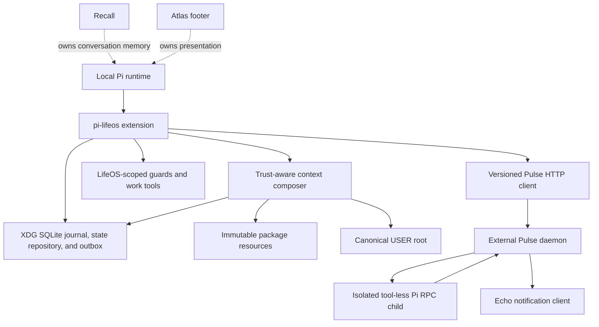
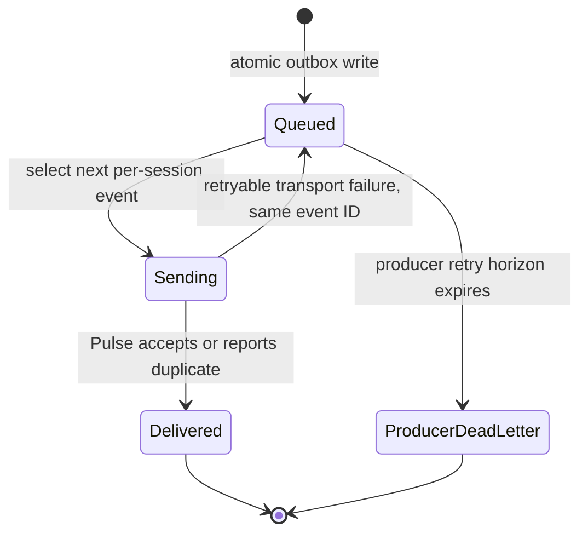
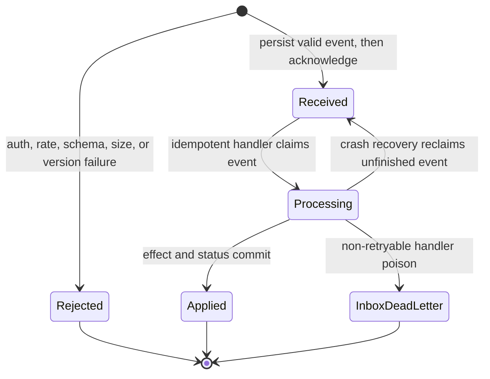

# Life OS - Plan

## Goal Capsule

- **Objective:** Build a native Pi LifeOS package in Atlas Config and adapt the external Pulse daemon to Pi without copying Claude configuration or duplicating Atlas ecosystem responsibilities.
- **Authority hierarchy:** The user-approved migration artifact and its ownership boundaries govern product scope; this plan governs implementation; repository DOX and package contracts govern local execution; implementation judgment fills only details this plan leaves open.
- **Execution profile:** Deep, cross-repository, staged migration with test-first proof at lifecycle, state, security, telemetry, and provider boundaries.
- **Stop conditions:** Stop if implementation would write to `~/.claude`, overwrite populated USER data, migrate legacy conversational MEMORY, reintroduce a Claude CLI or Anthropic SDK runtime dependency, replace Recall/Echo/Atlas/Pi ownership, or globally activate the package before isolated verification passes.
- **Tail ownership:** The implementing agent may build and verify both repositories in isolated worktrees. Global Pi activation and any daemon service cutover occur only from canonical checkouts after review.

---

## Product Contract

### Summary

Create `pi-lifeos` as a Pi-native package that composes bounded LifeOS context, exposes safe LifeOS work primitives, preserves lifecycle continuity, and publishes privacy-minimal telemetry to an external Pulse daemon. Adapt Pulse through a versioned Pi event contract and Pi RPC reasoning while leaving Recall, Echo, Atlas, and Pi in control of memory, voice, footer, and delegation.

### Problem Frame

LifeOS 7.1.1 carries portable philosophy, TELOS, ISA, Algorithm 8.4.0 doctrine, and Pulse domain behavior, but its runtime shell assumes Claude Code hooks, Claude permissions, Claude transcripts, `~/.claude` paths, the Claude CLI, and the Anthropic Agent SDK. `LifeOS/install/LIFEOS/TOOLS/PiSync.sh` copies files into live Pi configuration and regenerates global `AGENTS.md`, but it cannot reproduce lifecycle semantics, package ownership, provider neutrality, or safe state boundaries.

Atlas Config already has the right native precedent in `packages/pi-themis/`: a package manifest, one extension entrypoint, bundled skills, package-local DOX, and local package registration. The migration should follow that shape while retaining LifeOS's SYSTEM / USER / INTERFACE / RUNTIME-STATE separation from `LifeOS/install/LIFEOS/DOCUMENTATION/SystemUserBoundary.md`.

### Actors

- A1. **Ed** reviews scope, controls global activation, owns private USER data, and approves any cutover that changes live Pi or Pulse behavior.
- A2. **Pi session** loads the package, provides trusted-project state, owns model selection, sessions, compaction, and delegation, and invokes LifeOS extension events and tools.
- A3. **LifeOS package** composes doctrine and current-work context, protects LifeOS-owned state, exposes primitive work operations, and publishes bounded telemetry.
- A4. **Pulse daemon** remains a standalone Bun process that accepts versioned Pi events, runs non-conversational LifeOS telemetry and channels, and delegates reasoning to Pi RPC.
- A5. **Atlas ecosystem services** retain their established responsibilities: Recall for conversational memory, Echo for voice, Atlas for the Pi footer, and Pi/subagents for delegation.

### Requirements

#### Packaging and context

- R1. Ship LifeOS as `packages/pi-lifeos/` with accurate `package.json#pi` extension and skill entries, package-local DOX, human documentation, immutable resources, and no runtime state beneath the package.
- R2. Derive Pi-safe constitutional resources from LifeOS 7.1.1 and Algorithm 8.4.0 with a provenance manifest; do not copy Claude paths, tool names, permissions, memory directives, statusline behavior, or voice behavior into the Pi prompt.
- R3. Compose deterministic context before every agent turn from packaged doctrine, canonical USER data, and current LifeOS work state, with explicit source allowlists, sensitivity labels, freshness rules, provenance hashes, section precedence, and a 32 KiB default total budget.
- R4. Inject sensitivity-labelled USER, TELOS, or active work context only when Pi reports the project trusted **and** the canonical project is explicitly authorized in private USER configuration; project-local files may not grant authorization or redirect USER/state roots.

#### State and lifecycle

- R5. Read private USER data from `~/.config/LIFEOS/USER` through one typed interface and store runtime state under `${XDG_STATE_HOME:-~/.local/state}/lifeos`; store rebuildable cache under `${XDG_CACHE_HOME:-~/.cache}/lifeos`.
- R6. Never fall back to `~/.claude`, migrate old PAI/LifeOS MEMORY, parse Pi JSONL for normal runtime, or write mutable data beneath `packages/pi-lifeos/` or `pi/.pi/agent/`.
- R7. Coordinate managed mutations across Pi processes with one XDG-rooted SQLite transaction journal, reject stale revisions, publish each derived file atomically, and use source fingerprints plus dirty replay so interrupted derivations converge after restart.
- R8. Map behavior to Pi lifecycle capabilities rather than Claude hook names, including session start/shutdown, input, prompt composition, tool call/result, agent settlement, compaction observation, reload, new, resume, fork, and quit.
- R9. Persist every authoritative mutation when it occurs; shutdown is best-effort teardown and telemetry, never the durability boundary or evidence that work completed.
- R10. Treat ISA/work completion as an explicit domain-state transition, never as a consequence of `agent_settled` or `session_shutdown`.

#### Safety and interoperability

- R11. Guard only LifeOS-owned resources, managed USER/state paths, and restricted LifeOS egress; Pi and Atlas retain general repository and shell policy.
- R12. Fail closed when a recognized protected mutation or restricted egress check cannot be evaluated, fail open for unrelated tools, and record the guard fault without blocking on Pulse.
- R13. Expose primitive, revision-aware TELOS/ISA/work operations with rich results; prompts and the Algorithm orchestrate these primitives instead of creating a second delegation or workflow engine.
- R14. Coexist with Recall prompt injection and compaction by appending to the chained system prompt and observing compaction only; LifeOS must not provide a competing conversation summary or memory extractor.

#### Pulse and provider neutrality

- R15. Add a versioned Pulse ingestion contract that requires loopback peer identity plus a per-install credential, stable event IDs, per-session ordering, bounded typed payloads, request-rate/concurrency admission, durable inbox processing, and accepted/duplicate/rejected/unsupported-version outcomes.
- R16. Publish telemetry through a durable XDG outbox without delaying guards or agent turns; retries preserve event identity, poison events dead-letter, and Pulse outages degrade observability rather than LifeOS behavior.
- R17. Exclude prompts, tool arguments, tool results, file contents, secrets, private paths, and relationship history from telemetry and operational logs by default.
- R18. Replace active authenticated-channel Claude CLI and Anthropic SDK reasoning paths with one constrained Pi RPC runtime; disable rather than port proactive scheduled reasoning in this plan.
- R19. Remove Pulse-owned conversation bodies and summaries from normal channel continuity; retain only authenticated principal-to-opaque-session bindings and bounded operational metrics.
- R20. Route best-effort local spoken notifications only through Echo at `localhost:8888`; remove or disable Pulse/Telegram direct TTS and do not ship or enable Pulse VoiceServer behavior.

#### Ownership, rollout, and compatibility

- R21. Register no footer, statusline, conversational-memory subsystem, delegation framework, model router, or global permission replacement from `pi-lifeos`.
- R22. Do not port Claude agent metadata or the `ContextSearch`/`cs` commands; Recall replaces historical context search, and Pi's existing delegation stack replaces Forge/Gemini agent definitions.
- R23. Port operator-invoked Algorithm doctrine through the LifeOS skill, packaged resources, and primitive tools; do not create a second Algorithm runner or autonomous workflow engine.
- R24. Support the authoritative off/observe/enforce activation matrix, isolated package loading, reversible global registration, and Pulse channel cutover without deleting USER or XDG state.
- R25. Retire `PiSync.sh` from the Atlas workflow and document it as an unsupported migration foundation; do not invoke it, regenerate global `AGENTS.md`, or overlay Pi skills by normalized name.
- R26. Keep package README, bundled skill guidance, manifests, DOX indexes, source provenance, and rollout documentation synchronized with behavior.
- R27. Bound outbox, Pulse inbox, dead-letter, dedup, RPC session roots, and operational logs by bytes, count, and age; the producer retry horizon must expire before Pulse dedup tombstones can be pruned.
- R28. Launch external-channel Pi RPC with a dedicated tool-less profile, isolated working/session roots, private context disabled, an allowlisted environment, pre-acceptance input/rate/token budgets, bounded process/output/runtime resources, and one serialized session actor per authenticated routing key.
- R29. Create USER/state/outbox/session/log directories as user-owned mode 0700 and sensitive files as mode 0600; reject unsafe ownership, preserve restrictive modes across replacement, and project only required provider/runtime values—not Pulse transport secrets—into RPC children.
- R30. Load Pulse transport credentials and the ingestion credential only from user-owned 0600 files outside tracked TOML/plist/package files; validate ownership at startup, redact diagnostics, and support rotation without code or tracked-config changes.

### Key Flows

- F1. **Trusted context turn**
  - **Trigger:** Pi prepares an agent turn.
  - **Actors:** A2, A3.
  - **Steps:** Resolve package resources, canonical USER files, and active work state; require project trust plus canonical-project authorization for every private source; apply budgets and provenance; append one deterministic LifeOS block to the chained prompt.
  - **Outcome:** The active Pi model receives current LifeOS context without Recall duplication or Claude-specific directives.
  - **Covered by:** R2-R6, R14.
- F2. **Managed mutation and derivation**
  - **Trigger:** A LifeOS primitive or allowed tool changes TELOS, ISA, or managed work state.
  - **Actors:** A2, A3.
  - **Steps:** Record mutation intent and expected revision in the SQLite journal; publish the source mutation; commit its fingerprint/event; atomically rebuild derived state; reconcile source fingerprints and retry dirty derivations after interruption.
  - **Outcome:** Source remains authoritative and derived state converges without lost updates.
  - **Covered by:** R7, R9-R13, R29.
- F3. **Lifecycle continuity**
  - **Trigger:** A session settles, compacts, reloads, switches, forks, resumes, or quits.
  - **Actors:** A2, A3.
  - **Steps:** Observe the reason-specific Pi event, persist no conversation copy, reconstruct branch/session bindings through public APIs, and emit bounded telemetry.
  - **Outcome:** Work state survives lifecycle transitions without false completion or duplicate compaction behavior.
  - **Covered by:** R8-R10, R14.
- F4. **Pulse event delivery**
  - **Trigger:** The package records a lifecycle, guard, state, or completion event.
  - **Actors:** A3, A4.
  - **Steps:** Enqueue before send; expire producer events into the producer dead-letter after the retry horizon; publish over authenticated loopback HTTP; reject auth/schema/size/version failures without persistence; persist valid Pulse inbox items; and move non-retryable handler poison into the separate inbox dead-letter.
  - **Outcome:** Telemetry is ordered, private, restart-safe, bounded, non-blocking, and effectively-once for event-ID-aware handlers.
  - **Covered by:** R15-R17, R27, R29.
- F5. **External channel reasoning**
  - **Trigger:** Pulse accepts an authenticated Telegram, iMessage, or Siri input; proactive scheduled reasoning remains disabled.
  - **Actors:** A4, A2.
  - **Steps:** Sanitize input, map the authenticated principal to one tool-less serialized Pi RPC session actor, wait for `agent_settled`, retrieve final text, enforce channel/resource limits, and persist only opaque routing metadata.
  - **Outcome:** External channels use Pi's active provider and session model without Claude/Anthropic dependencies or duplicate conversation stores.
  - **Covered by:** R18-R20, R28-R29.
- F6. **Staged cutover and rollback**
  - **Trigger:** A reviewed migration phase is ready for live validation.
  - **Actors:** A1-A4.
  - **Steps:** Load locally in off/observe mode, verify boundaries, enable context and guards, enable Pulse events, cut authenticated channels to Pi RPC, then remove legacy runtime dependencies; on failure disable package/channel reasoning without deleting data or reviving a forbidden provider.
  - **Outcome:** Native behavior reaches production incrementally with a stable rollback path.
  - **Covered by:** R21-R26, R28-R29.

### Acceptance Examples

- AE1. **Given** a trusted Pi project and valid USER/TELOS files, **when** an agent turn begins, **then** exactly one bounded, provenance-labelled LifeOS context block is appended after prior extension prompt changes.
- AE2. **Given** an untrusted project or a trusted project absent from private-context authorization, **when** an agent turn begins, **then** private USER/TELOS/work content is absent while package doctrine remains available.
- AE3. **Given** a missing or malformed optional context source, **when** composition runs, **then** the source is omitted, the turn continues, and a degraded-context event records only metadata.
- AE4. **Given** a shell command targets a managed LifeOS file, **when** the command reaches `tool_call`, **then** it is blocked without contacting Pulse while unrelated project commands remain unaffected.
- AE5. **Given** two sessions update one ISA criterion from the same revision, **when** both mutations execute, **then** one succeeds and the stale update receives a revision conflict rather than overwriting newer state.
- AE6. **Given** a successful source edit followed by a derived-state failure, **when** the tool result completes, **then** the source remains intact, state is marked dirty, a warning is surfaced, and replay converges after restart.
- AE7. **Given** retry, overflow compaction, and a queued follow-up, **when** the interaction finally becomes idle, **then** one settled event is emitted and no event marks the ISA complete unless its status changed explicitly.
- AE8. **Given** reload, new, resume, fork, quit, or forced termination, **when** the next session starts, **then** work bindings recover without relying on prior shutdown and without parsing raw Pi JSONL.
- AE9. **Given** Pulse is unavailable, **when** telemetry is emitted, **then** the agent turn proceeds, events retain stable IDs within the retry horizon, and later duplicate delivery converges through one idempotent applied outcome.
- AE10. **Given** Pulse is bound for dashboard LAN access, **when** a non-loopback peer calls the Pi event endpoint, **then** the request is rejected regardless of Host header.
- AE11. **Given** an external channel prompt accepted by Pi RPC, **when** the child fails before settlement, **then** Pulse reports an indeterminate failure and does not replay the accepted prompt automatically.
- AE12. **Given** a failed cutover, **when** package and external-channel reasoning are disabled, **then** baseline Pi behavior returns, non-reasoning Pulse may continue, no Claude/Anthropic fallback reactivates, and USER/XDG state remains untouched.

### Success Criteria

- The package loads through Pi's real package loader, its static manifest entries resolve, and no runtime write occurs beneath the package, stowed Pi config, or `~/.claude`.
- Trusted and untrusted context tests prove deterministic ordering, freshness, provenance, sensitivity filtering, and the configured 32 KiB budget.
- Lifecycle tests cover settlement, all compaction outcomes, reload, new, resume, fork, quit, crash recovery, and concurrent work-state mutation.
- Pulse contract tests prove loopback enforcement, bounded schema validation, durable inbox recovery, idempotent application across restart, retention alignment, outbox replay, dead-letter quotas, and content redaction.
- The explicit Pi-compatible Pulse profile has no active runtime import, package dependency, process spawn, or configuration path for the Claude CLI or Anthropic Agent SDK; every repository match is classified by a reviewed provider-coupling inventory.
- Package and Pulse register no competing memory, voice, statusline, permission, session-parser, or delegation owner.
- Live activation remains reversible through configuration alone; rollback does not delete or rewrite USER or XDG state.

### Scope Boundaries

#### Included

- Native Pi package, immutable doctrine, typed paths/config, XDG state, context composition, LifeOS work primitives, narrow guards, lifecycle behavior, Pulse telemetry, Pi RPC channel reasoning, operator-invoked Algorithm behavior, package registration, documentation, and rollback.
- Minimum LifeOS source changes required to make Pulse accept Pi events and remove active Claude/Anthropic runtime dependencies.

#### Deferred to Follow-Up Work

- Autonomous Algorithm loop, ideate, iterate, and optimize execution modes.
- Proactive Pulse workflows that initiate Pi work without a human or authenticated channel trigger.
- Historical migration of Pulse observability files, channel transcripts, or old LifeOS MEMORY.
- Broad conversion of the full LifeOS skill library and public cross-harness installer.
- New custom compaction behavior unless Pi plus Recall continuity proves insufficient.
- Pulse dashboard redesign beyond fields required for Pi event compatibility.

#### Outside This Product's Identity

- Conversational memory storage or retrieval owned by Recall.
- TTS generation or voice-server ownership owned by Echo.
- Pi footer/statusline rendering owned by Atlas.
- Agent/subagent/task orchestration owned by Pi and installed delegation packages.
- A global shell permission engine or replacement for Pi's own trust/permission model.
- Automatic mutation of stowed configuration, shell startup files, launchd services, or `~/.claude`.

---

## Planning Contract

### Repository Path Convention

This is a cross-repository plan stored in Atlas Config.
Paths prefixed **Atlas Config** are relative to the `atlas-config` repository root.
Paths prefixed **LifeOS** are relative to the LifeOS repository root.
Runtime destinations are written with XDG or home-relative notation because they are deployment contracts, not repository files.

### Key Technical Decisions

- KTD1. **Build a Pi-native package, not a compatibility copy.** `(session-settled: user-approved — chosen over PiSync/file copying: the approved audit found that copying cannot reproduce runtime lifecycle semantics and can overwrite curated Pi configuration.)` The package follows `packages/pi-themis/` with one thin extension entrypoint and independently tested modules.
- KTD2. **Keep Pulse as a standalone Bun daemon.** `(session-settled: user-approved — chosen over embedding Pulse inside the extension: Pulse has independent scheduling, channel, HTTP, and observability lifecycles.)` The package communicates through versioned loopback HTTP; Pulse uses Pi RPC for agent reasoning.
- KTD3. **Separate immutable resources from private and runtime state.** `(session-settled: user-approved — chosen over package-local USER/MEMORY/logs: mutable or sensitive state inside an installable package breaks safety and upgrades.)` Preserve `~/.config/LIFEOS/USER`; use XDG state/cache roots; package directories are immutable.
- KTD4. **Preserve ecosystem ownership boundaries.** `(session-settled: user-approved — chosen over porting all LifeOS subsystems: Recall, Echo, Atlas, and Pi already provide memory, voice, footer, and delegation with stronger native contracts.)` LifeOS integrates through narrow adapters and negative tests enforce non-ownership.
- KTD5. **Implement the approved vertical slices in risk order.** `(session-settled: user-approved — chosen over a big-bang port: context, safety, telemetry, and provider neutrality prove the highest-value boundaries before broad Algorithm behavior.)`
- KTD6. **Port capabilities, not Claude hook names.** A lifecycle mapping table defines each behavior's Pi owner, unsupported exact parity, and explicit retirement. `agent_settled` means the agent interaction is idle; it does not mean LifeOS work is complete.
- KTD7. **Use host-native APIs in the extension and Pi RPC only across the daemon boundary.** Normal runtime uses event context and `ctx.sessionManager`; it does not introduce a package-owned inference service or parse session JSONL. Pulse replaces all Claude SDK/CLI reasoning with one constrained RPC runtime.
- KTD8. **Make context trust-aware and manifest-driven.** Every injected resource declares authority, sensitivity, budget, freshness, and provenance. Private sources require Pi project trust; context is recomposed on every turn so TELOS/ISA changes do not require reload.
- KTD9. **Use an XDG SQLite coordination journal with source-authoritative files.** SQLite transactions provide cross-process revision compare-and-swap, mutation intent, events, outbox, dirty state, and source fingerprints; derived files remain readable artifacts published by atomic rename. Startup reconciliation detects a source change even if a process dies before post-mutation observation.
- KTD10. **Use authenticated versioned HTTP ingestion with a durable Pulse inbox.** Pulse already owns loopback HTTP. A dedicated endpoint requires an operator-provisioned per-install credential, remains peer-loopback-only even when dashboard LAN binding is enabled, and enforces rate/concurrency/storage admission before persistence. Pulse stores received/processing/applied status and handlers apply effects idempotently by event ID; the contract promises recoverable effectively-once handling, not impossible generic exactly-once side effects.
- KTD11. **Guards are narrow and asymmetric.** Recognized LifeOS protected mutations and restricted egress fail closed on guard faults; unrelated coding tools fail open. Telemetry never participates in the blocking decision.
- KTD12. **Do not override compaction.** Recall retains conversational continuity. LifeOS observes compaction reason and outcome, then reconstructs only its domain work bindings from public Pi APIs and XDG state.
- KTD13. **Pulse channel continuity belongs to serialized Pi session actors.** Each authenticated channel principal maps to one supervised Pi session actor with at most one accepted prompt in flight. Pulse stores opaque routing IDs and operational counters, not conversation bodies or summaries. A failure after acceptance is not replayed automatically.
- KTD14. **Global activation is the final gate.** Development and review use temporary package loading and isolated roots. The tracked package path is added to Pi settings only after package, lifecycle, Pulse, and ownership tests pass; restow occurs only from the canonical checkout after merge.
- KTD15. **External-channel RPC is tool-less, budgeted, and least privilege by default.** Channel children load no project context, package extensions, skills, templates, shell/filesystem/network tools, or private LifeOS context. They use isolated roots, a minimal environment that excludes Pulse transport secrets, pre-acceptance input/rate/token limits, bounded process groups/output/session retention, and explicit provider/session material only.
- KTD16. **Rollback disables reasoning instead of reviving legacy providers.** The safe rollback target is package off plus external channels disabled. A retained prior daemon artifact may support non-reasoning Pulse functions only under a reviewed configuration that cannot reactivate Claude, Anthropic, Pulse voice, or body logging.

### High-Level Technical Design

#### Component topology



#### Session and mutation lifecycle

```mermaid
sequenceDiagram
  participant Pi
  participant Ext as pi-lifeos
  participant State as XDG state
  participant Pulse
  Pi->>Ext: session_start
  Ext->>State: recover bindings and outbox
  Pi->>Ext: before_agent_start
  Ext->>State: read current work snapshot
  Ext-->>Pi: append bounded context
  Pi->>Ext: tool_call
  Ext-->>Pi: allow or block without Pulse dependency
  Pi->>Ext: tool_result
  Ext->>State: successful managed mutation only: commit event and derived state
  Ext->>State: every bounded outcome: enqueue telemetry before delivery
  Ext-->>Pulse: non-blocking event delivery
  Pi->>Ext: agent_settled / compact / shutdown
  Ext->>State: persist domain event; never infer completion
```

#### Telemetry delivery and acknowledgement

Producer outbox:



Pulse inbox:



### Lifecycle Capability Mapping

| Claude/LifeOS surface | Pi-native owner | Planned behavior |
|---|---|---|
| `SessionStart` | `session_start` | Recover bindings, outbox, watchers, and extension mode; no conversation memory load. |
| `UserPromptSubmit` | `input` + `before_agent_start` | Observe raw input only when needed; compose constitutional/USER/work context before each turn. |
| `PreToolUse` | `tool_call` + `user_bash` | Apply narrow LifeOS path/egress guards and correlate telemetry by tool call. |
| `PostToolUse` | `tool_result` / finalized execution event | Derive state only after successful managed mutations; record bounded outcome metadata. |
| `PostToolUseFailure` | finalized execution error | Mark dirty state or emit failure telemetry without broad Algorithm nudges. |
| `Stop` | `agent_settled` | Emit one interaction-settled event after retries, compaction, steering, and follow-ups drain. |
| `SessionEnd` | `session_shutdown(reason)` | Tear down resources and flush best-effort telemetry; never mark work complete. |
| `PreCompact` / `PostCompact` | `session_before_compact` / `session_compact` | Observe reason/outcome only; no custom summary or Recall duplication. |
| `PermissionRequest` | Pi permission/trust model | No global replacement; package guards only its managed boundary. |
| `TaskCreated`, Agent start/stop | Pi delegation packages | Not ported; consume shared events later only if a stable contract exists. |
| `ConfigChange` | explicit `/lifeos` reload/doctor | No global watcher; reload package-owned config deliberately. |
| `StopFailure` | assistant error/aborted events + extension errors | Best-effort failure classification; no claim of exact hook parity. |

### Activation Matrix

| Surface | Off | Observe | Enforce |
|---|---|---|---|
| Package doctrine/context | Not injected | Compose and report diagnostics only; do not inject private sections | Inject according to trust plus explicit private-context authorization |
| LifeOS primitive tools | Status/doctor only | Read-only inspection tools | Read and revision-aware mutation tools |
| Tool guards | Disabled | Evaluate and record would-block decisions | Block recognized LifeOS boundary violations |
| Local state derivation | Disabled except health reads | Validate/reconcile without mutating USER-derived outputs | Transaction journal, events, snapshots, and recovery active |
| Telemetry outbox | Disabled | Local redacted events only; no network delivery | Local enqueue plus Pulse delivery when configured |
| Pulse ingestion/channels | Unchanged | Ingestion may accept test/observation events; channel reasoning unchanged | Pi event delivery and explicitly enabled Pi RPC channels |
| Private context | Disabled | Hash/size/omission diagnostics only | Requires Pi trust and per-project USER authorization; always disabled for external-channel RPC |

### Output Structure

The tree is a non-exhaustive scope map; each implementation unit's **Files** list is authoritative.

```text
Atlas Config
├── packages/pi-lifeos/
│   ├── AGENTS.md
│   ├── README.md
│   ├── package.json
│   ├── extensions/lifeos/index.ts
│   ├── skills/life-os/SKILL.md
│   ├── resources/
│   │   ├── manifest.json
│   │   ├── LIFEOS_SYSTEM_PROMPT.md
│   │   ├── algorithm/algorithm.md
│   │   ├── rules/*.md
│   │   └── contracts/pi-lifecycle-events-v1.json
│   ├── scripts/verify-resources.ts
│   ├── src/
│   │   ├── config/{config,paths}.ts
│   │   ├── context/{composer,manifest}.ts
│   │   ├── state/{state-db,repository,work-events,bindings}.ts
│   │   ├── tools/work-tools.ts
│   │   ├── policy/guards.ts
│   │   ├── lifecycle/runtime.ts
│   │   ├── telemetry/{events,outbox,pulse-client}.ts
│   └── test/
│       ├── harness.ts
│       ├── fixtures/
│       ├── extension/
│       ├── state/
│       └── telemetry/
├── packages/AGENTS.md
├── pi/.pi/agent/settings.json
└── README.md

LifeOS
├── LifeOS/install/LIFEOS/PULSE/
│   ├── package.json
│   ├── PULSE.toml
│   ├── PULSE.pi.toml
│   ├── pulse.ts
│   ├── lib/{runtime-paths,pi-rpc,event-store,rpc-profile}.ts
│   ├── Schema/PiLifecycleEvents.v1.json
│   ├── modules/pi-events.ts
│   ├── Schema/ProviderCouplingInventory.json
│   ├── modules/{telegram,imessage,siri}.ts
│   ├── checks/github-work.ts
│   └── lib.ts
└── LifeOS/test/
    ├── harness.ts
    └── pulse/
        ├── pi-events.test.ts
        ├── runtime-paths.test.ts
        ├── pi-rpc.test.ts
        ├── channel-parity.test.ts
        └── no-claude-runtime.test.ts
```

### Sequencing

| Phase | Units | Gate |
|---|---|---|
| Foundation | U1-U3 | Package loads in isolation; resources and XDG boundaries are deterministic and write-safe. |
| Native lifecycle | U4-U6 | Context, work primitives, guards, settlement, compaction, and session transitions pass without Pulse. |
| Local telemetry | U7 | Redacted bounded events persist locally without a Pulse dependency. |
| Operator value | U11 | The LifeOS skill and operator-invoked Algorithm behavior work after native package primitives and local telemetry, independent of channel cutover. |
| Pulse contract | U8 | Ingestion is authenticated, loopback-only, inbox-recoverable, bounded, and restart-safe. |
| Provider cutover | U9-U10 | Authenticated channels use constrained Pi RPC; scheduled reasoning is disabled; Claude/Anthropic active paths are absent. |
| Rollout | U12 | Registration, safe-disable rollback, docs, deployment profile, and ownership gates pass. |

---

## Implementation Units

### Unit Index

| Unit | Title | Primary files | Depends on |
|---|---|---|---|
| U1 | Package and DOX scaffold | `packages/pi-lifeos/`, `packages/AGENTS.md` | None |
| U2 | Pi-safe resources and provenance | `packages/pi-lifeos/resources/`, `scripts/verify-resources.ts` | U1 |
| U3 | Typed XDG config and state repository | `src/config/`, `src/state/` | U1 |
| U4 | Trust-aware context and extension bootstrap | `src/context/`, `extensions/lifeos/index.ts` | U2, U3 |
| U5 | Work primitives and narrow guards | `src/tools/`, `src/policy/` | U3, U4 |
| U6 | Lifecycle continuity and reconstruction | `src/lifecycle/`, `src/state/bindings.ts` | U3-U5 |
| U7 | Durable telemetry publisher | `src/telemetry/` | U3, U6 |
| U11 | Pi-native LifeOS skill and Algorithm behavior | `skills/life-os/`, packaged Algorithm resources | U5-U7 |
| U8 | Pulse event ingestion and runtime paths | `PULSE/modules/pi-events.ts`, `PULSE/lib/runtime-paths.ts` | U7 |
| U9 | Shared Pi RPC runtime and reference channel | `PULSE/lib/pi-rpc.ts`, `PULSE/modules/telegram.ts` | U8 |
| U10 | Remaining channels and provider cleanup | Pulse channel/job modules and manifest | U9 |
| U12 | Registration, documentation, and rollback | Pi settings, READMEs, rollout checks | U1-U11 |

### U1. Package and DOX scaffold

- **Goal:** Establish a loadable, inert `pi-lifeos` package that follows Atlas package and DOX contracts before any LifeOS behavior is enabled.
- **Requirements:** R1, R24, R26; KTD1, KTD14.
- **Dependencies:** None.
- **Files:**
  - **Atlas Config create:** `packages/pi-lifeos/AGENTS.md`
  - **Atlas Config create:** `packages/pi-lifeos/README.md`
  - **Atlas Config create:** `packages/pi-lifeos/package.json`
  - **Atlas Config create:** `packages/pi-lifeos/extensions/lifeos/index.ts`
  - **Atlas Config create:** `packages/pi-lifeos/test/harness.ts`
  - **Atlas Config create:** `packages/pi-lifeos/test/manifest.test.ts`
  - **Atlas Config modify:** `packages/AGENTS.md`
- **Approach:** Mirror `packages/pi-themis/` for manifest shape, peer dependencies, one extension registration, package-local README, and child DOX. The extension factory registers commands and event handlers only; it starts no daemon, watcher, timer, or stateful resource until `session_start`. Initial mode is off, and `/lifeos status` reports package/config/resource health without mutating the machine. The manifest declares the Node version required for built-in `node:sqlite`; both Bun tests and the actual Node-hosted Pi loader are required gates.
- **Execution note:** This is scaffolding and package metadata; prove it first with manifest and real loader smoke checks before adding behavior.
- **Patterns to follow:** `packages/pi-themis/package.json`, `packages/pi-themis/extensions/themis.ts`, `packages/pi-themis/AGENTS.md`, and the Child DOX Index in `packages/AGENTS.md`.
- **Test scenarios:**
  1. Parse the manifest and assert every `pi.extensions`, `pi.skills`, and `files` entry resolves to a shipped path.
  2. Load the package with a minimal mocked ExtensionAPI and assert registration creates no files, network requests, child processes, timers, or watchers.
  3. Invoke status with missing optional config and assert it reports an inert/degraded state without throwing or creating defaults.
  4. Assert the package manifest declares a Node runtime with `node:sqlite`, contains only Pi peer dependencies at the extension boundary, and has no Claude/Anthropic dependency.
- **Verification:** Pi recognizes the package through temporary loading, `/lifeos status` is read-only, and the package/parent DOX files accurately describe ownership and narrow checks.

### U2. Pi-safe resources and provenance

- **Goal:** Produce immutable, reviewable Pi resources from the approved LifeOS doctrine while making upstream version and omissions explicit.
- **Requirements:** R2, R3, R21-R23, R26; KTD4, KTD5, KTD8.
- **Dependencies:** U1.
- **Files:**
  - **Atlas Config create:** `packages/pi-lifeos/resources/manifest.json`
  - **Atlas Config create:** `packages/pi-lifeos/resources/LIFEOS_SYSTEM_PROMPT.md`
  - **Atlas Config create:** `packages/pi-lifeos/resources/algorithm/algorithm.md`
  - **Atlas Config create:** `packages/pi-lifeos/resources/rules/Philosophy.md`
  - **Atlas Config create:** `packages/pi-lifeos/resources/rules/SelfHealing.md`
  - **Atlas Config create:** `packages/pi-lifeos/resources/rules/VerificationExpanded.md`
  - **Atlas Config create:** `packages/pi-lifeos/resources/contracts/pi-lifecycle-events-v1.json`
  - **Atlas Config create:** `packages/pi-lifeos/scripts/verify-resources.ts`
  - **Atlas Config create:** `packages/pi-lifeos/test/resources.test.ts`
- **Approach:** Adapt rather than copy `LifeOS/install/LIFEOS/LIFEOS_SYSTEM_PROMPT.md`, `LifeOS/install/LIFEOS/ALGORITHM/v8.4.0.md`, and `LifeOS/install/LIFEOS/RULES/`. Preserve LifeOS philosophy and operator-facing Algorithm doctrine; replace Claude tool/event/path language with Pi concepts; remove response-template mandates that conflict with active harness instructions; remove legacy MEMORY, voice, statusline, named Claude agents, and global permission ownership. The manifest records LifeOS version 7.1.1, Algorithm version 8.4.0, source-relative paths, resource hashes, sensitivity, precedence, and default budget. The verifier reports drift but never overwrites resources.
- **Execution note:** Treat the prompt as a behavior-bearing artifact: add characterization assertions for retained doctrine and negative assertions for forbidden Claude/ownership directives before refining prose.
- **Patterns to follow:** LifeOS SYSTEM/USER boundary, Pi dynamic-resource/system-prompt examples, and package resource discovery conventions.
- **Test scenarios:**
  1. Assert the manifest names the correct upstream versions and every packaged resource hash matches its recorded content.
  2. Assert the Pi prompt contains constitutional purpose, TELOS/ISA vocabulary, verification doctrine, and operator-invoked Algorithm guidance.
  3. Assert no packaged prompt/resource instructs reads or writes under `~/.claude`, invokes Claude tools/hooks, owns conversational memory, emits Pulse voice, replaces the footer, or defines a delegation framework.
  4. Run the drift verifier with matching fixtures and expect a clean report; change one fixture and expect a non-mutating drift report that names the source.
  5. Validate the lifecycle-event JSON schema and reject an unversioned or unbounded payload fixture.
- **Verification:** A reviewer can trace every resource to an upstream source and understand each intentional omission; the package remains self-contained and Pi-native.

### U3. Typed XDG config and state repository

- **Goal:** Establish the only legal path/config/state interface before context, tools, telemetry, or Pulse can touch user data.
- **Requirements:** R5-R7, R9, R24, R29; KTD3, KTD9.
- **Dependencies:** U1.
- **Files:**
  - **Atlas Config create:** `packages/pi-lifeos/src/config/config.ts`
  - **Atlas Config create:** `packages/pi-lifeos/src/config/paths.ts`
  - **Atlas Config create:** `packages/pi-lifeos/src/state/state-db.ts`
  - **Atlas Config create:** `packages/pi-lifeos/src/state/repository.ts`
  - **Atlas Config create:** `packages/pi-lifeos/src/state/work-events.ts`
  - **Atlas Config create:** `packages/pi-lifeos/src/state/bindings.ts`
  - **Atlas Config create:** `packages/pi-lifeos/test/config-paths.test.ts`
  - **Atlas Config create:** `packages/pi-lifeos/test/state/repository.test.ts`
  - **Atlas Config create:** `packages/pi-lifeos/test/state/work-events.test.ts`
  - **Atlas Config create:** `packages/pi-lifeos/test/state/cross-process.test.ts`
- **Approach:** Adapt the typed-loader intent from `LifeOS/install/LIFEOS/TOOLS/LifeosConfig.ts` without inheriting its `.claude` defaults. Resolve canonical USER from `~/.config/LIFEOS/USER`, state from `${XDG_STATE_HOME:-~/.local/state}/lifeos`, and cache from `${XDG_CACHE_HOME:-~/.cache}/lifeos`. Keep package resources separate from mutable roots. Use Node's built-in `node:sqlite` in the Pi package to transactionally compare revisions, record mutation intent, append work events, track source fingerprints/dirty state, and coordinate separate Pi processes; Pulse may use its Bun-compatible SQLite adapter behind the same schema contract. Publish human-readable derived files through same-filesystem temporary files and rename. Create private directories as 0700 and sensitive files as 0600, preserve modes across replacement, and reject unsafe ownership, symlink roots, legacy fallback, or import paths.
- **Execution note:** Implement the repository test-first because every later unit depends on its crash, concurrency, and path-safety semantics.
- **Patterns to follow:** `LifeOS/install/LIFEOS/TOOLS/LifeosConfig.ts` for typed normalization, `LifeOS/install/LIFEOS/PULSE/lib.ts` for atomic state publication, and `LifeOS/install/hooks/lib/work-events.ts` for idempotent event folding.
- **Test scenarios:**
  1. Resolve default and overridden XDG roots under a fake HOME and assert no path enters `.claude`, `.pi/agent`, or the package tree.
  2. Reject traversal, symlink escape, malformed config, and a USER root that aliases the immutable package.
  3. Create state under a permissive umask and assert USER/state/cache ownership policy, 0700 directories, 0600 sensitive files, and restrictive replacement modes.
  4. Publish a state snapshot atomically and prove readers see either the old complete value or the new complete value, never a partial file.
  5. Spawn two processes against one expected revision and assert SQLite compare-and-swap permits one commit while the stale mutation conflicts without data loss.
  6. Replay a duplicate work event and assert the derived snapshot remains unchanged.
  7. Interrupt after mutation intent, after source publication, and after event commit; restart and assert source-fingerprint reconciliation converges and clears dirty state.
  8. Assert old PAI/LifeOS MEMORY and real user files are never read by tests or migration code.
- **Verification:** All mutable writes are contained under fixture XDG roots, state survives replay and concurrency tests, and the repository exposes typed errors rather than silent corruption.

### U4. Trust-aware context and extension bootstrap

- **Goal:** Inject current, bounded LifeOS context through Pi's prompt chain without leaking private USER data or duplicating Recall.
- **Requirements:** R3, R4, R8, R14; F1; AE1-AE3; KTD6, KTD8, KTD12.
- **Dependencies:** U2, U3.
- **Files:**
  - **Atlas Config create:** `packages/pi-lifeos/src/context/manifest.ts`
  - **Atlas Config create:** `packages/pi-lifeos/src/context/composer.ts`
  - **Atlas Config create:** `packages/pi-lifeos/src/lifecycle/runtime.ts`
  - **Atlas Config modify:** `packages/pi-lifeos/extensions/lifeos/index.ts`
  - **Atlas Config create:** `packages/pi-lifeos/test/extension/context-composer.test.ts`
  - **Atlas Config create:** `packages/pi-lifeos/test/extension/session-bootstrap.test.ts`
- **Approach:** Build one deterministic context manifest ordered as package doctrine, principal identity, TELOS, then active ISA/work summary. Re-read freshness metadata before every `before_agent_start`; append to `event.systemPrompt` rather than replace it. Treat Pi project trust as necessary but not sufficient: private sections also require an allowlisted canonical project root from private USER configuration, and authorization is invalidated when canonical cwd changes. External-channel RPC never receives private context. Omit optional invalid sources, keep packaged doctrine, and record only source hash/size/omission metadata. Use section-aware truncation that preserves headings and emits a visible omission ledger within the 32 KiB total budget. Start session-scoped resources at `session_start` and tear them down by reason at shutdown; extension construction stays side-effect free.
- **Execution note:** Begin with trusted/untrusted integration tests against a chained prompt fixture, including a preceding Recall prompt contribution.
- **Patterns to follow:** `packages/pi-themis/extensions/themis.ts` prompt chaining, Pi `dynamic-resources` examples, and the canonical USER path interface from U3.
- **Test scenarios:**
  1. Covers F1 / AE1. Compose a complete trusted fixture twice and assert byte-identical ordering, one LifeOS block, provenance labels, and a size at or below budget.
  2. Covers AE2. Test untrusted, trusted-but-unauthorized, authorized, canonical-cwd-changed, and external-channel profiles; assert private identity/TELOS/work content appears only in the authorized local project while package doctrine remains.
  3. Covers AE3. Remove or corrupt an optional source and assert the turn proceeds with an omission/degraded record containing no source body.
  4. Change TELOS between turns and assert the next prompt sees the new hash/content without package reload.
  5. Seed a prior Recall system-prompt contribution and assert LifeOS appends rather than replaces or repeats it.
  6. Supply oversized sections and assert deterministic section-aware truncation, required doctrine retention, and no broken UTF-8.
  7. Reload the extension and assert no duplicate context injection, watcher, timer, or retained stale session object.
- **Verification:** Real Pi prompt composition receives the expected trusted block, untrusted fixtures contain no private data, and context updates on the next turn without startup or reload coupling.

### U5. Work primitives and narrow guards

- **Goal:** Give Pi safe, composable LifeOS operations and protect only the state those operations own.
- **Requirements:** R7, R11-R13; F2; AE4-AE6; KTD11.
- **Dependencies:** U3, U4.
- **Files:**
  - **Atlas Config create:** `packages/pi-lifeos/src/tools/work-tools.ts`
  - **Atlas Config create:** `packages/pi-lifeos/src/policy/guards.ts`
  - **Atlas Config modify:** `packages/pi-lifeos/extensions/lifeos/index.ts`
  - **Atlas Config create:** `packages/pi-lifeos/test/extension/work-tools.test.ts`
  - **Atlas Config create:** `packages/pi-lifeos/test/extension/guards.test.ts`
  - **Atlas Config create:** `packages/pi-lifeos/test/state/derivation.test.ts`
- **Approach:** Register primitive operations for reading current LifeOS state, creating or reading an ISA/work binding, patching a field with expected revision, setting criterion status, and recording verification evidence. Keep judgment in prompts/Algorithm resources. Normalize paths and tool inputs before policy. Require typed primitives for managed mutations; block shell/redirection and raw write/edit into managed roots while leaving ordinary project work alone. Each primitive records mutation intent in SQLite before source publication, then commits source fingerprint/event/revision and derived-state outcome. Startup and pre-turn reconciliation compare source fingerprints so a crash before post-mutation observation cannot hide stale derived state. Failed derivation preserves the source, marks dirty, schedules replay, surfaces a concise warning, and never reports the snapshot current.
- **Execution note:** Add failing concurrency, traversal, and partial-derivation tests before exposing the tools through the extension.
- **Patterns to follow:** Pi custom tool registration, TypeBox parameters, `LifeOS/install/hooks/ISASync.hook.ts` domain intent, and `LifeOS/install/hooks/lib/work-events.ts` event folding—not Claude hook schemas.
- **Test scenarios:**
  1. Covers F2. Create a work binding, patch one field with the current revision, append one event, and produce one derived snapshot.
  2. Covers AE5. Race two criterion updates from the same revision and assert one typed conflict and no lost update.
  3. Covers AE6. Interrupt before source publication, after source publication, and before event/snapshot commit; assert intent/fingerprint reconciliation preserves source authority, marks/replays dirty work, and converges.
  4. Covers AE4. Block shell redirection, raw write/edit, and symlink-alias writes into managed roots without calling Pulse.
  5. Allow unrelated project writes and unknown custom tools without pretending to understand their mutation semantics.
  6. Force a guard parser fault for a recognized protected mutation and assert fail-closed; force the same fault for an unrelated tool and assert fail-open plus a fault record.
  7. Reject traversal, malformed revisions, invalid criterion transitions, oversized evidence, and writes to immutable resources.
  8. Assert tool results expose revisions, changed fields, and recovery state without returning private unrelated USER content.
- **Verification:** Primitive tools work through a mocked and real Pi extension surface, guard scope does not interfere with ordinary coding, and all managed mutations are revisioned, atomic per file, and recoverable.

### U6. Lifecycle continuity and reconstruction

- **Goal:** Preserve LifeOS domain state across Pi's real lifecycle without treating shutdown, settlement, or compaction as Claude equivalents.
- **Requirements:** R8-R10, R14; F3; AE7-AE8; KTD6, KTD12, KTD13.
- **Dependencies:** U3-U5.
- **Files:**
  - **Atlas Config modify:** `packages/pi-lifeos/src/lifecycle/runtime.ts`
  - **Atlas Config modify:** `packages/pi-lifeos/src/state/bindings.ts`
  - **Atlas Config modify:** `packages/pi-lifeos/extensions/lifeos/index.ts`
  - **Atlas Config create:** `packages/pi-lifeos/test/extension/lifecycle.test.ts`
  - **Atlas Config create:** `packages/pi-lifeos/test/state/bindings.test.ts`
- **Approach:** Create an interaction ID before each accepted run and emit one settled domain event only after Pi reports idle following retries, overflow compaction, steering, and queued follow-ups. Observe manual, threshold, overflow, failed, and aborted compaction without supplying a custom summary. Handle `reload`, `new`, `resume`, `fork`, and `quit` as attachment transitions: flush best-effort outbox state, release resources, and reconstruct the destination binding on the next `session_start`. Forks receive distinct session bindings with parent provenance and shared ISA lineage. Persist authoritative state before lifecycle teardown so crash recovery never depends on shutdown.
- **Execution note:** Use event-sequence tests rather than time waits; drive each lifecycle signal explicitly and assert state after every transition.
- **Patterns to follow:** Pi extension lifecycle documentation, reason-aware `session_shutdown`, and session state restoration in `packages/pi-themis/extensions/themis.ts` without copying its persona behavior.
- **Test scenarios:**
  1. Covers AE7. Drive agent retry, overflow compaction, and a queued follow-up; assert no `agent_end` completion and exactly one final interaction-settled event.
  2. Change ISA status only through a primitive and assert settlement/shutdown never marks it complete independently.
  3. Emit manual, threshold, overflow, failed, and aborted compaction and assert distinct outcome metadata with no custom summary or duplicated Recall context.
  4. Covers AE8. Drive reload, new, resume, fork, and quit; assert reason-specific teardown, reconstructed bindings, and no false completion.
  5. Fork a session and concurrently update shared ISA lineage; assert distinct session bindings and serialized state revisions.
  6. Kill the process without shutdown after a mutation and assert the next start replays dirty state and preserves the active work binding.
  7. Reload repeatedly and assert resources, handlers, outbox dispatchers, and session references do not duplicate or leak.
- **Verification:** Lifecycle fixtures and a real Pi session demonstrate correct behavior for every reason/outcome, and the package remains correct when shutdown never fires.

### U7. Durable telemetry publisher

- **Goal:** Publish privacy-minimal LifeOS events to Pulse without coupling safety or agent progress to daemon availability.
- **Requirements:** R15-R17, R27, R29-R30; F4; AE9; KTD10, KTD11.
- **Dependencies:** U3, U6.
- **Files:**
  - **Atlas Config create:** `packages/pi-lifeos/src/telemetry/events.ts`
  - **Atlas Config create:** `packages/pi-lifeos/src/telemetry/outbox.ts`
  - **Atlas Config create:** `packages/pi-lifeos/src/telemetry/pulse-client.ts`
  - **Atlas Config modify:** `packages/pi-lifeos/src/lifecycle/runtime.ts`
  - **Atlas Config create:** `packages/pi-lifeos/test/telemetry/events.test.ts`
  - **Atlas Config create:** `packages/pi-lifeos/test/telemetry/outbox.test.ts`
  - **Atlas Config create:** `packages/pi-lifeos/test/telemetry/pulse-client.test.ts`
- **Approach:** Implement the vendored v1 schema with stable event ID, event type, timestamp, session/interaction IDs, per-session sequence, producer version, sensitivity, and a bounded typed payload. Persist through the XDG SQLite outbox before delivery. Deliver asynchronously to the configured loopback endpoint, preserve order within each session, let unrelated sessions progress, reuse IDs across retries/restarts, and dead-letter non-retryable events. Default retention is bounded: outbox 10,000 events/16 MiB/7 days, dead-letter 16 MiB/30 days, and operational logs 32 MiB/14 days; Pulse dedup tombstones outlive the 7-day retry horizon. Reserve authoritative state from telemetry eviction and surface quota/disk-full degradation. Metadata and structured-log serializers are allowlists; they forbid generic object/error serialization, bodies, secrets, and private paths, create 0600 files, and rotate by policy. Guard decisions enqueue after the allow/block decision is already determined.
- **Execution note:** Build outbox crash/replay tests before adding network delivery, then test the HTTP client against an ephemeral fixture server.
- **Patterns to follow:** Pulse `writeState()` atomic publication and per-job failure isolation, without its hardcoded port, paths, or voice dispatch.
- **Test scenarios:**
  1. Serialize every supported event type and assert schema validity, stable IDs, monotonic per-session sequence, and no unapproved fields.
  2. Reject raw prompt, tool argument/result, file body, secret-shaped key, relationship history, oversized payload, and unknown event type.
  3. Covers AE9. Queue while Pulse is down, restart the publisher, and assert delivery uses the original IDs and preserves per-session order.
  4. Return accepted and duplicate acknowledgements and assert both remove the outbox item exactly once.
  5. Return unsupported-version or schema rejection and assert the item moves to dead-letter without blocking later session events.
  6. Stall the fixture server and assert tool guards, context composition, and settlement complete without waiting for telemetry delivery.
  7. Fill outbox/dead-letter/log quotas, force disk-full and permission loss, and assert deterministic eviction/expiry, preserved authoritative state, visible degradation, and no host-wide failure.
  8. Inject canary secrets, prompt bodies, private paths, and generic errors through failure paths and assert none reach events or logs.
  9. Reload/shutdown during send and assert the next process recovers a valid outbox without duplicate dispatcher instances.
- **Verification:** Telemetry contract fixtures pass, sensitive content cannot enter serialized events, and Pulse absence or delay has no observable effect on Pi tool/turn completion.

### U8. Pulse event ingestion and runtime paths

- **Goal:** Give the external Pulse daemon a secure, durable Pi event boundary and remove `.claude` assumptions from the state needed by that boundary.
- **Requirements:** R15-R17, R20, R27, R29-R30; F4; AE9-AE10; KTD2, KTD3, KTD10.
- **Dependencies:** U7.
- **Files:**
  - **LifeOS create:** `LifeOS/install/LIFEOS/PULSE/Schema/PiLifecycleEvents.v1.json`
  - **LifeOS create:** `LifeOS/install/LIFEOS/PULSE/lib/runtime-paths.ts`
  - **LifeOS create:** `LifeOS/install/LIFEOS/PULSE/lib/event-store.ts`
  - **LifeOS create:** `LifeOS/install/LIFEOS/PULSE/modules/pi-events.ts`
  - **LifeOS create:** `LifeOS/install/LIFEOS/PULSE/PULSE.pi.toml`
  - **LifeOS create:** `LifeOS/install/LIFEOS/PULSE/lib/ingest-auth.ts`
  - **LifeOS create:** `LifeOS/install/LIFEOS/PULSE/Schema/ProviderCouplingInventory.json`
  - **LifeOS modify:** `LifeOS/install/LIFEOS/PULSE/pulse.ts`
  - **LifeOS modify:** `LifeOS/install/LIFEOS/PULSE/PULSE.toml`
  - **LifeOS create:** `LifeOS/test/harness.ts`
  - **LifeOS create:** `LifeOS/test/pulse/pi-events.test.ts`
  - **LifeOS create:** `LifeOS/test/pulse/runtime-paths.test.ts`
- **Approach:** Add a dedicated versioned route such as `/api/lifeos/events/v1`, separate from legacy Claude `/hooks/*`. Before persistence, require an operator-provisioned ingestion token from a user-owned 0600 secrets file, compare it without logging, enforce actual loopback peer identity even when dashboard bind-all is enabled, limit to four concurrent requests and 120 accepted requests per minute by default, and enforce JSON content type plus a streaming 64 KiB ceiling with bounded no-additional-property schema. Persist the full accepted event in a SQLite inbox with received/processing/applied status, recover unfinished processing, and require each handler to apply idempotently by event ID. Default inbox quota is 50,000 events/64 MiB/30 days; dedup tombstones remain at least 30 days, beyond the 7-day producer retry horizon. Resolve all modules enabled by `PULSE.pi.toml` through XDG paths and the typed USER interface; migrate their mutable writes or disable them. The provider-coupling inventory classifies every repository match. Disable Pulse/Telegram TTS, legacy memory consolidation, proactive agent jobs, and any unclassified module in the Pi profile.
- **Execution note:** Add the endpoint behind an off-by-default module flag and prove security/idempotency on ephemeral ports before any real daemon smoke test.
- **Patterns to follow:** `LifeOS/install/LIFEOS/PULSE/pulse.ts` modular route loading, `PULSE/lib/host-guard.ts` intent with a stricter endpoint carve-in, `PULSE/lib.ts::writeState()`, and the parallel test tree in `LIFEOS/DOCUMENTATION/Testing/TestingDoctrine.md`.
- **Test scenarios:**
  1. Accept one valid fixture into received state, crash before and after handler effect, restart, and assert inbox recovery reaches one idempotent applied outcome.
  2. Covers AE9. Restart the fixture daemon, resend the same event ID within retention, and assert duplicate acknowledgement without repeated applied effect.
  3. Reject missing/invalid/rotated ingestion credentials, wrong method, content type, malformed JSON, unsupported version, unknown event type, and body above 64 KiB before persistence without logging the credential.
  4. Sustain valid-event floods and assert request rate/concurrency plus inbox byte/count/age quotas reject deterministically without starving existing inbox work.
  5. Covers AE10. Reject a LAN peer when general Pulse dashboard bind-all is enabled; accept an authenticated loopback peer with a valid Host.
  6. Resolve default/overridden XDG paths under fake HOME and assert no Pi event state writes to `.claude`, package source, or USER.
  7. Retry at the producer-horizon boundary and assert no accepted event ID is pruned before every legal replay expires.
  8. Run the Pi profile under a write-audit fixture and assert every enabled module writes only to approved XDG roots with restrictive modes.
  9. Assert the Pi-compatible config does not load VoiceServer, Telegram direct TTS, conversational-memory consolidation, proactive reasoning jobs, or any unclassified provider-coupled module.
- **Verification:** Pulse authenticates, admits, recovers, and idempotently applies package fixtures across restart; security/quota tests pass and the module remains inert when disabled or when no Pi client exists.

### U9. Shared Pi RPC runtime and reference channel

- **Goal:** Replace the first external reasoning path with a constrained, reusable Pi RPC adapter and Pi-owned session continuity.
- **Requirements:** R18-R20, R28-R30; F5; AE11; KTD7, KTD13, KTD15.
- **Dependencies:** U8.
- **Files:**
  - **LifeOS create:** `LifeOS/install/LIFEOS/PULSE/lib/pi-rpc.ts`
  - **LifeOS create:** `LifeOS/install/LIFEOS/PULSE/lib/agent-runtime.ts`
  - **LifeOS create:** `LifeOS/install/LIFEOS/PULSE/lib/rpc-profile.ts`
  - **LifeOS modify:** `LifeOS/install/LIFEOS/PULSE/modules/telegram.ts`
  - **LifeOS modify:** `LifeOS/install/LIFEOS/PULSE/lib/conversation.ts`
  - **LifeOS modify:** `LifeOS/install/LIFEOS/PULSE/package.json`
  - **LifeOS create:** `LifeOS/test/pulse/pi-rpc.test.ts`
  - **LifeOS create:** `LifeOS/test/pulse/telegram-pi.test.ts`
- **Approach:** Define one Pulse-side `AgentRuntime` boundary and implement it with a supervised Pi RPC actor per authenticated channel principal. Serialize one accepted prompt at a time per actor because `agent_settled` is session-scoped, not request-correlated. Launch from an empty 0700 working root with project context, extensions, skills, templates, approvals, private LifeOS context, and all shell/filesystem/network/delegation tools disabled; allowlist only required Pi provider/session environment and exclude every Pulse transport secret. Before prompt acceptance, cap input at 32 KiB or 8,000 estimated tokens, allow at most two queued messages per principal, default to 30 requests/hour per principal, 60/hour globally, and a configurable 200,000 input-token daily ceiling. Default to four active actors globally, five minutes per turn, 256 KiB per frame, 1 MiB cumulative stdout, 256 KiB cumulative stderr, and three restarts per actor per ten minutes; terminate the process group and descendants on budget or shutdown. Store principal-bound Pi sessions under a dedicated 0700 XDG root with 0600 files, default seven-day inactivity expiry, 100-session/256 MiB ceilings, binding expiry, and an operator purge surface. Frame strict LF-delimited JSONL, correlate command responses, distinguish prompt acceptance from settlement, and retrieve final text after settlement. Remove message-history replay, LifeOS-owned compression, body-bearing chat logs, Telegram Anthropic SDK, direct ElevenLabs/voice-summary generation, and transport-owned TTS. Default headless UI requests to deny/cancel. Retry only before prompt acceptance; after acceptance, child failure returns an indeterminate outcome rather than replaying the prompt.
- **Execution note:** Characterize Telegram's auth, sanitization, and output limits first; change only the reasoning/session seam in this unit.
- **Patterns to follow:** Pi RPC documentation, Telegram's existing channel-marker and egress controls, and its documented warning against combining resumed sessions with injected history.
- **Test scenarios:**
  1. Feed fragmented/multiple JSONL frames and assert strict newline framing, response correlation, streamed event handling, and no Node readline dependency.
  2. Accept a prompt, emit intermediate agent events, then settle; assert the channel sends one final response only after settlement.
  3. Covers AE11. Kill the child after prompt acceptance and assert no automatic replay and an indeterminate operational result.
  4. Send concurrent prompts for one routing key and for two different principals; assert one in-flight prompt per actor, bounded pending admission, correct settlement attribution, no cross-channel response, and bounded global concurrency.
  5. Reject oversized input, estimated-token overflow, principal/global bursts, and daily-token exhaustion before spawn/prompt acceptance.
  6. Expire inactive/over-quota session roots, remove principal bindings, purge on operator request, and reconstruct a fresh actor without cross-principal reuse.
  7. Fail before acceptance and assert one policy-bounded retry can occur without duplicate user-visible output.
  8. Attempt shell, file, credential, network, extension, skill, template, project-context, private-context, and cross-session access; assert the tool-less profile and isolated roots deny every path and child environment contains no transport secret canary.
  9. Exceed frame, cumulative output, wall-clock, restart, and descendant-process budgets and assert process-group termination plus bounded/redacted diagnostics.
  10. Emit a headless confirmation/UI request and assert deny/cancel rather than implicit approval.
  11. Resume through principal-bound opaque Pi session identity and assert Pulse stores no prompt, assistant body, compaction summary, or reconstructed conversation history.
  12. Verify Telegram authentication/sanitization and text output limits remain unchanged; assert direct voice-summary/ElevenLabs paths are disabled.
  13. Assert the Telegram module and runtime path contain no Anthropic SDK import or Claude subprocess call.
- **Verification:** A fixture Telegram turn completes through a fake and real constrained Pi RPC session, preserves channel controls, and leaves continuity exclusively in Pi.

### U10. Remaining channels and provider cleanup

- **Goal:** Move remaining authenticated channels to the constrained runtime, disable proactive reasoning, and classify every provider-coupled Pulse path after the reference adapter is proven.
- **Requirements:** R18-R20, R28-R30; F5; KTD7, KTD13, KTD15.
- **Dependencies:** U9.
- **Files:**
  - **LifeOS modify:** `LifeOS/install/LIFEOS/PULSE/modules/imessage.ts`
  - **LifeOS modify:** `LifeOS/install/LIFEOS/PULSE/modules/siri.ts`
  - **LifeOS modify:** `LifeOS/install/LIFEOS/PULSE/checks/github-work.ts`
  - **LifeOS modify:** `LifeOS/install/LIFEOS/PULSE/run-job.ts`
  - **LifeOS modify:** `LifeOS/install/LIFEOS/PULSE/setup.ts`
  - **LifeOS modify:** `LifeOS/install/LIFEOS/PULSE/lib.ts`
  - **LifeOS modify:** `LifeOS/install/LIFEOS/PULSE/pulse.ts`
  - **LifeOS modify:** `LifeOS/install/LIFEOS/PULSE/pulse-old.ts`
  - **LifeOS modify:** `LifeOS/install/LIFEOS/PULSE/pulse-unified.ts`
  - **LifeOS modify:** `LifeOS/install/LIFEOS/PULSE/Conduit/BuildInsight.ts`
  - **LifeOS modify:** `LifeOS/install/LIFEOS/PULSE/adapters/AdapterRunner.ts`
  - **LifeOS modify:** `LifeOS/install/LIFEOS/PULSE/Performance/cost-aggregator.ts`
  - **LifeOS modify:** `LifeOS/install/LIFEOS/PULSE/Schema/ProviderCouplingInventory.json`
  - **LifeOS modify:** `LifeOS/install/LIFEOS/PULSE/package.json`
  - **LifeOS create:** `LifeOS/test/pulse/channel-parity.test.ts`
  - **LifeOS create:** `LifeOS/test/pulse/no-claude-runtime.test.ts`
- **Approach:** Move iMessage and Siri onto the U9 `AgentRuntime`; preserve each transport's authentication, sanitization, output limits, channel marker, principal-to-session binding, and least-privilege launch profile. Disable proactive agent-style scheduled jobs and Claude inference adapters rather than port them; a future plan may reintroduce authenticated scheduling. Remove `spawnClaude()` and every active transitive `Inference.ts` caller rather than renaming them. Classify legacy entrypoints and optional modules in the provider-coupling inventory; Pi profile loading fails if an enabled match is unclassified. Load Telegram/iMessage/Siri credentials from `${XDG_CONFIG_HOME:-~/.config}/lifeos/secrets/pulse.env` (user-owned 0600, outside tracked TOML/plist), validate ownership/mode at startup, support rotation through restart without code changes, and never serialize values in diagnostics. Remove Anthropic billing-key logic that existed solely for Claude subprocesses, Claude pricing/session assumptions from active Pi usage reporting, and the SDK dependency after enabled imports are gone. Keep optional spoken output disabled unless it routes to Echo; never reactivate Pulse or Telegram-owned TTS.
- **Execution note:** Convert one remaining channel at a time against shared parity fixtures, then remove the dependency only after a repository-wide forbidden-runtime assertion passes.
- **Patterns to follow:** U9 `AgentRuntime`, existing channel-specific security boundaries, and explicit capability degradation rather than silent fallback.
- **Test scenarios:**
  1. Run equivalent authenticated prompts through Telegram, iMessage, and Siri fixtures and assert each waits for Pi settlement and applies its own output contract.
  2. Invoke every proactive agent-style scheduled job or adapter in the Pi profile and assert it is disabled with an explicit capability result, not routed to Pi or a legacy provider.
  3. Load, rotate, and reject unsafe transport secret files; assert tracked TOML/plist/source and all logs remain secret-free and child environments receive no transport token.
  4. Fail Pi RPC and assert each authenticated channel reports/degrades according to its transport without falling back to Anthropic or Claude CLI.
  5. Assert remote channels cannot trigger desktop voice and any allowed notification targets Echo at `localhost:8888` only.
  6. Assert Pulse retains no channel message bodies, conversation summaries, or duplicate compression state after successful turns.
  7. Scan the active Pi-profile import graph and assert no `@anthropic-ai/claude-agent-sdk`, `claude --print`, `spawnClaude`, `ANTHROPIC_*` runtime handling, direct TTS, or Pulse voice invocation remains.
  8. Scan the entire Pulse repository and assert every provider-coupled match appears in the inventory with a verified migrated, disabled, archived, fixture, or documentation disposition.
  9. Feed Pi usage without a supported pricing source and assert an honest unsupported/degraded result rather than Claude-family pricing.
- **Verification:** All enabled Pulse reasoning paths pass channel parity through Pi RPC, and the no-Claude-runtime test proves the active dependency/process/config surface is provider-neutral.

### U11. Pi-native LifeOS skill and Algorithm behavior

- **Goal:** Make LifeOS intentionally usable from Pi through one package skill and operator-invoked Algorithm behavior built on the proven context, state, and tool primitives.
- **Requirements:** R13, R22, R23, R26; KTD4, KTD5, KTD7.
- **Dependencies:** U5-U7.
- **Files:**
  - **Atlas Config create:** `packages/pi-lifeos/skills/life-os/SKILL.md`
  - **Atlas Config modify:** `packages/pi-lifeos/package.json`
  - **Atlas Config modify:** `packages/pi-lifeos/extensions/lifeos/index.ts`
  - **Atlas Config modify:** `packages/pi-lifeos/resources/algorithm/algorithm.md`
  - **Atlas Config create:** `packages/pi-lifeos/test/extension/algorithm.test.ts`
  - **Atlas Config create:** `packages/pi-lifeos/test/skill-contract.test.ts`
  - **Atlas Config modify:** `packages/pi-lifeos/README.md`
- **Approach:** Create a lowercase-hyphen `life-os` skill with Pi-valid frontmatter and progressive-disclosure references, then add the final `pi.skills` and package `files` entries only when their paths exist. Use Pi's active model, installed tools, and delegation packages; do not copy Forge/Gemini metadata, permissions, voice settings, or provider-specific routing. Implement operator-invoked/native Algorithm behavior entirely through the skill, packaged Algorithm resource, and work primitives—no second runner or workflow engine. Preserve mode detection and verification doctrine where they do not require autonomous loops. Replace `ContextSearch`/`cs` guidance with Recall, omit duplicate memory workflows, and defer autonomous loop/ideate/optimize execution. Add `/lifeos enforce|off|observe|status|doctor` session controls backed by typed config and package/session state. Doctor probes package-owned resources, USER/XDG safety, Pi capabilities, and configured Pulse health only; it reports Recall/Echo/Atlas/Pi as external owners without probing them.
- **Execution note:** Evaluate behavior with transcript/tool-call fixtures as well as unit tests; the success criterion is correct use of native primitives and ownership, not textual similarity to Claude output.
- **Patterns to follow:** Pi Agent Skills rules, `packages/pi-themis/skills/themis-pm/SKILL.md`, and Algorithm 8.4.0's domain phases after removing harness-specific machinery.
- **Test scenarios:**
  1. Validate SKILL frontmatter, directory/name match, relative links, final `pi.skills`/`files` manifest entries, packed contents, and reachability of every referenced package resource.
  2. Activate native Algorithm behavior on a bounded work fixture and assert it reads current state, uses primitive operations, records verification, and never spawns a provider CLI.
  3. Invoke context-search intent and assert the guidance routes to Recall rather than a LifeOS memory command.
  4. Invoke delegation intent and assert the package uses Pi-installed delegation capabilities without registering its own agent framework or model router.
  5. Toggle off, observe, and enforce modes and assert context, guards, tools, and telemetry activate only according to the documented matrix.
  6. Run doctor with missing Pulse, USER, Pi capability, and writable XDG state; assert package-owned capabilities report live/degraded/off without mutation and external owners are identified without health probes.
  7. Assert autonomous loop/ideate/optimize modes return a documented deferred-capability response rather than partially executing.
- **Verification:** The skill is discoverable from the package, behavior tests show native Pi tool/context use, and status/doctor accurately report ownership and degraded capabilities.

### U12. Registration, documentation, and rollback

- **Goal:** Make the completed migration reviewable, locally loadable, reversible, and safe to activate on the stow-managed machine.
- **Requirements:** R1, R24-R26, R28-R30; F6; AE12; KTD14-KTD16.
- **Dependencies:** U1-U11.
- **Files:**
  - **Atlas Config modify:** `pi/.pi/agent/settings.json`
  - **Atlas Config modify:** `packages/pi-lifeos/README.md`
  - **Atlas Config modify:** `packages/pi-lifeos/AGENTS.md`
  - **Atlas Config modify:** `packages/AGENTS.md`
  - **Atlas Config modify:** `README.md`
  - **Atlas Config create:** `packages/pi-lifeos/scripts/provision-ingest-token.ts`
  - **Atlas Config create:** `packages/pi-lifeos/test/rollout.test.ts`
  - **LifeOS modify:** `LifeOS/install/LIFEOS/PULSE/manage.sh`
  - **LifeOS modify:** `LifeOS/install/LIFEOS/PULSE/com.lifeos.pulse.plist`
  - **LifeOS modify:** `LifeOS/install/LIFEOS/PULSE/PULSE.pi.toml`
  - **LifeOS modify:** `LifeOS/install/LIFEOS/DOCUMENTATION/LifeosSystemArchitecture.md`
  - **LifeOS modify:** `LifeOS/install/LIFEOS/DOCUMENTATION/Pulse/PulseSystem.md`
  - **LifeOS modify:** `LifeOS/install/LIFEOS/DOCUMENTATION/SystemUserBoundary.md`
- **Approach:** Add `../../Developer/Atlas/Config/packages/pi-lifeos` to the tracked Pi package list only after prior gates pass. Provide an explicit operator-run token provisioner that creates/rotates the shared ingestion credential at a documented untracked XDG secrets path with 0700/0600 ownership and never prints the value. Document temporary loading, the activation matrix, XDG paths, USER ownership, Pulse endpoint/version, transport-secret source/rotation, least-privilege RPC profile, degraded behavior, rollback, and the prohibition on PiSync/installer use for Atlas. Preserve the warning that `settings.json` is single-machine-canonical and restow only from the canonical checkout after merge. Update Pulse service templates to run the reviewed source with the explicit Pi profile and XDG state; no worktree or test activates launchd. Update LifeOS architecture docs for Pi, ecosystem ownership, XDG state, and provider-neutral Pulse. Safe rollback disables package and external-channel reasoning; if the daemon itself is unhealthy, stop it. Never restore a prior Claude/Anthropic channel mode. USER, outbox, inbox, dedup, and work state remain untouched.
- **Execution note:** Treat activation as an operational smoke gate after code verification, not as a test setup step. No installer, launchd mutation, or restow runs from a worktree.
- **Patterns to follow:** `packages/pi-themis/README.md` local install/smoke guidance, root stow instructions, and package-local verification contracts.
- **Test scenarios:**
  1. Provision and rotate the ingestion credential under a fake XDG config root; assert 0700/0600 ownership, no stdout/log secret, tracked-file exclusion, and package/Pulse agreement.
  2. Assert the tracked package path resolves from `pi/.pi/agent/settings.json` and preserves every existing package entry and theme/model preference.
  3. Load in off mode and assert no context, guard, telemetry, Pulse, footer, voice, memory, or delegation side effect.
  4. Load in observe mode and assert telemetry/context diagnostics occur without blocking mutations or external-channel cutover.
  5. Covers F6 / AE12. Enable then disable/remove package registration in an isolated Pi home and assert baseline behavior returns while USER/XDG fixture state remains byte-identical.
  6. Disable external-channel reasoning and, separately, stop the new daemon; assert no Claude/Anthropic/voice/body-log path reactivates and core Pi returns to baseline while the ingestion endpoint is inert without clients.
  7. Assert documentation names the same commands, modes, paths, endpoint version, package files, secret lifecycle, and ownership rules as implementation.
  8. Assert no rollout path invokes `PiSync.sh`, regenerates global `AGENTS.md`, writes `~/.claude`, or runs a LifeOS installer.
- **Verification:** Temporary loader, isolated-home activation, rollback, documentation, manifest, and DOX checks pass; only then may the canonical checkout be restowed and Pi reloaded for user-observed smoke validation.

---

## System-Wide Impact

### Prompt and trust boundary

LifeOS will join Recall and optional persona packages on `before_agent_start`, so prompt composition order and replacement semantics are system-wide contracts. `pi-lifeos` must always append to the prompt it receives, identify its block, and remain deterministic under reload. Private TELOS/identity/work injection raises the highest privacy risk: Pi project trust is necessary but private USER authorization is separately required, project-local content cannot override roots or grant disclosure, and external-channel RPC receives no private context.

### State lifecycle and concurrency

The canonical USER tree remains private and user-authored; XDG state becomes the shared workspace for Pi sessions and Pulse. Parallel Pi processes, forks, tools, retries, and crashes can touch one ISA lineage. SQLite transactions coordinate revisions and mutation intent across processes; source fingerprints, atomic derived-file publication, restrictive permissions, dirty markers, and replay make recovery a correctness contract.

### Extension interoperability

Recall may also append prompt context and observe compaction. Atlas owns the footer, Echo owns TTS, and installed Pi packages own delegation and ask-user behavior. The LifeOS extension must coexist through standard events and register no overlapping provider. Package order in `pi/.pi/agent/settings.json` may change prompt ordering, so integration tests must include Recall and Themis-style chained prompt fixtures.

### Pulse security and operations

The new ingestion endpoint adds a security boundary to a daemon that may optionally bind dashboards to a LAN interface. Pi events are more sensitive than general dashboard reads even after payload minimization; the endpoint must validate the actual peer as loopback regardless of bind mode. Durable outbox/inbox, tombstones, dead-letter, and logs share finite disk, so byte/count/age quotas, restrictive permissions, retry-retention ordering, operator visibility, and authoritative-state reservation are required.

### Provider and channel behavior

Moving external channels to Pi changes model/session ownership and failure semantics. Pulse can no longer replay its own history or silently fall back to Claude. It must distinguish failure before prompt acceptance from indeterminate failure after acceptance, preserve channel authentication/output behavior, and report unsupported usage/cost data honestly when Pi does not expose a provider-neutral equivalent.

### Configuration and rollout

Atlas Config's Pi settings are single-machine-canonical because merge rules preserve local settings. Package registration therefore lands in tracked config for this Mac but is not a multi-machine distribution mechanism. Development uses temporary loading; global restow and `/reload` happen only after merge from the canonical checkout. Rollback disables package and external-channel reasoning; it never restores a prior Claude/Anthropic channel mode. If the new daemon itself is unhealthy, Pulse stops while core Pi behavior and all USER/XDG state remain intact.

---

## Risks and Dependencies

### Risk Analysis and Mitigation

| Risk | Impact | Mitigation | Verification anchor |
|---|---|---|---|
| Private context enters an unauthorized project | Identity, TELOS, or work data can be exposed to repository-controlled instructions | Require Pi trust plus private USER authorization, allowlist canonical sources, invalidate on cwd change, disable for RPC | U4, AE2 |
| Concurrent or interrupted state writes lose work | ISA criteria or derived state can regress silently | SQLite transactions and mutation intent, source fingerprints, atomic derived files, dirty reconciliation | U3, U5, AE5-AE6 |
| Pulse event endpoint becomes LAN reachable | Remote clients can inject lifecycle data | Enforce actual loopback peers independently of dashboard bind mode; validate method, type, size, schema | U8, AE10 |
| Telemetry blocks or fills the host | Pulse outage degrades Pi usability or exhausts disk | Bounded local enqueue/logs, reserved authoritative state, asynchronous delivery, expiry, dead-letter alerts | U7-U8, AE9 |
| RPC prompt is duplicated or misattributed | External users receive duplicate or cross-channel responses | One serialized actor per authenticated principal; separate acceptance/settlement; retry only before acceptance | U9-U10, AE11 |
| External prompt reaches host tools or secrets | Prompt injection can mutate files, run commands, or exfiltrate transport credentials | Tool-less isolated RPC profile, minimal environment, no private context, process/output limits, canary tests | U9-U10 |
| Private state/log permissions leak data | Other local users or diagnostics can read USER-derived state | 0700 directories, 0600 files, ownership checks, allowlisted redacted logging, rotation | U3, U7-U10 |
| Claude coupling survives in a secondary path | Provider-neutral claim is false and billing/runtime behavior can regress | One shared Pi runtime, repository-wide forbidden-runtime test, remove SDK dependency last | U9-U10 |
| Prompt/context grows without bound | Higher latency, lower useful context, compaction pressure | Manifest budgets, 32 KiB default cap, section-aware truncation, provenance and omission ledger | U2-U4 |
| Package conflicts with Recall/Echo/Atlas/Pi | Duplicate memory, voice, footer, or delegation behavior | Explicit non-ownership contracts and negative registration/runtime tests | U1, U4, U10-U12 |
| Cross-repository schema drift | Package and Pulse disagree on event contract | Versioned JSON schema, vendored provenance hash, shared fixtures, explicit unsupported-version outcome | U2, U7-U8 |
| Pulse/Algorithm scope expands into a rewrite | Migration stalls before useful slices land | Enforce phase gates; defer autonomous modes, historical imports, broad skills, and dashboard redesign | Sequencing, U11 |
| Local settings do not propagate to another Mac | Package appears absent despite merged code | Document single-machine behavior and require explicit receiving-machine personalization | U12 |

### Dependencies and Prerequisites

- **Pi runtime:** Current installed Pi extension/package, session, trust, compaction, SDK, and RPC contracts reviewed from the Pi 0.80.x documentation. Pi is Node-hosted, so the package requires a Node release with stable `node:sqlite`; the real loader gate must fail before implementation proceeds if that prerequisite is absent. Any Pi API drift is resolved against installed docs.
- **Bun:** Test runner and Pulse runtime. Tests use fake HOME/XDG roots, fixture subprocesses, and ephemeral ports; they never use real credentials or live USER data.
- **LifeOS source:** Resource provenance is pinned to LifeOS 7.1.1 and Algorithm 8.4.0. Pulse changes build from the release source under `LifeOS/install/LIFEOS/PULSE/` rather than the live installed tree.
- **Recall:** Existing conversational memory and compaction context remain external. LifeOS degrades without attempting a replacement if Recall is unavailable.
- **Echo:** Existing local notification service at port 8888 remains the only optional spoken output. Echo failure is non-blocking.
- **Atlas statusline:** `pi/.pi/agent/extensions/atlas-status-line.ts` remains the only Pi footer implementation.
- **Pi delegation:** Existing subagent/goal/Themis packages remain the delegation substrate; LifeOS may call them through normal agent behavior but does not depend on their internal implementation.

---

## Documentation and Operational Notes

### Staged Delivery

1. **Foundation:** Land U1-U3 with no live registration. Review package boundaries, resource provenance, XDG paths, and crash/concurrency behavior.
2. **Context pilot:** Land U4 in off/observe mode. Inspect trusted/untrusted prompt output and context budget before any guards or Pulse delivery are enabled.
3. **Native work behavior:** Land U5-U6. Validate primitive tools, narrow guards, lifecycle reasons, crash recovery, and non-interference with Recall/Atlas/Pi.
4. **Local telemetry:** Land U7 with network delivery disabled and prove quotas, redaction, and outage behavior.
5. **Operator LifeOS behavior:** Land U11 after U7 so the skill and operator-invoked Algorithm can deliver Pi value without waiting for external-channel migration. Keep autonomous modes deferred.
6. **Pulse telemetry pilot:** Land U8 with ingestion off by default, then observe fixture and local ephemeral-daemon traffic before enabling the real endpoint.
7. **Provider cutover:** Land U9 with Telegram text as the reference channel; convert iMessage/Siri and disable scheduled reasoning in U10 only after least-privilege and failure semantics pass.
8. **Activation:** Land U12, load off/observe first, then enforce/package/Pulse modes one gate at a time. Remove legacy dependencies only after every enabled Pi-profile path is migrated or disabled and inventoried.

### Rollback

- Disable LifeOS mode first; this preserves package registration while removing context, guards, tools, and delivery side effects.
- If package behavior remains suspect, remove/disable the local package registration and reload Pi; do not delete USER, XDG state, outbox, dedup, or dead-letter data.
- Disable external-channel reasoning if Pulse integration fails; leave the Pi event endpoint inert with no client. If the daemon itself is unhealthy, stop it rather than restoring a forbidden provider path.
- Never restore PiSync-generated `AGENTS.md`, copied skills, Pulse VoiceServer, direct Telegram TTS, old conversational-memory hooks, or an Anthropic/Claude fallback as a rollback shortcut.
- Treat state cleanup or historical telemetry migration as separate, reviewed work after stability—not as part of rollback.

### Documentation Responsibilities

- `packages/pi-lifeos/README.md` owns install/load modes, commands, paths, dependencies, degraded behavior, verification, and rollback for humans.
- `packages/pi-lifeos/AGENTS.md` owns package boundaries, extension/Pulse contracts, forbidden ownership, test commands, and DOX expectations.
- `packages/pi-lifeos/skills/life-os/SKILL.md` owns agent-facing trigger and behavior guidance; it must stay aligned with extension commands and Algorithm support.
- LifeOS architecture/Pulse/boundary docs own the provider-neutral daemon and XDG changes.
- Root/package DOX indexes and Atlas README own repository discoverability; they should point to package docs rather than repeat them.

---

## Verification Contract

All automated tests run with fixture HOME, XDG roots, credentials, USER data, Pi sessions, and ports. No verification step runs the LifeOS installer, PiSync, launchd setup, or a live daemon against port 31337.

| Gate | Repository | Command or probe | Proves | Units |
|---|---|---|---|---|
| Manifest parse | Atlas Config | `node -e "JSON.parse(require('fs').readFileSync('packages/pi-lifeos/package.json','utf8'))"` | Package metadata is valid JSON | U1, U12 |
| Package suite | Atlas Config | `bun test packages/pi-lifeos/test` | Resources, paths, state, context, tools, guards, lifecycle, outbox, skill, and rollback contracts | U1-U7, U11-U12 |
| Temporary Pi load | Atlas Config | `pi -e ./packages/pi-lifeos -p "/lifeos status"` | Real Pi package loader and command registration work without global activation | U1, U4, U11 |
| Pulse suite | LifeOS | `bun test LifeOS/test/pulse` | Ingress, loopback security, XDG writes, durable inbox, RPC confinement, channels, quotas, logging, and provider-neutral profile | U8-U10 |
| Active-profile provider gate | LifeOS | `bun test LifeOS/test/pulse/no-claude-runtime.test.ts` | No enabled Pi-profile import/process/config path reaches Claude, Anthropic, direct TTS, or Pulse voice | U8-U10 |
| Coupling inventory | LifeOS | `rg -n "@anthropic-ai/claude-agent-sdk|claude --print|spawnClaude|ANTHROPIC_(API_KEY|AUTH_TOKEN)|localhost:31337/notify|ElevenLabs" LifeOS/install/LIFEOS/PULSE --glob '*.ts' --glob 'package.json'` | Every repository match is classified in `ProviderCouplingInventory.json`; scan is an inventory audit, not a false zero-match promise | U8-U10 |
| Resource drift | Atlas Config | `bun packages/pi-lifeos/scripts/verify-resources.ts` | Packaged doctrine and schema provenance match reviewed sources | U2, U8 |
| Stow dry run | Atlas Config | `just status` | Package/config changes do not create ownership conflicts or broken links | U12 |
| Diagnostics | Both | LSP/pi-lens diagnostics on changed TypeScript and JSON files | No blocking type, syntax, structural, or security findings | All code units |
| Isolated integration | Both | Fixture Pi + ephemeral Pulse + fake XDG roots | Trusted context, managed mutation, lifecycle, outbox, HTTP dedup, RPC response, and rollback work end-to-end | U4-U12 |
| Canonical activation | Atlas Config | `just pi`, then `/reload` from the canonical checkout only | Stowed Pi config resolves the reviewed local package on this Mac | U12 |

### Required Integration Scenarios

1. Start an authorized trusted Pi fixture with Recall prompt contribution, LifeOS observe mode, valid USER/TELOS, and Pulse unavailable; verify bounded chained diagnostics and no blocked turn.
2. Enable enforce mode, mutate one managed ISA through a primitive from two processes, compact, queue a follow-up, settle, reload, and verify one converged state plus one ordered event stream.
3. Run untrusted, trusted-but-unauthorized, cwd-changed, and external-channel fixtures and prove private context and project path overrides are absent.
4. Start Pulse on an ephemeral loopback port, crash inbox processing before/after effect, replay through restart, and prove one idempotent applied outcome within the retention horizon.
5. Exercise Telegram text through tool-less constrained Pi RPC, then test concurrent principals, secret canaries, resource limits, and failures before/after acceptance.
6. Disable/remove package and external-channel reasoning, then stop Pulse; verify baseline Pi behavior, no legacy provider reactivation, and byte-identical USER/XDG authoritative state.
7. Inspect runtime registrations and filesystem writes to prove there is no LifeOS footer, voice server, memory extractor, session parser, delegation framework, `.claude` write, or package-tree mutation.

### Manual Review Gates

- **Context review:** Ed reviews a rendered trusted context sample and a redacted provenance/omission ledger before enforce mode.
- **Security review:** A reviewer validates trust plus private authorization, permissions/ownership, symlink/traversal handling, loopback enforcement, streaming body/schema limits, inbox/outbox retention, redacted logs, RPC tool/environment confinement, and secret/resource-limit tests.
- **Ownership review:** Compare package registrations and emitted behavior against Recall, Echo, Atlas statusline, and Pi delegation contracts.
- **Channel review:** Validate Telegram/iMessage/Siri authentication and output behavior did not regress when reasoning moved to Pi.
- **Activation review:** Inspect the exact `pi/.pi/agent/settings.json` change and stow dry run before canonical restow.

---

## Sources and Research

### Approved Audit

- **LifeOS:** `.agents/diagrams/lifeos-pi-migration-architecture.html` — user-approved architecture, compatibility, ownership, and roadmap artifact.

### Atlas Config Patterns and Contracts

- **Atlas Config:** `AGENTS.md`
- **Atlas Config:** `docs/AGENTS.md`
- **Atlas Config:** `packages/AGENTS.md`
- **Atlas Config:** `packages/pi-themis/AGENTS.md`
- **Atlas Config:** `packages/pi-themis/package.json`
- **Atlas Config:** `packages/pi-themis/extensions/themis.ts`
- **Atlas Config:** `packages/pi-themis/README.md`
- **Atlas Config:** `pi/.pi/agent/AGENTS.md`
- **Atlas Config:** `pi/.pi/agent/settings.json`
- **Atlas Config:** `pi/.pi/agent/extensions/atlas-status-line.ts`
- **Atlas Config:** `pi/.pi/agent/extensions/recall-compaction.ts`

### LifeOS Source Evidence

- **LifeOS:** `LifeOS/install/hooks/hooks.json`
- **LifeOS:** `LifeOS/install/LIFEOS/LIFEOS_SYSTEM_PROMPT.md`
- **LifeOS:** `LifeOS/install/LIFEOS/ALGORITHM/v8.4.0.md`
- **LifeOS:** `LifeOS/install/LIFEOS/DOCUMENTATION/SystemUserBoundary.md`
- **LifeOS:** `LifeOS/install/LIFEOS/DOCUMENTATION/Testing/TestingDoctrine.md`
- **LifeOS:** `LifeOS/install/LIFEOS/TOOLS/LifeosConfig.ts`
- **LifeOS:** `LifeOS/install/LIFEOS/TOOLS/Inference.ts`
- **LifeOS:** `LifeOS/install/LIFEOS/TOOLS/algorithm.ts`
- **LifeOS:** `LifeOS/install/LIFEOS/TOOLS/PiSync.sh`
- **LifeOS:** `LifeOS/install/LIFEOS/PULSE/package.json`
- **LifeOS:** `LifeOS/install/LIFEOS/PULSE/pulse.ts`
- **LifeOS:** `LifeOS/install/LIFEOS/PULSE/lib.ts`
- **LifeOS:** `LifeOS/install/LIFEOS/PULSE/modules/telegram.ts`
- **LifeOS:** `LifeOS/install/LIFEOS/PULSE/modules/imessage.ts`
- **LifeOS:** `LifeOS/install/LIFEOS/PULSE/modules/siri.ts`

### Pi Runtime References

Reviewed from the installed Pi package documentation and examples:

- `docs/extensions.md`
- `docs/packages.md`
- `docs/session-format.md`
- `docs/sdk.md`
- `docs/rpc.md`
- `examples/extensions/dynamic-resources/`
- `examples/extensions/protected-paths.ts`
- `examples/extensions/custom-compaction.ts`
- `examples/extensions/subagent/`

No Atlas Config `docs/solutions/`, `CONCEPTS.md`, or ADR corpus existed to supply additional institutional learnings. Local package conventions and the approved audit were sufficient; no external web research shaped a decision.

---

## Definition of Done

### Global Completion Contract

- The full Product Contract is traceable through U1-U12 and the Verification Contract, with no launch-blocking open question.
- Both repositories pass their automated suites, diagnostics, resource/schema checks, and isolated integration scenarios.
- The package loads under the real Pi loader, Pulse recovers and idempotently applies inbox events, and authenticated external channel reasoning uses serialized tool-less Pi RPC actors.
- No enabled Pi-profile runtime path depends on Claude CLI, Anthropic Agent SDK, old LifeOS conversational MEMORY, Pulse/Telegram direct TTS, Pulse VoiceServer, a LifeOS footer, or package-owned delegation; every repository match has an inventory disposition.
- No implementation or verification step writes to `~/.claude`, real USER data, stowed Pi runtime state, or immutable package resources.
- Trust plus private authorization, cross-process mutation, crash-window reconciliation, lifecycle reasons, loopback security, quotas/disk failure, Pulse inbox recovery, RPC confinement/concurrency/uncertainty, and safe-disable rollback all have behavior-specific tests.
- Package, skill, manifests, DOX indexes, Atlas docs, LifeOS architecture docs, and runtime behavior agree.
- Global activation was either completed through the reviewed canonical-checkout gate or deliberately left off with temporary-load evidence; the plan is not considered globally activated merely because code merged.
- Experimental and abandoned code introduced by this migration is removed. Pre-existing legacy source may remain only when the provider-coupling inventory marks it archived or disabled-by-profile and active-import tests prove the Pi profile cannot reach it.

### Unit Completion Signals

| Unit | Done signal |
|---|---|
| U1 | Inert package loads, manifest resolves, and package/parent DOX is complete. |
| U2 | Pi-safe resources pass provenance, drift, schema, retained-doctrine, and forbidden-directive tests. |
| U3 | Typed XDG paths and SQLite-backed state pass ownership, traversal, symlink, cross-process revision, crash-window reconciliation, replay, and no-legacy-memory tests. |
| U4 | Authorized trusted context works through the real prompt chain; untrusted, unauthorized, cwd-changed, and RPC surfaces remain private. |
| U5 | Primitive work tools and narrow guards preserve source authority, conflict safely, and do not interfere with unrelated coding. |
| U6 | Settlement, compaction, reload/new/resume/fork/quit, and crash reconstruction pass without false completion or Recall duplication. |
| U7 | Redacted telemetry survives outage/restart within quotas, preserves authoritative state, rotates private logs, and never blocks turns. |
| U8 | Pulse ingress is versioned, loopback-only, bounded, inbox-recoverable, idempotent by event ID, XDG-rooted, and inert by default. |
| U9 | Telegram text uses a principal-bound serialized tool-less Pi RPC actor with constrained environment/resources and no body history or direct TTS. |
| U10 | Every authenticated channel uses the shared constrained runtime, scheduled reasoning is disabled, and all provider-coupled matches are inventoried. |
| U11 | LifeOS skill/Algorithm behavior uses Pi primitives and correctly defers unsupported autonomous modes. |
| U12 | Registration, service profile, docs, isolated activation, safe-disable rollback, stow dry run, and ownership review pass before canonical restow. |
