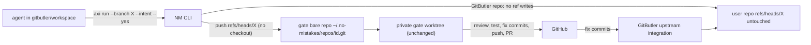

# nm-gitbutler-safe

Requirements: `docs/plans/2026-10-17-nm-gitbutler-safe-requirements.md`.

## Outcome

An agent publishes one GitButler stack branch through the No Mistakes gate from `gitbutler/workspace` with `no-mistakes axi run --branch <name> --intent "..." --yes`: no checkout, no side clone, no NM write to `refs/heads/*` or `HEAD` in the user repo. Fix commits the pipeline pushed come back through GitButler. Plain git repos behave as today.

## Structure

Code lives in `/Users/ed/Developer/Contributions/NoMistakes` (NM below), one commit per unit on `feat/axi-run-selector`, each shaped to stand alone as an upstream PR.

## Implementation Units

### U1. Sync the fork with upstream
- Depends on: none
- Files: none (history only)
- Change: `git fetch upstream`, rebase `feat/axi-run-selector` (local `axi run --run`, `7d65fb7`) onto `upstream/main`, resolve conflicts keeping upstream behavior plus the `--run` change.
- Done when: the branch sits on the current `upstream/main` tip with the `--run` commit on top.
- Verify: `make lint && make test` pass in NM; `git log --oneline upstream/main..HEAD` shows only fork commits.

### U2. GitButler detection with override
- Depends on: U1
- Files: NM `internal/git/gitbutler.go` (new), `internal/git/gitbutler_test.go` (new)
- Change: `GitButlerMode(ctx, dir) (bool, error)`. Read git config `no-mistakes.gitbutler` in the user repo: `true` forces on, `false` forces off, unset or `auto` detects. Detection is on when `HEAD` is `refs/heads/gitbutler/workspace` or `gitbutler.project.*` keys exist in the repo's git config. The override is local git config, not `.no-mistakes.yaml`, because whether a clone is under GitButler is a property of that checkout, and a committed file would apply to every clone.
- Done when: the helper returns the right mode for each case.
- Verify: table test covering workspace HEAD, project config only, plain branch, override `true` on a plain repo, override `false` on a GitButler repo; `go test ./internal/git/...`.

### U3. `axi run --branch <name>`
- Depends on: U2
- Files: NM `internal/cli/axi_drive.go`, `internal/cli/axi_run_branch_test.go` (new)
- Change: new flag, mutually exclusive with `--run`. When set, the branch comes from the flag instead of `git.CurrentBranch` (`axi_drive.go:333`), and the head from `rev-parse refs/heads/<name>` instead of `HEAD` (`:342`). `preflightGuard` (`:729`) keeps the default-branch refusal but skips the dirty-tree check when the named branch is not the checked-out branch (its content is committed). `triggerRun` (`:853`) pushes `refs/heads/<name>:refs/heads/<name>` to the gate instead of `HEAD`, keeping every push option (intent, skips, profile, closes). Active-run lookup and reattach key on the named branch, so a repeated `--branch` call reattaches. A missing or detached ref errors with the exact name.
- Done when: from a dirty `gitbutler/workspace` checkout, `--branch X --intent ...` starts a run for X with intent recorded and drives it, and `refs/heads/X` and `HEAD` are unchanged.
- Verify: e2e-style tests modeled on `axi_run_selector_test.go`: (a) dirty workspace, `--branch` starts a run on X with the intent on the run row; (b) user repo `refs/heads/X` and `HEAD` reflogs unchanged; (c) `--branch` with `--run` exits 2; (d) unknown branch errors; (e) `--branch` naming the default branch refuses; (f) repeat call reattaches. `make test`.

### U4. No branch-ref writes in GitButler repos
- Depends on: U2, U3
- Files: NM `internal/branchsync/sync.go`, `internal/branchsync/gitbutler_test.go` (new), `internal/cli/sync.go`, `internal/cli/axi_drive.go` (Service construction at `:817`), `internal/cli/wizard.go`
- Change: `branchsync.Service` gains `Branch string` (inspect that branch's ref instead of `CurrentBranch`, `sync.go:1807-1819`; `Local.Clean` is not required for a named non-checked-out branch) and `GitButler bool`. In GitButler mode, every user-repo write refuses before touching anything with safety `blocked_gitbutler_owned` and `NextAction{Code: "integrate_with_gitbutler"}`: `Apply` (`reset --hard` / `merge --ff-only`, `:488-497`) and ordinary `Recover` (`update-ref` plus `read-tree` in the work dir, `:1373-1401`). Gate-only writes stay (`--keep-local` and `--adopt-published` CAS on `GateDir`, `:1103`, `:1209`, `:1746`). `axi sync` / `--recover` callers pass `Branch` from a new `--branch` flag. The wizard refuses in GitButler mode (it runs `checkout -b`).
- Done when: no NM command writes `refs/heads/*`, `HEAD`, or the working tree of a GitButler repo; plain repos are unchanged.
- Verify: tests in a fixture with `HEAD` on `gitbutler/workspace`: `Apply` and `Recover` return `blocked_gitbutler_owned`, and `for-each-ref refs/heads` plus `git status` are byte-identical before and after; `--keep-local` still updates only the gate; override `false` restores today's `Apply`. Existing `internal/branchsync` tests pass unchanged. `make test`.

### U5. Report fix commits and the GitButler step
- Depends on: U4
- Files: NM `internal/cli/axi_drive.go` (terminal result rendering), `internal/branchsync/sync.go` (next action text), tests beside them
- Change: when a run in GitButler mode pushed a head that differs from the submitted head, the drive result and `axi status` carry `branch_sync.next_action.code: integrate_with_gitbutler` with a message: the branch was updated upstream with N fix commits, and the GitButler step that brings them in. Confirm that step from https://docs.gitbutler.com/ (integrating upstream commits into a stack branch) before writing the text; if the CLI has no single command, the message names the app action and `but status` to see it.
- Done when: a run that added fix commits says so and names the step; a run with no fix commits says nothing extra.
- Verify: tests for both cases asserting the `next_action.code` and commit count in the TOON output (a serialized protocol, not prose). `make test`.

### U6. NM docs and shipped skill
- Depends on: U3, U4, U5
- Files: NM `docs/src/content/docs/reference/cli.md`, the custody/branch-sync doc page, `skills/no-mistakes/SKILL.md` (NM ships it; regenerate per NM's `make skill`)
- Change: document `--branch`, GitButler mode, the override key, `blocked_gitbutler_owned`, and `integrate_with_gitbutler`. The skill tells an agent in a GitButler repo to use `axi run --branch <name>` and never `axi sync`/`--recover` for branch moves.
- Done when: docs and skill match U2-U5 behavior.
- Verify: `make lint` (includes `skill-check`) and `make docs-build` pass.

### U7. Install and prove it end to end on GAP
- Depends on: U6
- Files: none in NM; GAP's approved versioned requirements and plan documents plus `.no-mistakes.yaml` only. The unrelated uncommitted regroup note stays uncommitted.
- Change: `make install` in NM (installs to `~/.go/bin`, first on PATH), then `no-mistakes daemon restart` only when `no-mistakes status` shows no active run. Copy the same binary to `~/.no-mistakes/bin/no-mistakes`. In GAP, from `gitbutler/workspace` with the unrelated uncommitted regroup note untouched, publish `docs/nm-gitbutler-plan` with `axi run --branch docs/nm-gitbutler-plan --intent "..." --yes --skip=ci`.
- Done when: every Success line in the requirements holds on that run.
- Verify: record before/after `git -C ~/Developer/Atlas/GAP reflog refs/heads/<name>` and `HEAD` (no NM entry), `but status` (no conflicts), the run outcome and PR, and, if fix commits were pushed, the local branch containing them after the GitButler step. Also run one plain-git repo through `axi run` unchanged.

### U8. GAP policy and skills
- Depends on: U7
- Files: GAP `global/AGENTS.md`, `skills/global/workflow/do-commit/references/procedure.md` (and any other GAP skill that tells agents to publish through No Mistakes), `README.md` if it covers publishing
- Change: the No Mistakes rule says: in a GitButler repo, publish with `no-mistakes axi run --branch <name> --intent "..." --yes`, bring fix commits back with GitButler, never `axi sync`/`--recover`; outer agent only (phase-agent exception carried from the PR #86 review). Remove the side-clone workaround. GitButler owns branches and commits; NM owns gated publication and PR creation.
- Done when: guidance matches U7's proven path, and `gap sync` after merge publishes it.
- Verify: `go test ./...` in GAP; `rg -n "side clone|GAP-skills|git push no-mistakes" global skills` returns no live instruction.

### U9. Offer upstream
- Depends on: U7
- Files: none in NM's tree; an upstream issue and PRs on `kunchenguid/no-mistakes`
- Change: open an issue describing the GitButler conflicts with the U7 evidence, then one PR per unit (U2+U4 GitButler mode, U3 `--branch`, U5 report), each rebased on `upstream/main`. Needs the user's explicit go before anything is posted.
- Done when: the issue and PRs exist, or the user declines.
- Verify: `gh pr list -R kunchenguid/no-mistakes --author @me` lists them.

## Out of scope

- Replacing gate worktrees with clones.
- NM calling `but`, or GitButler pushing to the gate.
- jj or other VCS support.
- Behavior changes in plain git repos.

## todo.txt

- U1-U7: build GitButler-safe No Mistakes in ~/Developer/Contributions/NoMistakes and prove it on GAP
- U8: update GAP No Mistakes policy and do-commit for axi run --branch in GitButler repos
- U9: offer the NM changes upstream (needs explicit go)

Review complete
