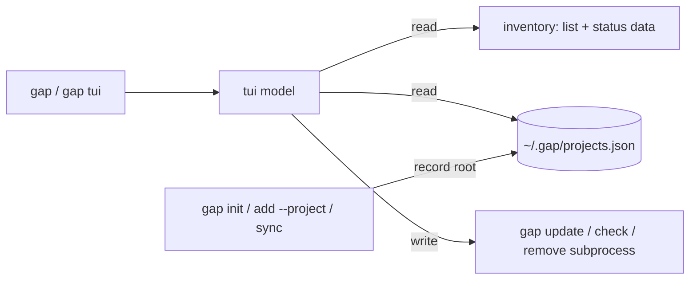

# gap-tui

Requirements: [2026-11-23-gap-tui-requirements.md](2026-11-23-gap-tui-requirements.md)

## Outcome

`gap tui`, and plain `gap` on a terminal, opens an AUP-style TUI with three tabs: Items, Status, and Projects. From Items you can check or update one item, delete one or several user utilities, and disable a distro component. Projects lists every repo in a new project registry. Every change runs the same code as the CLI commands, so the results match.

## Approach

- **Reads run in-process.** The Items and Projects tabs read data structures built by the same code `gap list` and `gap status` use. U2 extracts that code so both callers share it.
- **Writes run the real CLI.** Update, check, remove, and restore run `os.Executable()` with the matching arguments. Stdin is `/dev/null`, `NO_COLOR=1` is set, and output streams into the running pane, the way AUP's `bridge.go` does it. The TUI cannot drift from the CLI, and the prompts that `stdinIsTerminal` guards stay off.
- **The Status tab shows the output of `gap status`**, captured in plain mode. Its counts match by construction.
- **The registry is its own file, `~/.gap/projects.json`.** It is not a key in `state.json`, which every install rewrites. A separate file keeps a sync in one repo from racing a registry write from another. This answers the requirements' first open question.
- **The TUI lives in `cmd/gap` as `tui_*.go` files** in package main, next to `ui_*.go`. It makes `charm.land/bubbletea/v2` a direct dependency (it is already in go.mod as indirect).

## Implementation Units

### U1. Project registry
- Depends on: none
- Files: `cmd/gap/projects.go` (new), `cmd/gap/projects_test.go` (new), `cmd/gap/provision.go`, `cmd/gap/utility.go`, `cmd/gap/main.go`
- Change: add `projectsPath(home)`, `readProjects(home)`, `recordProject(home, root)`, and `forgetProject(home, root)`. The file holds sorted, cleaned absolute roots plus the date each was first seen. Writes are atomic (temp file then rename), like `writeState`. On the first read with no file, import the `ProjectSkills` roots from `state.json`. Call `recordProject` after `initProject` succeeds, in the project branch of `addUtility`, and from `syncAll` when `invokingProjectRoot()` has a `.gap/gap.toml`. A failed registry write prints a warning and never fails the command.
- Done when: `gap init` in a throwaway repo puts that root in `projects.json`, a second run does not duplicate it, and legacy `projectSkills` roots appear the first time the file is read.
- Verify: `go test ./cmd/gap -run 'Projects|Registry'`. The tests use throwaway HOME values only.

### U2. Shared inventory data
- Depends on: none
- Files: `cmd/gap/inventory.go` (new), `cmd/gap/inventory_test.go` (new), `cmd/gap/utility.go` (`listUtilities`), `cmd/gap/components.go` (`statusAll`)
- Change: add `type itemRow` with id, source (distro/user), scope, repo, ref, commit, hooks, pin flag, enabled, store state (ok/missing/changed/unpinned), drift count, and `new=N` from `readChecks`. Add `inventory(home, repoRoot, projectRoot) ([]itemRow, error)`. `listUtilities` builds its rows from it. `statusAll` takes its per-component state from it and keeps printing exactly what it prints today. `projectInventory(root)` returns the project-scope items and drift for one registered root, or a `missing` flag when the root is gone.
- Done when: `gap list` and `gap status` print byte-for-byte what they printed before, and `inventory` returns the same states.
- Verify: `go test ./...`. The existing `commands_test.go`, `store_status_test.go`, and `cli_test.go` must pass unchanged, and a new test compares the `inventory` states with `statusAll` output on a fixture home.

### U3. Disable a distro component
- Depends on: none
- Files: `cmd/gap/utility.go`, `cmd/gap/utility_test.go`
- Change: add `setComponentEnabled(home, id, enabled bool)`. It writes or flips `enabled = false` under `[components.<id>]` in `userConfigFile(home)`, using the existing TOML subset and keeping all other text. It refuses user utilities, which `gap remove` handles.
- Done when: disabling `echo` adds the key once, a repeat run changes nothing, and the next `inventory` reports echo as disabled.
- Verify: `go test ./cmd/gap -run Enabled`.

### U4. TUI model and views
- Depends on: U1, U2
- Files: `cmd/gap/tui_model.go`, `cmd/gap/tui_view.go`, `cmd/gap/tui_style.go`, `cmd/gap/tui_model_test.go` (all new), `go.mod`, `go.sum`
- Change: a bubbletea v2 model modelled on AUP's `internal/tui/model.go`. Tabs `1`/`2`/`3` (Items, Status, Projects) and `tab` to switch. `j`/`k`, `g`/`G` to move. `space` marks a user utility. Actions: `c` check, `u` update, `d` delete (marked ids, or the selected one), `x` disable a distro item, `f` forget a missing project, `r` refresh, `q` quit. Distro rows render as locked, and `d` on one shows the "disable instead" hint. Delete and mass delete open a confirm screen listing every id. `esc` during a run asks before cancelling. Colors come from the existing `ui_palette.go`.
- Done when: model tests drive key messages and assert the screen state: marking, the confirm list, locked distro rows, the missing-project flag, and the cancel prompt.
- Verify: `go test ./cmd/gap -run TUI`.

### U5. Action runner
- Depends on: U4
- Files: `cmd/gap/tui_run.go` (new), `cmd/gap/tui_run_test.go` (new)
- Change: run `os.Executable()` with `check [id]`, `update <id>`, or `remove <id>`. Stdin is `/dev/null` and the environment adds `NO_COLOR=1`. Stream stdout and stderr lines into the running pane as messages. A batch runs ids one at a time, records each exit code, and keeps going after a failure. A summary table lists each id as ok or failed with its last error line. Cancel sends SIGINT to the current child and skips the rest. Once a batch finishes, the inventory reloads. The Status tab runs `gap status` the same way and shows the captured text.
- Done when: a batch with one bad id removes the others and reports the bad one as failed, and cancel stops the run partway.
- Verify: `go test ./cmd/gap -run TUIRun`. The test builds the binary like `main_test.go:658` does, uses a throwaway HOME, and checks that `~/.gap/backups/` holds each removed copy. It also checks that the Status tab text equals `gap status` output captured from the same home.

### U6. Entry points
- Depends on: U4, U5
- Files: `cmd/gap/cli.go` (`rootCmd`, new `tuiCmd`), `cmd/gap/cli_test.go`
- Change: add `gap tui`. It errors with exit 2 when stdin or stdout is not a terminal, or when `plainEnv()` is set. The root `RunE` opens the TUI when `stdinIsTerminal()`, stdout is a terminal, and `!plainEnv()`. Otherwise it keeps today's help with `exitCode = 2`.
- Done when: piped `gap` still prints help and exits 2, `NO_COLOR=1 gap` prints help, and `gap tui` under a pty draws the Items tab.
- Verify: `go test ./cmd/gap -run 'Root|TUIEntry'`. Use a pty test in the style of `picker_unix_test.go`.

### U7. End-to-end and docs
- Depends on: U1-U6
- Files: `cmd/gap/tui_e2e_test.go` (new), `README.md`, `cmd/gap/AGENTS.md`, and the site docs source that renders the command reference (find it with `grep -rl "gap update" site/src` before editing; if the docs come from README alone, README is the only doc edit)
- Change: write one pty test against the built binary on a throwaway HOME with two user utilities and one registered project. It opens `gap tui`, marks both utilities, deletes them, and checks that `gap list` no longer shows them, the backups exist, and `gap.lock` changed only in those entries. A second test updates one item and checks that only its lock line moved. Then document `gap tui`, the keys, and `projects.json` in the README and the site docs, and add the `tui_*.go`, `projects.go`, and `inventory.go` ownership to `cmd/gap/AGENTS.md`.
- Done when: the e2e tests pass, and the docs name every key and the registry file.
- Verify: `go test ./...`, then `npm --prefix site run check:docs`. Then run `gap tui` by hand on the real machine and capture a screenshot of each tab for the PR.

## Out of scope

- Everything the requirements put out of scope: adding a utility, `gap sync` from the TUI, editing `gap.toml` beyond disable, deleting distro components, scanning folders, and Windows.
- "Update all" and project actions such as `gap restore` in a repo. Both stay open questions in the requirements. The Projects tab shows status only until the user decides.
- Changing `gap list`, `gap status`, or `gap remove` output.

## todo.txt

- Build the gap TUI per docs/plans/2026-11-23-gap-tui-plan.md (U1-U7) +gap
- Decide whether the gap TUI offers update all and per-project restore +gap @waiting Ed

Review complete
