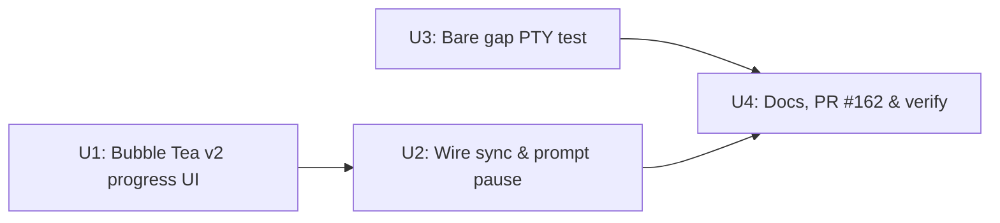

# gap sync Live Progress & Bubble Tea TUI Plan

| Unit | Status | What changes |
| --- | --- | --- |
| U1. Bubble Tea progress model | next | Replace raw ANSI scroll-region bar with inline Bubble Tea v2 step list, spinner, bar, elapsed clock, ETA, and terminal pause/resume |
| U2. Wire sync & update | next | Feed planned steps and per-component/per-skill items into progress UI; pause cleanly for prompts/hooks; delegate `spin()` |
| U3. Verify bare `gap` TUI | next | Confirm existing bare `gap` -> Bubble Tea v2 TUI launch with a direct PTY test |
| U4. Docs, PR & verification | next | Update docs, refresh open PR #162, and run full test + build checks (reinstall `~/.go/bin/gap` after merge) |

## Goal
Make `gap sync` clearly show what it is syncing, that it is actively working, and roughly how much time remains — using Bubble Tea v2 rather than a raw ANSI bar — while confirming bare `gap` launches the Bubble Tea v2 TUI.

## Now
- Bare `gap` already launches the Bubble Tea v2 TUI on a terminal (`NO_COLOR` unset, `TERM != dumb`).
- On `master`, `gap sync` prints green policy checkmarks and then goes silent during long fetch/skill phases while a raw ANSI bottom bar sits frozen with no spinner, no per-item status, and no ETA.
- Open PR #162 (`feat/sync-live-progress`) added a ticker/ETA to the raw ANSI bar, which still risks racing with interactive prompts and `spin()` on stderr.

## Next
Approve this plan (in Plannotator or chat), then run `do-work` to build U1–U4, update PR #162, and rebuild `~/.go/bin/gap`.

## Risks
- Interactive prompts (policy conflicts, hook trust, skill drift) and hook subprocesses must suspend Bubble Tea via `ReleaseTerminal()` / `RestoreTerminal()` so input and output never collide.
- Piped/CI stdout must stay unchanged when not attached to a terminal.
- Narrow or short terminals need clean truncation and list windowing so the inline view never wraps or flickers.
