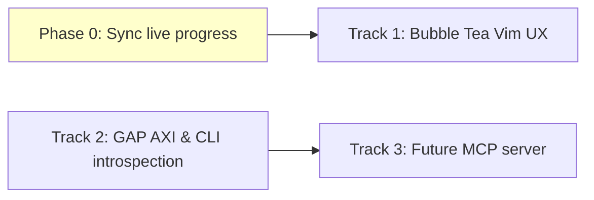

# GAP UX, GAP AXI & Future MCP Roadmap

| Track | Status | What changes |
| --- | --- | --- |
| Phase 0: `gap sync` progress | ready | Bubble Tea v2 live progress bar, spinner, ETA & PTY check (PR #162 plan) |
| Track 1: Bubble Tea Vim UX (T1–T3) | planned | Vim chords (`gg`, `Ctrl+d/u`, `h/l`, `:`), local `/` filter, `?` help, active borders & modal status pills |
| Track 2: GAP AXI (A1–A3) | planned | Harness-agnostic `gap axi`, `gap describe`, `--format toon\|json`, structured errors & thin Agent Skill stub |
| Track 3: Future `gap mcp` (M1–M2) | future | Thin `stdio` + HTTP MCP server over the AXI core for cloud agents (Grokbot, Dot, Muse, Hermes) |

## Goal
Give humans a fast, visual, low-friction Vim-first Bubble Tea TUI while giving any coding agent — local or cloud, in any harness — an accurate, token-efficient way to discover and operate GAP.

## Now
- Bare `gap` opens a Bubble Tea v2 TUI, but lacks full Vim motions (`gg`, `Ctrl+d/u`, `h/l` pane focus, `:` palette, local `/` filter), active-pane border contrast, modal status pills, and a `?` help overlay.
- Only `gap add` supports `--json`; agents otherwise parse human prose and have no live CLI introspection or structured error recovery.
- Cloud/remote agents without local shell access have no MCP path into GAP.

## Next
1. Approve this roadmap (and confirm whether to file the 3 drafted GitHub issues).
2. Finish Phase 0 (`gap sync` Bubble Tea live progress, PR #162).
3. Build **Track 1 (Vim TUI)** and **Track 2 (GAP AXI)** directly into `cmd/gap` — sharing one typed Go core so **Track 3 (`gap mcp`)** slots cleanly on top later.

## Risks
- **Keybinding clutter:** Keep `/` for instant local filter and `S`/`:search` for remote `skills.sh` search, with `?` holding full docs so the footer stays clean.
- **Doc drift for agents:** Generate `gap describe` straight from Cobra and keep the `gap-axi` skill as a tiny discovery stub pointing at live CLI output.
- **Remote MCP safety:** Keep `gap mcp` read-only by default, coarse-grained (avoiding eager-schema token bloat), and never auto-approve untrusted hooks remotely.
