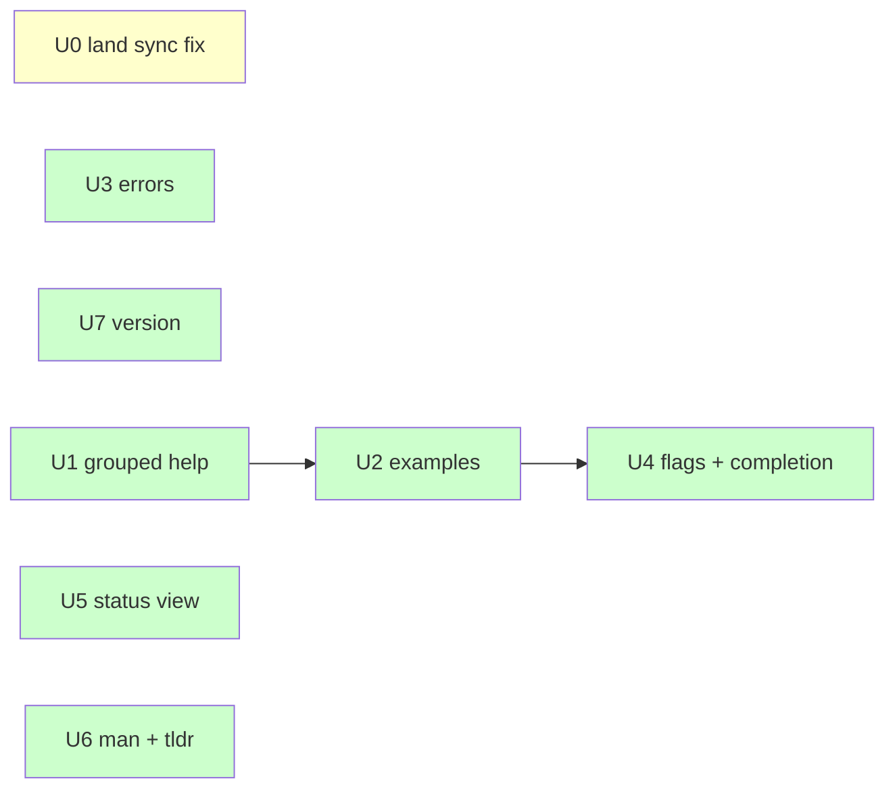

# GAP CLI UX plan

| Unit | What you get | Size |
| --- | --- | --- |
| U0 | `gap sync` answers in 0.2 s, picker in 2.5 s (was 14-16 s blank) | own PR |
| U1 | `gap --help` first screen shows the key commands, all grouped | S |
| U2 | Copy-paste example on every command | S |
| U3 | Same clear "missing <id>" error everywhere | S |
| U4 | Flags say what they take; tab completes ids | M |
| U5 | `gap status` shows a summary and the fix | M |
| U6 | `man gap` works; tldr page by path until accepted upstream | M |
| U7 | `gap -v` shows the commit | S |

## Now
- Help is 20 lines of jargon, then 18 commands A-Z. Only `completion` has examples.
- Three different error styles for a missing argument.
- `gap status` is raw key=value lines. No man page. `gap -v` says "unknown".

## Status
- U1-U7 landed in #188.
- U0 is in its own PR.

## Next
1. Merge the U0 PR.
2. Submit the tldr page upstream so `tldr gap` works by name.

## Risks
- Scripts read `gap status` and piped sync output: those stay byte for byte, checked by a test.
- Error work could clash with the planned agent errors (A3): U3 uses the same shape so A3 builds on it.
