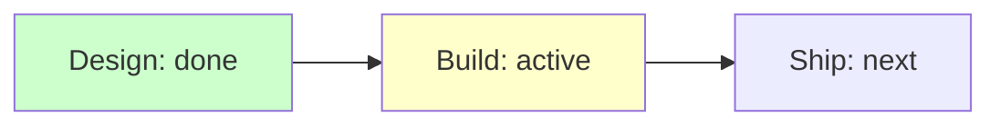

# Plans

## Two versions

- Every plan, spec, and regroup produces two files with the same stem.
- `<name>.md` is for agents: full detail, plus the todo.txt section. See [todo-txt.md](todo-txt.md).
- `<name>.human.md` is for the human: the same plan, short and visual.
- Project location rules still win. Write both files where the project keeps plans.

## Human version

Put a diagram or table first. Then goal, now, next, and risks. It fits one screen.

Human plan test. All must pass before you hand it over:

- Visual first.
- Goal, now, and next read in about a minute.
- Small diagrams: 8 nodes or fewer, a flowchart or a table.
- No code, diffs, or long file lists.
- Matches the agent version: same steps, same status.

Phase flowchart:



Status table:

```markdown
| Step   | Status | Note            |
| ------ | ------ | --------------- |
| Design | done   | approved        |
| Build  | active | 2 of 3 parts    |
| Ship   | next   | after the tests |
```

## Open visually

Only when the human asks: "open this visually", "show me", "Plannotator".

- Check the harness per [harness-detection.md](harness-detection.md).
- In Empryo, use the native `show` tool.
- Else, when `command -v plannotator` succeeds, use Plannotator.
- Else, write a self-contained `<name>.human.html` beside the human version, with the mermaid rendered, and open it with `open` (macOS) or `xdg-open`.
- An uncertain harness falls back to the portable path.

## Done

The human reads the plan in about a minute, and the agent version carries the full detail and the todo section.
