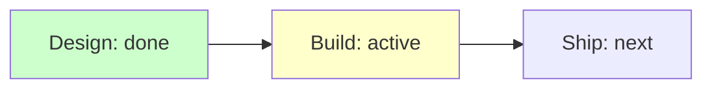

# Plans

## Two versions

- Every plan, spec, and regroup produces two files with the same stem.
- `<name>.md` is for agents: full detail, plus the todo.txt section. See [todo-txt.md](todo-txt.md).
- `<name>.human.md` is for the human: the same plan, short and visual.
- Project location rules still win. Write both files where the project keeps plans.
- Revise the agent version, then refresh the human version in the same change. A stale human version fails the test below.
- When a skill writes only the agent version, write the human version yourself right after it.
- The paired-file rule overrides a skill's single-output limit, but only for the companion files (the `.human.md` and the optional `.human.html`); never overwrite or delete an older regroup file; regroup never edits todo.txt or done.txt, but a plan or spec may still append its own follow-up tasks there.
- Compare against the previous agent version, never the human version. Regroup diffs need the raw task lines.

## Human version

Put a diagram or table first. Then goal, now, next, and risks. It fits one screen.

Human plan test. All must pass before you hand it over:

- Visual first.
- Goal, now, and next read in about a minute.
- Small diagrams: 8 nodes or fewer, a flowchart or a table.
- No code, diffs, or long file lists.
- Matches the agent version: same steps, same status.

Phase flowchart:



Status table:

```markdown
| Step   | Status | Note            |
| ------ | ------ | --------------- |
| Design | done   | approved        |
| Build  | active | 2 of 3 parts    |
| Ship   | next   | after the tests |
```

## Open visually

This previews the human version. Only when the human asks: "open this visually", "show me".

- A request to review or approve the plan in Plannotator is not a preview. Open the agent version in Plannotator and follow the plan skill's approval gate.
- Check the harness per [harness-detection.md](harness-detection.md).
- In Empryo, use the native `show` tool.
- Else, when `command -v plannotator` succeeds, use Plannotator: run `plannotator annotate <name>.human.md` and do not pass `--gate`, since `--gate` adds an approval action that belongs to the full-plan approval flow, which stays on the agent version.
- Else, write a self-contained `<name>.human.html` from the human version, beside the human version, with the mermaid rendered, and open it with `open` (macOS) or `xdg-open`.
- An uncertain harness falls back to the portable path.

## Done

The human reads the plan in about a minute, and the agent version carries the full detail and the todo section.
