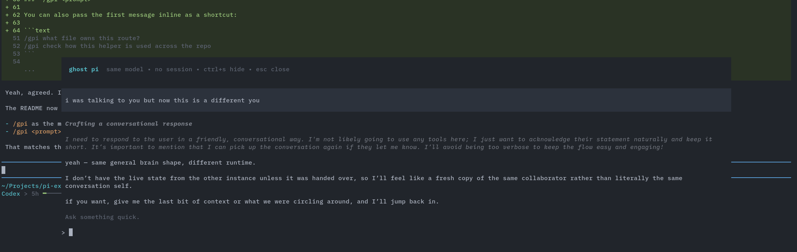

# pi-better-btw

Temporary side conversation overlay for [pi](https://github.com/earendil-works/pi).

Open a temporary, "sidebar", chat session inside the current pi UI, ask something quick, hide it, bring it back, then close it without saving any session history.



## Try Before You Install

```bash
pi -e git:github.com/edheltzel/pi-better-btw
```

Or

```bash
pi install git:github.com/edheltzel/pi-better-btw
```

## What it does

`pi-better-btw` is just like other BTW extension but it adds a `/btw` command that opens a floating overlay backed by a separate **in-memory** `AgentSession`.

So:

- it starts with the **same currently selected model** as the main session
- it uses **no persisted session file**
- it renders with native pi components for user messages, assistant messages, thinking blocks, and tool execution cards
- it can be **hidden** without losing the temporary conversation
- when you **close** it, the ghost session is disposed completely

## Usage

### `/btw`

Open the ghost overlay, then type directly into the ghost UI.

```text
/btw
```

Main flow:

1. run `/btw`
2. the overlay opens
3. type into the ghost prompt
4. press `Enter`

### `/btw <prompt>`

You can also pass the first message inline as a shortcut:

```text
/btw what file owns this route?
/btw check how this helper is used across the repo
```

If the overlay is already open, `/btw <prompt>` sends another message into the ghost session.
If the overlay is hidden, run `/btw` again to bring it back.

## Controls

The shortcut menu stays pinned to the bottom edge of the overlay.

- `Esc` — close the ghost session completely
- `↑` / `↓` — scroll the transcript
- `PageUp` / `PageDown` — scroll faster
- `Home` / `End` — jump to top or bottom
- `Ctrl+H` — hide the overlay
- `Enter` — send message to ghost pi

When hidden, a small widget is shown above the prompt:

```text
/btw is running • run /btw to bring it back
```

## Behavior

A quick pop-up chat that opens at the latest message and stays in follow mode while new output streams. Scroll up to inspect older output, then use `End` to jump back to live output.

It has its own temporary conversation state:

- hide it → state stays in memory
- run `/btw` again → continue where you left off
- close it → state is gone

The pop-up session uses the **main session's model at the moment it is created**.
If you change models in the main session later, the already-open ghost session keeps using its existing model until you close and reopen it.

## Why

Useful when you want to:

- ask a small side question without polluting the main thread
- inspect a file or run a quick command in parallel
- keep a temporary tangent around while continuing the main conversation

`pi-better-btw` is for those little "btw" moments without leaving the current TUI.

## Requirements

- [pi](https://github.com/earendil-works/pi) with extension support
- interactive mode (the overlay is TUI-only)

## Development

Run from this repo with:

```bash
pi -e /absolute/path/to/packages/pi-better-btw/index.ts
```

## License

MIT
