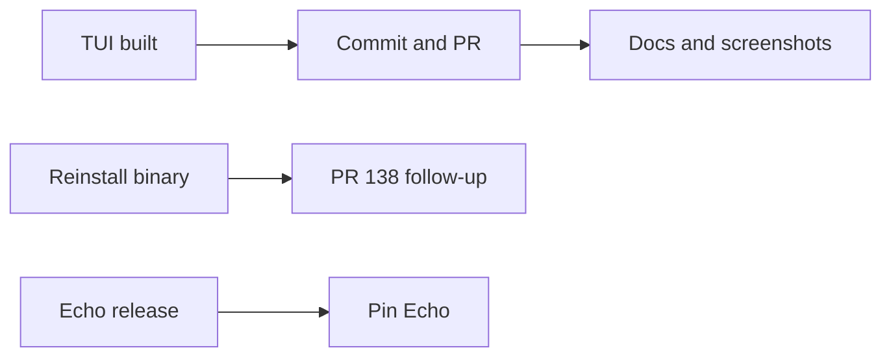

# GAP, 2026-11-23

| | |
| --- | --- |
| Done today | PR #138 and PR #139 merged. The gap TUI is built and passed review. It is not committed. |
| Waiting | 4 tasks, all on Ed or on an Echo release tag that is not cut. |
| Changed | v0.5.1, the last "up next", shipped on 2026-11-16. |

## Now

The TUI exists only in the checkout. Committing it unblocks the docs and the screenshots. Reinstalling the binary is separate and needs nobody's go.

## Next

1. Commit the gap TUI and open its PR. Leave `gap.lock`, `.gitignore`, and the PR 138 plan files alone.
2. `go install ./cmd/gap` from a master checkout, so the installed binary gets `gap add`.
3. Add the TUI to the README, CONCEPTS, and the landing page, then take the screenshots.

## Risks

- Two tasks still say they are blocked on dependencies that are already done (`gap-tui`, `gap-drift-baseline`). Easy to skip them.
- The Echo pin cannot move until Echo cuts a release after v0.13.3. That tag is stuck on a pre-commit typecheck failure in Echo, not in GAP.
- The newest handoff is `docs/plans/handoffs/2026-11-05-gap-plans-sync.md`. It still lists the jcode question as open. That shipped on 2026-11-16.
